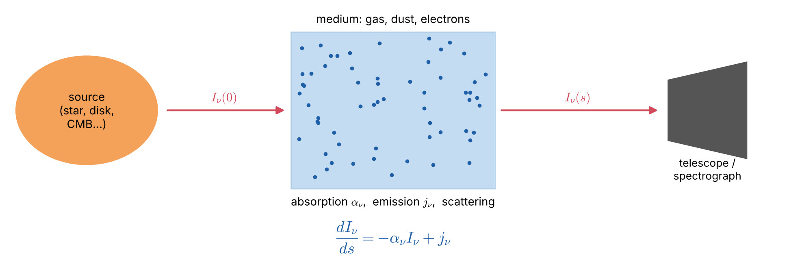

# Lecture 1 — Introduction: How Is the Radiative Transfer Equation Used in Astrophysics?

> **Level:** pre-master → Astrophysics master entry.
> **Sources:** A670 *Advanced Astrophysics* Lecture 1 (course outline); W. Hu, *Astro 305 Lecture Notes, Set 1*; MIT 8.901 (2019) Lecture 7; G. W. Collins II, *The Fundamentals of Stellar Astrophysics*, Ch. 9; S. Chandrasekhar, *Radiative Transfer* (1950), Ch. I.

## Learning goals

By the end of this lecture you should be able to:

1. State in one sentence what radiative transfer (RT) is and why almost all of astrophysics depends on it.
2. Write the one-dimensional radiative transfer equation (RTE) and name every symbol in it.
3. Distinguish **thermodynamic equilibrium (TE)**, **local thermodynamic equilibrium (LTE)** and **non-LTE (NLTE)** in words.
4. List the main astrophysical applications of the RTE.

## Key concepts in plain words

**Radiative transfer is photon bookkeeping.** Imagine following one narrow beam of light as it travels from a star to your telescope. At every step along the way, some photons are removed from the beam (absorbed, or knocked sideways by scattering), and some new photons are added to it (emitted by the gas, or scattered into the beam from other directions). Radiative transfer is simply careful accounting of these gains and losses. The radiative transfer equation (RTE) is that account written as a differential equation: *change of the beam = gains − losses*.

**Why astronomers care.** We cannot visit stars or gas clouds; we only receive their light. The light we receive is not the light that was originally produced: it has been processed by every layer it crossed. RT is the "translation dictionary" between the physical conditions (temperature, density, composition, motion) and the spectrum we record. Without RT we could not measure the temperature of the Sun's surface, the chemical composition of a distant star, or the density of an interstellar cloud.

**Specific intensity — the brightness of one beam.** The basic quantity is the *specific intensity* $I_\nu$: the energy carried by light of one frequency, travelling in one direction, through a unit area, per unit time. It is what one pixel of a camera measures when it looks at an extended object. All other radiation quantities (flux, energy density, pressure) are built from it by averaging over directions.

**Optical depth — distance measured in "fog units".** Optical depth $\tau_\nu$ counts how many photon mean free paths lie along a path. On a foggy day, visibility might be 50 m: an object 50 m away is at $\tau\approx1$, and one 500 m away is at $\tau\approx10$, completely hidden. In the same way, $\tau\ll1$ means "transparent" (optically thin) and $\tau\gg1$ means "opaque" (optically thick). Optical depth, not geometrical distance, decides what we can see.

**Source function — what the gas would like the beam to be.** The ratio $S_\nu = j_\nu/\alpha_\nu$ (emission divided by absorption) is the brightness the gas tends to impose on any beam passing through it. If the beam is brighter than $S_\nu$ it is dimmed; if it is fainter it is brightened. A thick layer always ends up "painting" the beam with its own $S_\nu$.

**TE, LTE and NLTE — three levels of equilibrium.** In *thermodynamic equilibrium* (TE) everything, matter and light, shares one temperature, as inside a closed hot oven. In *local thermodynamic equilibrium* (LTE) the **matter** at each place behaves as if it were in an oven at the local temperature, because collisions between particles are frequent; the **light**, however, can stream freely and need not be in equilibrium. In *non-LTE* (NLTE) collisions are too rare, and the radiation field itself controls how atoms are excited and ionised. Most of this course works in LTE, because it is the first and most important model for stellar atmospheres.

---

## 1.1 What is radiative transfer?

Almost everything we know about the Universe beyond the Solar System comes to us as **photons**. Before they reach our telescopes these photons are **emitted**, **absorbed** and **scattered** by atoms, ions, molecules, free electrons and dust grains. *Radiative transfer* is the theory of how a beam of radiation changes as it passes through matter. It is the link between:

- the **physical state** of the gas (temperature $T$, density $\rho$, chemical composition, velocity field), and
- the **observable** quantity: the spectrum $I_\nu$ that we record.

*Figure 1.1 — The radiative transfer problem. A beam with intensity $I_\nu(0)$ enters a medium. Absorption ($\alpha_\nu$) removes energy from the beam, emission ($j_\nu$) adds energy, and scattering does both by redirecting photons. We observe $I_\nu(s)$.*

Two complementary problems:

| Problem | Given | Find | Example |
|---|---|---|---|
| **Forward (modelling)** | $T(z)$, $\rho(z)$, composition | emergent spectrum $I_\nu$ | model stellar atmosphere, synthetic spectrum |
| **Inverse (diagnostics)** | observed $I_\nu$ | $T$, $\rho$, abundances | abundance analysis, limb-darkening inversion |

## 1.2 The fundamental equation (preview)

Along a ray, with path length $s$:

$$
\boxed{\;\frac{dI_\nu}{ds} = -\alpha_\nu I_\nu + j_\nu\;}
$$

| Symbol | Name | SI units |
|---|---|---|
| $I_\nu$ | specific intensity | W m$^{-2}$ Hz$^{-1}$ sr$^{-1}$ |
| $\alpha_\nu = n\sigma_\nu = \rho\kappa_\nu$ | absorption (extinction) coefficient | m$^{-1}$ |
| $\kappa_\nu$ | opacity (mass absorption coefficient) | m$^2$ kg$^{-1}$ |
| $j_\nu$ | emission coefficient (emissivity) | W m$^{-3}$ Hz$^{-1}$ sr$^{-1}$ |

**Physical reading.** The first term is a *loss* proportional to how much light there already is, so absorption removes a fixed *fraction* per unit length. The second term is a *gain* that does not depend on $I_\nu$; matter emits whether or not light is present.

We define the dimensionless **optical depth** $d\tau_\nu = \alpha_\nu\,ds$ and the **source function** $S_\nu = j_\nu/\alpha_\nu$:

$$
\frac{dI_\nu}{d\tau_\nu} = -I_\nu + S_\nu .
$$

This compact form is the one we will use throughout the course. Lectures 2–5 derive it carefully.

## 1.3 A short history

| Year | Who | Contribution |
|---|---|---|
| 1859 | Kirchhoff | $j_\nu/\alpha_\nu$ is a universal function of $T$ for matter in equilibrium |
| 1900 | Planck | the universal function: $B_\nu(T)$ |
| 1906 | K. Schwarzschild | RTE for the solar atmosphere; radiative equilibrium explains solar limb darkening |
| 1916–1926 | Eddington | radiative equilibrium of stars; the **Eddington approximation** $K = J/3$ |
| 1917 | Einstein | $A$ and $B$ coefficients; stimulated emission |
| 1930–34 | Hopf, Milne | exact solution of the gray atmosphere (Hopf function $q(\tau)$) |
| 1950 | Chandrasekhar | *Radiative Transfer*: discrete ordinates, $H$-functions, polarisation |
| 1960s–1978 | Mihalas, Auer & Mihalas | NLTE model atmospheres, numerical methods |
| today | many groups | 3D, time-dependent, Monte-Carlo, NLTE, polarised RT on supercomputers |

## 1.4 LTE versus non-LTE: the central idea of this course

> **Correction to a common statement.** The A670 Lecture 1 notes state that "in LTE the radiative transfer equation simplifies to $I_\nu = B_\nu(T)$". That is the condition for **full thermodynamic equilibrium (TE)**, which holds deep inside stars. In **LTE** the correct statement is
> $$S_\nu = B_\nu(T_{\rm local}) \qquad\text{but in general}\qquad I_\nu \neq B_\nu .$$
> The *matter* is in equilibrium at the local temperature, so it emits like a black body per unit absorption. The *radiation field* is **not** Planckian, because photons near the surface come from regions of different temperature and can escape. If $I_\nu$ were equal to $B_\nu$ everywhere, there would be no net flux and stars would not shine. Lectures 6 and 9 return to this point in detail.

| | **TE** (stellar interior) | **LTE** (most photospheres) | **NLTE** (upper atmospheres, nebulae, ISM) |
|---|---|---|---|
| Particle velocities | Maxwell at $T$ | Maxwell at local $T$ | Maxwell (usually) |
| Excitation / ionisation | Boltzmann + Saha at $T$ | Boltzmann + Saha at local $T$ | from **statistical equilibrium** (rate equations) |
| Source function | $S_\nu = B_\nu$ | $S_\nu = B_\nu(T)$ | $S_\nu$ depends on $J_\nu$ (non-local) |
| Radiation field | $I_\nu = B_\nu$ (isotropic) | $I_\nu \neq B_\nu$ (anisotropic, carries flux) | $I_\nu \neq B_\nu$ |
| What sets populations? | — | collisions dominate | radiative rates compete with collisions |

## 1.5 Where is the RTE used?

1. **Stellar atmospheres:** emergent spectra, $T_{\rm eff}$, $\log g$, abundances, limb darkening. Classic LTE territory (Lectures 7–10).
2. **The interstellar medium (ISM):** extinction and reddening by dust ($A_V = 1.086\,\tau_V$), 21-cm emission and absorption, molecular lines (CO), heating and cooling of clouds.
3. **H II regions and planetary nebulae:** recombination lines and free-free radio emission. These are optically thin to thick slabs (Lecture 5) and strongly NLTE.
4. **Planetary atmospheres:** greenhouse effect, remote sensing, exoplanet transmission spectra.
5. **Accretion disks, AGN and quasars:** disk spectra, Compton scattering, broad-line regions.
6. **Cosmology:** the CMB is the best black body known ($T = 2.725$ K); Thomson scattering at recombination and reionisation; Lyman-$\alpha$ forest absorption.
7. **Stellar interiors:** the diffusion limit of the RTE gives the radiative energy flux and the **Rosseland mean opacity** (Lecture 8).

## 1.6 How the course is built

| # | Lecture | Key result |
|---|---|---|
| 1 | Introduction (this lecture) | RTE, TE/LTE/NLTE |
| 2 | Describing the radiation field | $I_\nu$, $J_\nu$, $F_\nu$, $K_\nu$; $I_\nu$ constant in vacuum |
| 3 | Black-body radiation | Planck, Wien, Stefan–Boltzmann, brightness temperature |
| 4 | Emission, absorption, scattering | $\alpha_\nu$, $j_\nu$, cross-sections, Einstein coefficients, random walk |
| 5 | The RTE and its formal solution | $I = I_0e^{-\tau}+S(1-e^{-\tau})$; MIT toy models: thin H cloud, two-layer star, thermal inversion |
| 6 | Thermodynamic equilibrium and **LTE** | Kirchhoff, Saha–Boltzmann, $S_\nu=B_\nu$ |
| 7 | Plane-parallel atmospheres | Schwarzschild–Milne, $E_n$, Eddington–Barbier |
| 8 | Moments, diffusion and scattering | Eddington approximation, Rosseland mean, $S(0)=\sqrt{\varepsilon}B$ |
| 9 | **The gray LTE atmosphere: full solution** | $T^4 = \tfrac34T_{\rm eff}^4(\tau+q)$, limb darkening |
| 10 | **LTE spectral lines** and the limits of LTE | Milne–Eddington, curve of growth, NLTE |
| — | Final exam with full solutions | |

---

## Worked example 1.1 — Reading the RTE

*A beam passes through a uniform slab of gas of thickness $L = 10^{12}$ m. The gas has $\alpha_\nu = 2\times10^{-12}$ m$^{-1}$ and does not emit. What fraction of the beam emerges?*

**Solution.** With $j_\nu = 0$, $dI_\nu/ds = -\alpha_\nu I_\nu$, so $I_\nu(L) = I_\nu(0)\,e^{-\alpha_\nu L}$. The optical depth is $\tau_\nu = \alpha_\nu L = 2$, and the transmitted fraction is $e^{-2} = 0.135$ (13.5 %). In magnitudes the extinction is $A = 2.5\log_{10}e^{\tau} = 1.086\,\tau = 2.17$ mag.

## Worked example 1.2 — Why does the Sun have a sharp edge?

*The solar photosphere has a density scale height of about $H \approx 150$ km, and the opacity rises steeply with depth. Why does the solar limb look sharp even though the Sun is gaseous?*

**Solution.** We see down to optical depth $\tau \approx 1$. Because $\alpha \propto \rho$ (and the opacity also rises with $T$), the optical depth changes from $\tau \approx 0.1$ to $\tau \approx 10$ within a few scale heights, i.e. a few hundred km. Seen from Earth, $1'' \approx 725$ km on the Sun, so the transition from transparent to opaque happens within less than $1''$, and the edge looks sharp. RT defines what "the surface" of a star means: the layer where $\tau \approx 2/3$ (Lecture 9).

---

## Common misconceptions

1. **"In LTE the intensity equals the Planck function."** No: in LTE the *source function* equals $B_\nu(T)$. The intensity is set by the RTE and carries information from many different depths.
2. **"Optical depth is a distance."** It is a *number of mean free paths*. One kilometre of air and one millimetre of a stellar interior can have very different optical depths.
3. **"Absorption lines always mean cold gas between us and the star."** In a stellar atmosphere the lines form because the temperature *decreases outward*; no separate cold cloud is needed (Lectures 5 and 10).
4. **"A star has a solid surface."** The "surface" is simply the layer from which photons can escape, at optical depth $\tau\approx2/3$.

## Lecture summary

- Radiative transfer follows a beam of light and adds up what matter removes and adds.
- The RTE, $dI_\nu/ds = -\alpha_\nu I_\nu + j_\nu$, is the mathematical form of this bookkeeping.
- Optical depth measures transparency; the source function measures what the gas emits per unit absorption.
- LTE is a statement about **matter** (local temperature controls excitation and ionisation), not about light.
- RT is used everywhere in astrophysics: stars, the ISM, nebulae, planets, accretion disks and cosmology.

---

## Exam questions and answers — Lecture 1

**Q1.** Write the RTE along a ray. Explain the physical meaning of each term and why the absorption term is proportional to $I_\nu$ but the emission term is not.

> **A1.** $dI_\nu/ds = -\alpha_\nu I_\nu + j_\nu$. Absorption removes a fixed *fraction* $\alpha_\nu\,ds$ of the photons already present in the beam, so the loss is $\propto I_\nu$. Spontaneous emission is produced by the matter (excited atoms decay at rate $A_{21}$ whether or not there is light), so it does not depend on $I_\nu$. (Stimulated emission *is* $\propto I_\nu$ and is therefore counted as negative absorption inside $\alpha_\nu$; see Lecture 4.)

**Q2.** What is the difference between TE and LTE? "In LTE, $I_\nu = B_\nu$." True or false?

> **A2.** In TE, both matter and radiation are in equilibrium at one temperature: $I_\nu = J_\nu = B_\nu(T)$ is isotropic and there is no net flux. In LTE the *matter* is in equilibrium at the local temperature $T(\mathbf{r})$ (Maxwell, Boltzmann and Saha distributions hold), which gives $j_\nu = \alpha_\nu B_\nu(T)$, i.e. $S_\nu = B_\nu(T)$. The *radiation field* may differ from $B_\nu$. The statement is **false**: in LTE $S_\nu = B_\nu$, not $I_\nu = B_\nu$. At the surface of a star, for example, $I_\nu(\mu<0) = 0$ (no incoming radiation) while $B_\nu \neq 0$.

**Q3.** Define optical depth. A medium has $\tau_\nu = 0.01$ at one frequency and $\tau_\nu = 100$ at another. Describe what an observer sees at each frequency.

> **A3.** $\tau_\nu = \int\alpha_\nu\,ds$ is the path length measured in photon mean free paths. At $\tau_\nu = 0.01$ (optically thin), 99 % of the background light passes through; the medium adds $\approx\tau_\nu S_\nu$, so we see through it, and its own emission is weak and proportional to its column density. At $\tau_\nu = 100$ (optically thick), the background is blocked ($e^{-100}$), and we see only the medium's own surface layers, $I_\nu \to S_\nu$ evaluated near $\tau_\nu \approx 1$.
