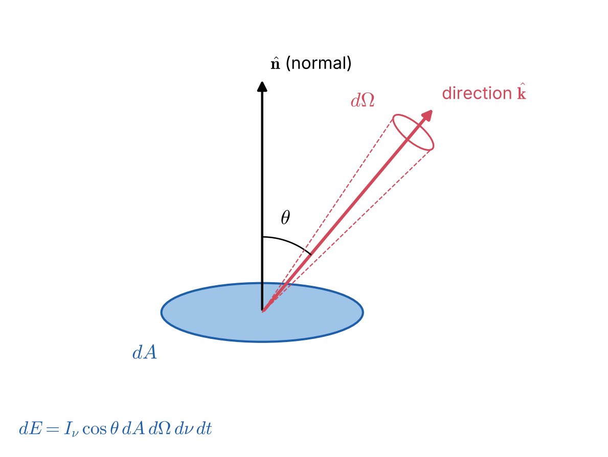
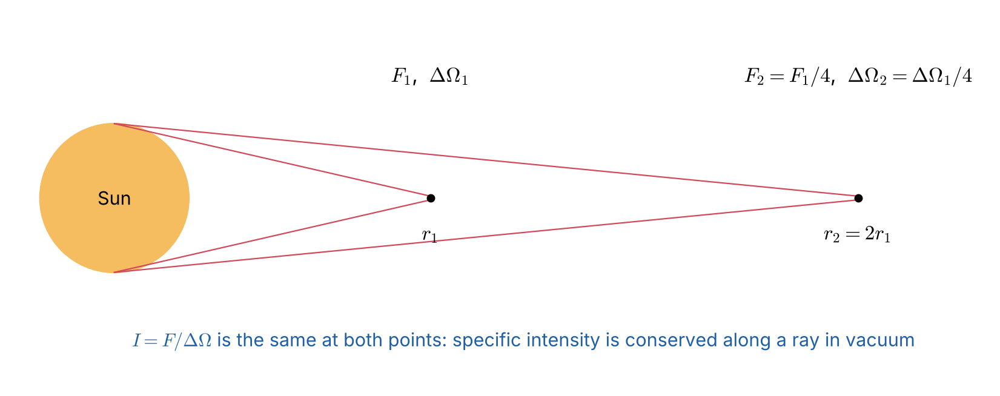

# Lecture 2 — Describing the Radiation Field: Intensity, Flux and Moments

> **Sources:** Hu, *Astro 305 Set 1* (observables, auxiliary quantities); Collins Ch. 9.2–9.3 (specific intensity, moments); Chandrasekhar Ch. I §1–6; MIT 8.901 Lec. 7.

## Learning goals

1. Define the specific intensity $I_\nu$ and explain why it is the fundamental quantity.
2. Derive the mean intensity $J_\nu$, flux $F_\nu$, energy density $u_\nu$ and radiation pressure $P_\nu$ as angular moments of $I_\nu$.
3. Prove that $I_\nu$ is constant along a ray in empty space.
4. Use these definitions to compute fluxes from stars.

---

## 2.1 The four observables

A detector can measure four things about radiation (Hu): **energy flux**, **direction**, **frequency** and **polarisation**. Measuring the first three together defines the specific intensity. Polarisation adds the Stokes parameters $Q, U, V$; we use only $I$ in this course.

## 2.2 Specific intensity

*Figure 2.1 — Energy $dE$ crosses an area $dA$ whose normal $\hat{\mathbf n}$ makes angle $\theta$ with the direction of propagation $\hat{\mathbf k}$, into solid angle $d\Omega$, in frequency interval $d\nu$ and time $dt$.*

$$
\boxed{\;dE = I_\nu(\mathbf r,\hat{\mathbf k},t)\;\cos\theta\;dA\;d\Omega\;d\nu\;dt\;}
$$

**Units:** W m$^{-2}$ Hz$^{-1}$ sr$^{-1}$ (cgs: erg s$^{-1}$ cm$^{-2}$ Hz$^{-1}$ sr$^{-1}$). The factor $\cos\theta$ is the *projected* area seen by the beam.

Per unit wavelength: $I_\nu\,|d\nu| = I_\lambda\,|d\lambda|$. Since $\nu = c/\lambda$, $|d\nu/d\lambda| = c/\lambda^2$, so
$$I_\lambda = \frac{c}{\lambda^2}I_\nu, \qquad \nu I_\nu = \lambda I_\lambda .$$

**Relation to the photon distribution function** (Collins eq. 9.2.8). If $f(\mathbf r,\mathbf p)$ is the photon phase-space density, then
$$I_\nu = \frac{h^4\nu^3}{c^2}\,f .$$
Since $f$ is conserved along a photon trajectory (Liouville's theorem), $I_\nu/\nu^3$ is invariant. This is why surface brightness dims as $(1+z)^{-4}$ in cosmology (Hu).

## 2.3 Constancy of $I_\nu$ along a ray in vacuum

*Figure 2.2 — The flux from the Sun falls as $r^{-2}$, but so does the solid angle it subtends. Their ratio, the intensity, is independent of distance.*

**Proof.** Consider two small areas $dA_1$ and $dA_2$ separated by distance $r$ along a ray, both perpendicular to it. Photons that pass through both areas cross $dA_1$ into solid angle $d\Omega_1 = dA_2/r^2$, and cross $dA_2$ from solid angle $d\Omega_2 = dA_1/r^2$. With no matter in between, energy is conserved:
$$I_{\nu,1}\,dA_1\,d\Omega_1\,d\nu\,dt = I_{\nu,2}\,dA_2\,d\Omega_2\,d\nu\,dt
\;\Rightarrow\;
I_{\nu,1}\frac{dA_1dA_2}{r^2} = I_{\nu,2}\frac{dA_2dA_1}{r^2}
\;\Rightarrow\; I_{\nu,1} = I_{\nu,2}.$$
So $dI_\nu/ds = 0$ in vacuum. **Consequence:** the surface brightness of a resolved object does not depend on its distance (in a static, non-expanding space).

## 2.4 Angular moments of the intensity

Use spherical coordinates around a chosen axis: $d\Omega = \sin\theta\,d\theta\,d\phi = -d\mu\,d\phi$ with $\mu = \cos\theta$.

| Moment | Definition | Plane-parallel form ($I$ independent of $\phi$) | Physical meaning |
|---|---|---|---|
| **zeroth** $J_\nu$ | $\dfrac{1}{4\pi}\oint I_\nu\,d\Omega$ | $\tfrac12\int_{-1}^{1}I_\nu\,d\mu$ | mean intensity |
| **first** $F_\nu$ | $\oint I_\nu\cos\theta\,d\Omega$ | $2\pi\int_{-1}^{1}I_\nu\,\mu\,d\mu$ | net (physical) flux |
| **first** $H_\nu$ | $\dfrac{1}{4\pi}\oint I_\nu\cos\theta\,d\Omega$ | $\tfrac12\int_{-1}^{1}I_\nu\,\mu\,d\mu$ | Eddington flux, $H_\nu = F_\nu/4\pi$ |
| **second** $K_\nu$ | $\dfrac{1}{4\pi}\oint I_\nu\cos^2\theta\,d\Omega$ | $\tfrac12\int_{-1}^{1}I_\nu\,\mu^2\,d\mu$ | radiation pressure, $P_\nu = 4\pi K_\nu/c$ |

> **Warning about flux definitions** (Collins §9.3b). Books use three different "fluxes": the physical flux $F_\nu$ (W m$^{-2}$ Hz$^{-1}$), the Eddington flux $H_\nu = F_\nu/4\pi$, and the "astrophysical flux" $\mathcal F_\nu = F_\nu/\pi$. Always check which one a formula uses. **In this course, $F$ is the physical flux** and $F = \sigma T_{\rm eff}^4$.

### Energy density

Radiation crossing $dA$ in time $dt$ fills a cylinder of volume $dV = c\,dt\,dA$ (Hu). The energy in that volume travelling into $d\Omega$ is $dE = I_\nu\,dA\,d\Omega\,d\nu\,dt$, so the specific energy density per solid angle is $I_\nu/c$. Integrating over angles:
$$u_\nu = \frac1c\oint I_\nu\,d\Omega = \frac{4\pi}{c}J_\nu, \qquad u = \int_0^\infty u_\nu\,d\nu .$$

### Radiation pressure

A photon carries momentum $E/c$ along $\hat{\mathbf k}$. The component normal to a surface is $(E/c)\cos\theta$, and the rate at which it crosses the surface carries another factor $\cos\theta$. For a surface that absorbs everything that hits it:
$$P_\nu = \frac1c\oint I_\nu\cos^2\theta\,d\Omega = \frac{4\pi}{c}K_\nu .$$
(A perfectly reflecting wall feels twice this from one side; Hu.)

### The isotropic case

If $I_\nu = I$ is independent of direction:
$$J_\nu = I,\qquad F_\nu = 2\pi I\int_{-1}^{1}\mu\,d\mu = 0,\qquad K_\nu = \tfrac12 I\int_{-1}^1\mu^2d\mu = \frac I3 = \frac{J_\nu}{3}.$$
Therefore
$$\boxed{\;P = \tfrac13 u\;}\qquad\text{(equation of state of isotropic radiation)},$$
and $K_\nu = J_\nu/3$ is the basis of the **Eddington approximation** (Lecture 8).

### One-sided flux

The flux leaving a surface that radiates with the same intensity $I$ in every outward direction ($0\le\mu\le1$), with nothing coming in:
$$F^+ = 2\pi\int_0^1 I\,\mu\,d\mu = \pi I .$$
This is the origin of the ubiquitous factor $\pi$: a black body has $F = \pi B = \sigma T^4$.

## 2.5 Flux from a uniform sphere

A star of radius $R$ with uniform surface intensity $I$ (no limb darkening), seen from distance $r$: it subtends a cone of half-angle $\theta_c$ with $\sin\theta_c = R/r$.
$$F(r) = \int_0^{2\pi}\!\!\int_0^{\theta_c} I\cos\theta\sin\theta\,d\theta\,d\phi = \pi I\sin^2\theta_c = \pi I\left(\frac Rr\right)^2 .$$
At the surface ($r = R$), $F = \pi I$; far away, $F \propto r^{-2}$, while $I$ itself is unchanged.

---

## Worked example 2.1 — The Sun: from luminosity to intensity

*Given $L_\odot = 3.828\times10^{26}$ W, $R_\odot = 6.957\times10^8$ m and 1 AU $= 1.496\times10^{11}$ m, find (a) the surface flux and $T_{\rm eff}$, (b) the mean intensity of the solar disk, (c) the solar constant, computed two ways.*

**(a)** $F_\odot = L_\odot/(4\pi R_\odot^2) = 6.294\times10^7$ W m$^{-2}$. With $F = \sigma T_{\rm eff}^4$: $T_{\rm eff} = (F/\sigma)^{1/4} = 5772$ K.

**(b)** $\bar I = F/\pi = 2.003\times10^7$ W m$^{-2}$ sr$^{-1}$.

**(c)** Solid angle of the Sun at 1 AU: $\Omega_\odot = \pi(R_\odot/{\rm AU})^2 = 6.794\times10^{-5}$ sr. Since $I$ is conserved and the disk is small (so $\cos\theta\approx1$), $F_{\oplus} = \bar I\,\Omega_\odot = 1361$ W m$^{-2}$. By the inverse-square law, $F_\odot(R_\odot/{\rm AU})^2 = 1361$ W m$^{-2}$, the same.

## Worked example 2.2 — Radiation versus gas pressure at the centre of the Sun

*At the solar centre, $T_c = 1.57\times10^7$ K and $P_{\rm gas}\approx2.3\times10^{16}$ Pa. Find $P_{\rm rad}$.*

**Solution.** In the interior the radiation is in TE, so it is isotropic and $P_{\rm rad} = u/3 = aT^4/3$, with $a = 4\sigma/c = 7.566\times10^{-16}$ J m$^{-3}$ K$^{-4}$. Then $u = 4.6\times10^{13}$ J m$^{-3}$ and $P_{\rm rad} = 1.5\times10^{13}$ Pa, so $P_{\rm rad}/P_{\rm gas}\approx7\times10^{-4}$. Radiation pressure is negligible in the Sun but dominates in very massive stars ($M \gtrsim 50\,M_\odot$).

## Worked example 2.3 — Moments of a linear (Eddington) intensity field

*Suppose $I(\mu) = I_0 + I_1\mu$ for all $-1\le\mu\le1$. Compute $J$, $H$, $K$ and show that $K = J/3$ exactly.*

$$J = \tfrac12\int_{-1}^1(I_0+I_1\mu)\,d\mu = I_0,\quad
H = \tfrac12\int_{-1}^1(I_0+I_1\mu)\mu\,d\mu = \frac{I_1}{3},\quad
K = \tfrac12\int_{-1}^1(I_0+I_1\mu)\mu^2d\mu = \frac{I_0}{3}.$$
So $K = J/3$ even though the field is **anisotropic** and carries a flux $F = 4\pi H = 4\pi I_1/3$. This is why the Eddington approximation works well deep in a star, where $I$ is very nearly linear in $\mu$.

---

## Exam questions and answers — Lecture 2

**Q1.** Define $I_\nu$, $J_\nu$, $F_\nu$ and $K_\nu$, give their units, and say which can be measured by a single pixel of a telescope pointed at a resolved source.

> **A1.** $I_\nu = dE/(\cos\theta\,dA\,d\Omega\,d\nu\,dt)$ [W m$^{-2}$ Hz$^{-1}$ sr$^{-1}$]; $J_\nu = \frac{1}{4\pi}\oint I_\nu d\Omega$ [same units]; $F_\nu = \oint I_\nu\cos\theta\,d\Omega$ [W m$^{-2}$ Hz$^{-1}$]; $K_\nu = \frac{1}{4\pi}\oint I_\nu\cos^2\theta\,d\Omega$ [same as $I_\nu$]. A pixel collects photons from a small solid angle, so it measures $I_\nu$ (the surface brightness). For an **unresolved** source the whole object falls in one pixel, and we measure $F_\nu$.

**Q2.** Prove that $I_\nu$ is constant along a ray in vacuum. Hence explain why the Sun's disk looks equally bright from Earth and from Mars.

> **A2.** See §2.3: energy conservation between two areas $dA_1$, $dA_2$ at distance $r$ gives $I_1dA_1(dA_2/r^2) = I_2dA_2(dA_1/r^2)$, so $I_1 = I_2$. From Mars the flux is lower by $(1/1.52)^2 = 0.43$, but the Sun's solid angle is smaller by the same factor. The surface brightness, i.e. $I_\nu$, is the same.

**Q3.** Show that for an isotropic radiation field $F_\nu = 0$ and $P_\nu = u_\nu/3$.

> **A3.** $F_\nu = I\int_0^{2\pi}d\phi\int_{-1}^1\mu\,d\mu = 0$ (odd integrand). $u_\nu = 4\pi I/c$; $P_\nu = \frac{2\pi I}{c}\int_{-1}^{1}\mu^2d\mu = \frac{4\pi I}{3c} = u_\nu/3$.

**Q4.** A surface emits $I(\mu) = I_0$ for $\mu > 0$ and nothing for $\mu < 0$. Find $J$, $F$ and $K$ at the surface. What is $J/F$?

> **A4.** $J = \tfrac12\int_0^1 I_0d\mu = I_0/2$; $F = 2\pi\int_0^1I_0\mu\,d\mu = \pi I_0$; $K = \tfrac12\int_0^1I_0\mu^2d\mu = I_0/6$. So $J/F = 1/(2\pi)$, i.e. $J = 2H$ where $H = F/4\pi$. This is **Eddington's surface boundary condition** $J(0) = 2H(0)$, used in Lecture 9.

**Q5.** Show that $I_\lambda = (c/\lambda^2)I_\nu$. A spectrum has $I_\nu$ = constant. Is $I_\lambda$ constant?

> **A5.** The energy in a band must be the same whichever variable we use: $I_\nu|d\nu| = I_\lambda|d\lambda|$, and $|d\nu/d\lambda| = c/\lambda^2$. No: if $I_\nu$ is flat, then $I_\lambda\propto\lambda^{-2}$. Spectral "shapes" and peak positions depend on whether you plot per unit $\nu$ or per unit $\lambda$.

**Q6.** A star of radius $R$ and uniform surface intensity $I$ is observed from distance $d \gg R$. Derive $F = \pi I(R/d)^2$, and hence $L = 4\pi R^2\pi I$.

> **A6.** $F = \int I\cos\theta\,d\Omega$ over the cone $\theta\le\theta_c$, $\sin\theta_c = R/d$: $F = 2\pi I\int_0^{\theta_c}\cos\theta\sin\theta\,d\theta = \pi I\sin^2\theta_c = \pi I R^2/d^2$. Then $L = 4\pi d^2F = 4\pi R^2(\pi I)$, consistent with a surface flux $\pi I$.

**Q7.** Explain why cosmological surface brightness dims as $(1+z)^{-4}$.

> **A7.** $I_\nu/\nu^3$ is conserved (Liouville, $f$ conserved). Frequencies redshift as $\nu\propto(1+z)^{-1}$, so $I_\nu\propto(1+z)^{-3}$ at a corresponding frequency, and the bolometric $I = \int I_\nu d\nu$ picks up one more factor $(1+z)^{-1}$ from $d\nu$. Total: $(1+z)^{-4}$ (Tolman dimming).
