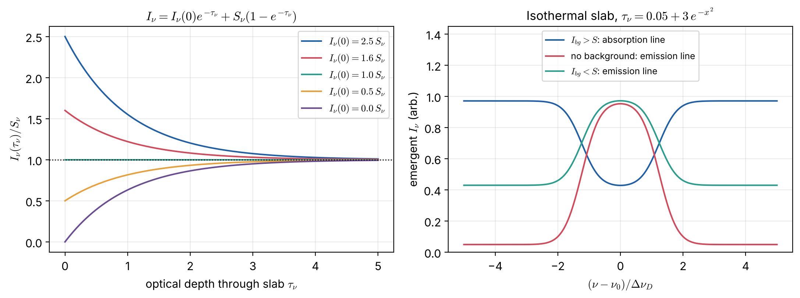

# Lecture 5 — The Radiative Transfer Equation and Its Formal Solution

> **Sources:** MIT 8.901 Lec. 7 §§7.1–7.2 (RTE, constant-$S$ solution, formal solution); Hu Set 1 (optical depth, source function, formal solution, interpretation); Collins §9.2c–d (source function and its meaning).

## Learning goals

1. Write the RTE in terms of $\tau_\nu$ and $S_\nu$ and explain why "$I_\nu$ relaxes toward $S_\nu$".
2. Derive the formal solution with an integrating factor.
3. Solve the uniform slab, including its optically thin and thick limits.
4. Explain Kirchhoff's three laws of spectroscopy with RT.

---

## 5.1 The equation

Combining Lecture 4's gains and losses:
$$\frac{dI_\nu}{ds} = -\alpha_\nu I_\nu + j_\nu .$$
Divide by $\alpha_\nu$ and use $d\tau_\nu = \alpha_\nu\,ds$ (optical depth measured **along the beam**) and $S_\nu = j_\nu/\alpha_\nu$:
$$\boxed{\;\frac{dI_\nu}{d\tau_\nu} = S_\nu - I_\nu\;}$$

**Physical meaning.** If $I_\nu > S_\nu$, then $dI_\nu/d\tau_\nu<0$: intensity decreases. If $I_\nu < S_\nu$, it increases. **The intensity always relaxes toward the local source function, on a scale of one optical depth.** $S_\nu$ is the intensity the medium "wants" to have.

## 5.2 Formal solution

Multiply by the integrating factor $e^{\tau_\nu}$ (MIT eq. 82–85):
$$\frac{d}{d\tau_\nu}\left(I_\nu e^{\tau_\nu}\right) = S_\nu e^{\tau_\nu}.$$
Integrate from $0$ to $\tau_\nu$:
$$\boxed{\;I_\nu(\tau_\nu) = I_\nu(0)\,e^{-\tau_\nu} + \int_0^{\tau_\nu}S_\nu(t)\,e^{-(\tau_\nu-t)}\,dt\;}$$

**Interpretation** (Hu): what arrives at $\tau_\nu$ is (i) the initial intensity attenuated by the whole column, plus (ii) the emission $S_\nu\,dt$ from every layer $t$, attenuated by the material between $t$ and the observer, $e^{-(\tau_\nu-t)}$.

The solution is "formal" because $S_\nu$ may depend on $I_\nu$ itself (scattering, NLTE). It is then an integral equation, not an explicit answer. In **LTE without scattering**, $S_\nu = B_\nu(T)$ is known once $T(\tau)$ is known, and the formal solution **is** the solution.

## 5.3 The uniform (isothermal) slab

If $S_\nu$ is constant:
$$\boxed{\;I_\nu = I_\nu(0)\,e^{-\tau_\nu} + S_\nu\left(1-e^{-\tau_\nu}\right)\;}$$

*Figure 5.1 — Left: whatever the incident intensity, $I_\nu\to S_\nu$ after a few optical depths. Right: a slab with optical depth larger at line centre than in the wings produces an absorption line when the background is brighter than $S$, and an emission line when it is fainter.*

| Limit | Result | Meaning |
|---|---|---|
| $\tau_\nu\ll1$ (optically thin) | $I_\nu\approx I_\nu(0)(1-\tau_\nu) + \tau_\nu S_\nu$ | background passes; emission $\propto$ column density ($\tau S = j\,L$) |
| $\tau_\nu\gg1$ (optically thick) | $I_\nu\to S_\nu$ | memory of the background lost; we see the medium itself |
| thick, LTE | $I_\nu = B_\nu(T)$ | an optically thick isothermal LTE body radiates as a black body |

> Even in LTE, $I_\nu = B_\nu$ only inside an **optically thick, isothermal** body. A real star is not isothermal, so its emergent spectrum is not exactly Planckian.

### Kirchhoff's laws of spectroscopy, explained

Write $\tau_\nu = \tau_c + \tau_0\phi(\nu)$, with a weak continuum $\tau_c$ plus a line. Then:

1. **Hot, opaque body** ($\tau_\nu\gg1$ at all $\nu$): $I_\nu = B_\nu(T)$, a continuous spectrum.
2. **Hot, thin gas, no background** ($I_\nu(0) = 0$): $I_\nu = B_\nu(1-e^{-\tau_\nu})$ is largest where $\tau_\nu$ is largest, so we see **emission lines**.
3. **Cooler gas in front of a hotter continuum** ($I_\nu(0) > S_\nu$): where $\tau_\nu$ is large, $I_\nu$ is pulled *down* toward $S_\nu$, giving **absorption lines**.

The real criterion is $I_{\rm background}$ versus $S_\nu$, not "cool versus hot" by itself. This idea carries over to stellar atmospheres in Lecture 10.

## 5.4 Radio spectrum of an H II region

For free–free absorption, $\tau_\nu\propto T_e^{-1.35}\nu^{-2.1}\int n_e^2\,ds$ (the integral is the emission measure). In the RJ limit, $I_\nu\propto T_b$:
$$T_b = T_e\left(1-e^{-\tau_\nu}\right).$$
At low $\nu$, $\tau\gg1$, so $T_b = T_e$ and the flux $S_\nu\propto\nu^2T_e$ (black body). At high $\nu$, $\tau\ll1$, so $T_b = T_e\tau_\nu\propto\nu^{-2.1}$ and the flux is $\propto\nu^{-0.1}$ (almost flat). The turnover at $\tau_\nu\approx1$ measures the emission measure.

---

## Worked example 5.1 — H II region brightness temperatures

*$T_e = 8000$ K. Find $T_b$ for $\tau = 0.01, 0.1, 1, 3, 10$.*

| $\tau$ | 0.01 | 0.1 | 1 | 3 | 10 |
|---|---|---|---|---|---|
| $T_b = T_e(1-e^{-\tau})$ [K] | 80 | 761 | 5057 | 7602 | 8000 |

**Lesson:** the brightness temperature equals the physical temperature only when the source is optically thick.

## Worked example 5.2 — Absorption by a foreground cloud

*A star with continuum intensity $I_0$ is seen through a cloud with $S = 0.3I_0$. At line centre $\tau = 5$, in the wings $\tau = 0.1$. Find the line profile values and the central depth.*

$I = I_0e^{-\tau}+S(1-e^{-\tau})$:
- wings ($\tau = 0.1$): $I = 0.933\,I_0$;
- $\tau = 1$: $I = 0.558\,I_0$;
- centre ($\tau = 5$): $I = 0.305\,I_0\approx S$.

The line core is **saturated**: it cannot go below $S$, however large $\tau$ becomes. The central depth is $1-0.305/0.933 = 0.67$ relative to the local continuum.

## Worked example 5.3 — Formal solution with a linearly increasing source function

*Let $S(t) = a + bt$ along a path of total optical depth $\tau$, with $I(0) = 0$. Find $I(\tau)$ and its thick limit.*

$$I(\tau) = \int_0^\tau(a+bt)e^{-(\tau-t)}dt.$$
Put $u = \tau-t$: $I = \int_0^\tau[a+b(\tau-u)]e^{-u}du = (a+b\tau)(1-e^{-\tau}) - b\left[1-(1+\tau)e^{-\tau}\right]$.
For $\tau\to\infty$: $I\to a + b\tau - b = S(\tau-1)$.

**The emerging intensity equals the source function one optical depth back from the observer.** This is the seed of the Eddington–Barbier relation (Lecture 7).

---

## Exam questions and answers — Lecture 5

**Q1.** Starting from $dI_\nu/ds = -\alpha_\nu I_\nu+j_\nu$, derive the formal solution.

> **A1.** With $d\tau = \alpha\,ds$ and $S = j/\alpha$: $dI/d\tau + I = S$. Multiply by $e^\tau$: $d(Ie^\tau)/d\tau = Se^\tau$. Integrate: $I(\tau)e^\tau - I(0) = \int_0^\tau S(t)e^tdt$, so $I(\tau) = I(0)e^{-\tau}+\int_0^\tau S(t)e^{-(\tau-t)}dt$.

**Q2.** For a uniform slab with $S$ constant, derive $I = I_0e^{-\tau}+S(1-e^{-\tau})$ and discuss the thin and thick limits.

> **A2.** Take $S$ out of the integral: $\int_0^\tau e^{-(\tau-t)}dt = 1-e^{-\tau}$. Thin: $I\approx I_0+\tau(S-I_0)$, so the change is linear in $\tau$ (the column density). Thick: $I\to S$, independent of $I_0$.

**Q3.** "Absorption lines form because the gas in a stellar atmosphere is cooler than the gas below it." Rephrase this precisely using $I_\nu$ and $S_\nu$.

> **A3.** At line frequencies $\tau_\nu$ is large, so the emergent intensity is set by $S_\nu$ in higher layers. If $S_\nu$ decreases outward (in LTE, $S_\nu = B_\nu(T)$ with $T$ decreasing outward), then line photons come from layers with smaller $S_\nu$ than continuum photons, and an absorption line results. If $S_\nu$ increases outward (a chromosphere, or NLTE effects), the line appears in emission.

**Q4.** A planetary nebula has $\tau = 0.02$ in [O III] 500.7 nm and no background light. How does its surface brightness scale with column density? With distance?

> **A4.** $I\approx\tau S = j_\nu L$: linear in the emissivity times path length (column). Surface brightness is independent of distance (Lecture 2), but the total flux falls as $d^{-2}$.

**Q5.** An observer sees a source behind a slab with $\tau_V = 1.5$. By how many magnitudes is it dimmed (ignoring the slab's emission)?

> **A5.** $I = I_0e^{-1.5}$; $A_V = 2.5\log_{10}e^{1.5} = 1.086\times1.5 = 1.63$ mag.

**Q6.** Explain physically why the term $\int S(t)e^{-(\tau-t)}dt$ is dominated by layers within $\Delta\tau\approx1$ of the observer.

> **A6.** The weight $e^{-(\tau-t)}$ falls by $e$ per unit optical depth away from the observer. Emission from deeper layers is absorbed before it arrives, so about 63 % of the received emission comes from the last unit of optical depth.

**Q7.** Sketch $T_b(\nu)$ for a uniform H II region with $T_e = 10^4$ K, given that $\tau = 1$ at 1 GHz and $\tau\propto\nu^{-2.1}$.

> **A7.** For $\nu\ll1$ GHz: $T_b\to10^4$ K (flat $T_b$, flux $\propto\nu^2$). At 1 GHz: $T_b = 10^4(1-e^{-1}) = 6300$ K. At 10 GHz: $\tau = 10^{-2.1} = 7.9\times10^{-3}$, so $T_b\approx79$ K, falling as $\nu^{-2.1}$. On a log–log plot of $T_b(\nu)$ we get a plateau, then a power law of slope $-2.1$, with the knee at $\tau\approx1$.
