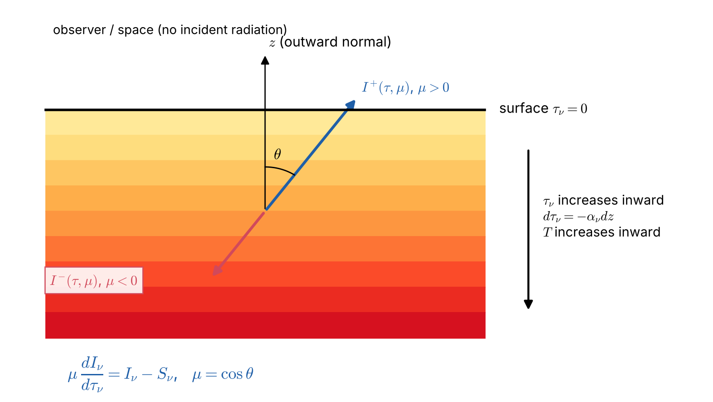
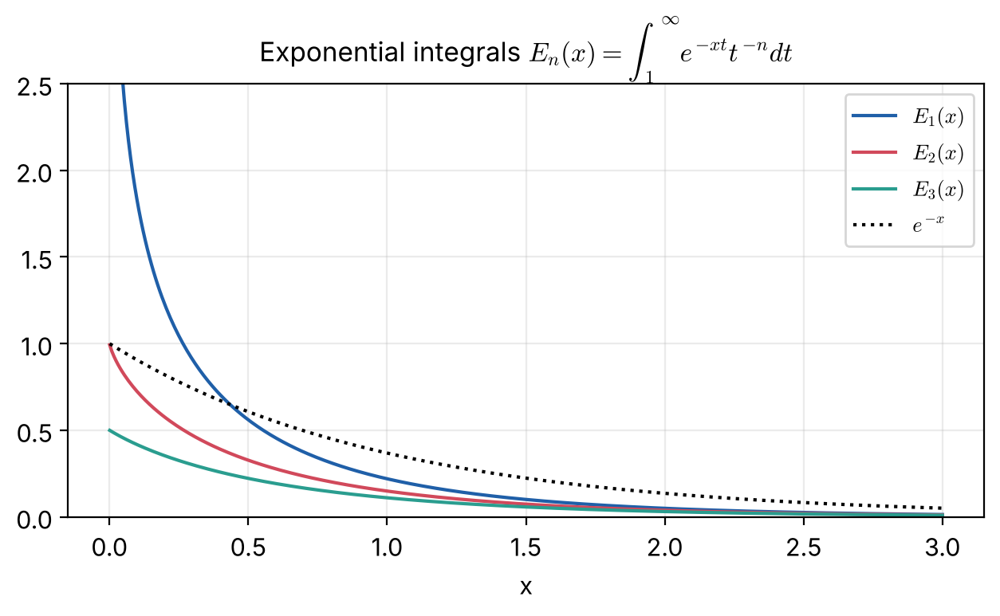
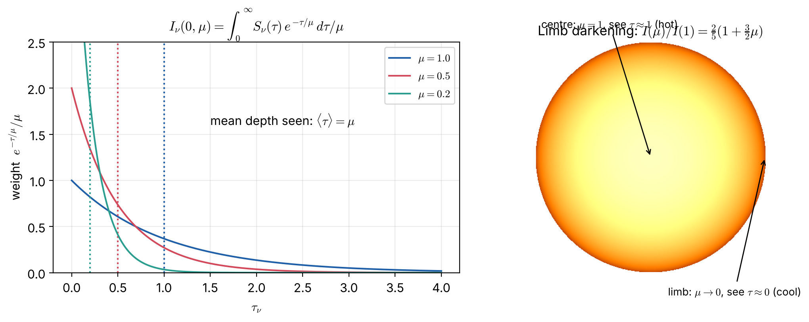

# Lecture 7 — Plane-Parallel Atmospheres: Schwarzschild–Milne Equations and Eddington–Barbier

> **Sources:** Collins §9.2 (plane-parallel RTE, eq. 9.2.24–9.2.26, Fig. 9.3), §9.3 (moments $J$, $H$, $K$); Chandrasekhar Ch. I §§9–11 (the formal solution and the $\Lambda$, $\Phi$, $X$ operators); Hu Set 1 (formal solution); MIT 8.901 §7.2.

## Learning goals

1. Write the RTE in plane-parallel geometry with $\tau$ measured **inward**.
2. Derive the formal solutions for outgoing and incoming intensity and the Schwarzschild–Milne integrals for $J$, $H$ and $K$.
3. Prove the Eddington–Barbier relations and use them to invert limb darkening into a temperature structure.

---

## 7.1 Geometry and sign conventions

*Figure 7.1 — A plane-parallel atmosphere. $z$ points outward, $\theta$ is measured from the outward normal, and $\mu = \cos\theta$. Outgoing rays have $\mu>0$, incoming rays $\mu<0$. The optical depth increases **inward**: $d\tau_\nu = -\alpha_\nu dz$.*

Along a ray, $ds = dz/\mu$. Then $dI_\nu/ds = \mu\,dI_\nu/dz = -\mu\,\alpha_\nu\,dI_\nu/d\tau_\nu$, and the RTE becomes (Collins eq. 9.2.26)
$$\boxed{\;\mu\,\frac{dI_\nu(\tau_\nu,\mu)}{d\tau_\nu} = I_\nu(\tau_\nu,\mu) - S_\nu(\tau_\nu)\;}$$
Note the sign change compared with Lecture 5, because $\tau$ is now measured against the outgoing direction.

**Boundary conditions** for a semi-infinite stellar atmosphere:
- no incident radiation at the top: $I_\nu(0,\mu<0) = 0$;
- the intensity does not grow faster than $e^{\tau}$ at depth: $\lim_{\tau\to\infty}I_\nu e^{-\tau/\mu} = 0$.

## 7.2 Formal solution in a semi-infinite atmosphere

Multiply by $e^{-\tau/\mu}/\mu$: $\dfrac{d}{d\tau}\left(Ie^{-\tau/\mu}\right) = -\dfrac{S}{\mu}e^{-\tau/\mu}$.

**Outgoing** ($0<\mu\le1$), integrating from $\tau$ to $\infty$:
$$I_\nu^+(\tau,\mu) = \int_\tau^\infty S_\nu(t)\,e^{-(t-\tau)/\mu}\,\frac{dt}{\mu}.$$
**Incoming** ($\mu<0$; write $\mu = -|\mu|$), integrating from $0$ to $\tau$ with $I(0) = 0$:
$$I_\nu^-(\tau,\mu) = \int_0^\tau S_\nu(t)\,e^{-(\tau-t)/|\mu|}\,\frac{dt}{|\mu|}.$$
**Emergent intensity** (what we observe at disk position $\mu$):
$$\boxed{\;I_\nu(0,\mu) = \int_0^\infty S_\nu(t)\,e^{-t/\mu}\,\frac{dt}{\mu}\;}$$
This is a **Laplace transform** of $S_\nu(\tau)$. Measuring $I_\nu(0,\mu)$ across the disk of the Sun ($\mu$ from 1 at centre to 0 at the limb) therefore probes $S_\nu(\tau)$ at different depths.

## 7.3 Exponential integrals and the Schwarzschild–Milne equations

$$E_n(x) = \int_1^\infty\frac{e^{-xt}}{t^n}\,dt = \int_0^1 e^{-x/\mu}\mu^{n-2}\,d\mu,\qquad
\frac{dE_n}{dx} = -E_{n-1},\quad E_n(0) = \frac{1}{n-1}\ (n>1).$$

*Figure 7.2 — $E_1$ diverges logarithmically at $x = 0$ (but is integrable); all $E_n$ decay roughly like $e^{-x}/x$.*

Insert the formal solution into the moment definitions and swap the order of integration:
$$J_\nu(\tau) = \tfrac12\int_0^\infty S_\nu(t)\,E_1|t-\tau|\,dt\ \equiv\ \Lambda_\tau[S_\nu]$$
$$F_\nu(\tau) = 2\pi\left[\int_\tau^\infty S_\nu(t)E_2(t-\tau)\,dt - \int_0^\tau S_\nu(t)E_2(\tau-t)\,dt\right]\ \equiv\ \Phi_\tau[S_\nu]$$
$$K_\nu(\tau) = \tfrac12\int_0^\infty S_\nu(t)\,E_3|t-\tau|\,dt\ \equiv\ X_\tau[S_\nu]$$
These are the **Schwarzschild–Milne equations**, and $\Lambda$ is the **lambda operator** of Chandrasekhar.

**Example: $S$ constant.** $J(0) = \tfrac12S\int_0^\infty E_1(t)dt = \tfrac12S\,E_2(0) = S/2$. At the surface only half the sky is filled, so $J = S/2$. Deep inside, $J\to S$.

## 7.4 The Eddington–Barbier relations

Expand the source function near the surface as $S_\nu(\tau) = a + b\tau$. Then
$$I_\nu(0,\mu) = \int_0^\infty(a+bt)e^{-t/\mu}\frac{dt}{\mu} = a + b\mu,$$
using $\int_0^\infty e^{-t/\mu}dt/\mu = 1$ and $\int_0^\infty te^{-t/\mu}dt/\mu = \mu$. So
$$\boxed{\;I_\nu(0,\mu) = S_\nu(\tau_\nu = \mu)\;}$$
**exactly** for a linear $S$, and approximately otherwise. For the surface flux:
$$F_\nu(0) = 2\pi\int_0^1(a+b\mu)\mu\,d\mu = \pi\left(a+\tfrac23b\right)\ \Rightarrow\ \boxed{\;F_\nu(0) = \pi S_\nu(\tau_\nu = 2/3)\;}$$

*Figure 7.3 — Left: the weighting kernel $e^{-\tau/\mu}/\mu$ peaks at the surface but has mean depth $\langle\tau\rangle = \mu$. Right: limb darkening. At disk centre we see down to $\tau\approx1$ (hot); at the limb, rays graze the atmosphere and we see $\tau\approx0$ (cool).*

**Physical meaning:**
- "We see down to $\tau\approx1$ along the line of sight," i.e. to vertical depth $\tau\approx\mu$.
- Toward the limb we see higher, cooler layers. If $S$ increases inward ($b>0$), the limb is **darker**.
- The observed flux of a star reflects the conditions at $\tau\approx2/3$, which is why the "photosphere" is defined there and why $T(\tau = 2/3)\approx T_{\rm eff}$ (Lecture 9).

## 7.5 From limb darkening to temperature: an LTE inversion

In LTE, $S_\nu = B_\nu(T)$. Measuring $I_\nu(0,\mu)$ gives $S_\nu(\tau_\nu = \mu)$ by Eddington–Barbier, and inverting the Planck function then gives $T(\tau_\nu)$. This is how the first empirical models of the solar photosphere were built.

---

## Worked example 7.1 — The temperature of the solar photosphere from limb darkening

*At $\lambda = 500$ nm the solar limb darkening is approximately $I(\mu)/I(1) = 0.36 + 0.64\mu$, and the disk-centre intensity is $I(1)\approx4.0\times10^{13}$ W m$^{-3}$ sr$^{-1}$. Assume LTE. Find $T$ at $\tau_{500} = 0$, $0.5$ and $1$.*

**Step 1 (Eddington–Barbier):** $S(\tau) = I(1)\,(0.36 + 0.64\tau)$, so
$S(0) = 0.36I(1) = 1.44\times10^{13}$, $S(0.5) = 0.68I(1) = 2.72\times10^{13}$, $S(1) = 4.0\times10^{13}$.

**Step 2 (LTE):** $S = B_\lambda(T)$, so $T = \dfrac{hc/\lambda k}{\ln(1+2hc^2/\lambda^5S)}$ with $hc/\lambda k = 28\,776$ K and $2hc^2/\lambda^5 = 3.811\times10^{15}$:

| $\tau_{500}$ | $S/I(1)$ | $T$ [K] |
|---|---|---|
| 0 | 0.36 | 5155 |
| 0.5 | 0.68 | 5814 |
| 1 | 1.00 | 6300 |

**Conclusion:** the temperature **increases inward**, by roughly 1100 K over one optical depth. This is direct observational proof that the Sun is not isothermal, and it explains why the solar spectrum has absorption lines.

## Worked example 7.2 — Emergent intensity for a quadratic source function

*$S(\tau) = a + b\tau + c\tau^2$. Find $I(0,\mu)$ and the error of Eddington–Barbier.*

$\int_0^\infty t^2e^{-t/\mu}dt/\mu = 2\mu^2$, so $I(0,\mu) = a + b\mu + 2c\mu^2$, whereas $S(\mu) = a + b\mu + c\mu^2$. The error is $c\mu^2$, i.e. Eddington–Barbier is exact only for linear $S$.

## Worked example 7.3 — Mean intensity at the surface for linear $S$

*$S = a+b\tau$. Compute $J(0)$ and $H(0)$, and show that $J(0)\neq S(0)$.*

$I^+(0,\mu) = a+b\mu$ and $I^-(0) = 0$, so $J(0) = \tfrac12\int_0^1(a+b\mu)d\mu = \tfrac a2 + \tfrac b4$ and $H(0) = \tfrac12\int_0^1(a+b\mu)\mu\,d\mu = \tfrac a4 + \tfrac b6$. With $b = 0$: $J(0) = a/2 = S(0)/2$. **The radiation field at the surface is not in equilibrium with the local source function**, a signature of photon escape.

---

## Exam questions and answers — Lecture 7

**Q1.** Starting from $dI/ds = \alpha(S-I)$, derive $\mu\,dI/d\tau = I - S$ for a plane-parallel atmosphere with $\tau$ increasing inward.

> **A1.** $ds = dz/\mu$ and $d\tau = -\alpha dz$, so $dI/ds = \mu\,dI/dz = -\alpha\mu\,dI/d\tau$. Then $-\alpha\mu\,dI/d\tau = \alpha(S-I)$, i.e. $\mu\,dI/d\tau = I-S$.

**Q2.** Derive the formal solution for the emergent intensity of a semi-infinite atmosphere.

> **A2.** $\frac{d}{d\tau}(Ie^{-\tau/\mu}) = -\frac{S}{\mu}e^{-\tau/\mu}$. Integrate from $0$ to $\infty$ with $Ie^{-\tau/\mu}\to0$: $-I(0,\mu) = -\int_0^\infty S e^{-t/\mu}dt/\mu$, so $I(0,\mu) = \int_0^\infty S(t)e^{-t/\mu}dt/\mu$.

**Q3.** Prove the Eddington–Barbier relations $I(0,\mu) = S(\tau = \mu)$ and $F(0) = \pi S(\tau = 2/3)$ for $S = a+b\tau$.

> **A3.** See §7.4: $I(0,\mu) = a+b\mu = S(\mu)$; $F = 2\pi\int_0^1(a+b\mu)\mu d\mu = 2\pi(a/2+b/3) = \pi(a+2b/3) = \pi S(2/3)$.

**Q4.** Explain limb darkening physically. Under what condition would we see limb **brightening**?

> **A4.** At disk centre the line of sight is perpendicular to the layers, so $\tau = 1$ is reached at vertical depth $\tau_{\rm vert} = 1$. Near the limb the ray is oblique, and $\tau = 1$ along it occurs at $\tau_{\rm vert} = \mu$, in higher layers. If $S$ (in LTE, $T$) decreases outward, the limb is darker. If $S$ increases outward, as in the chromosphere at UV, EUV and radio wavelengths, the limb is brighter.

**Q5.** Show that $J(\tau) = \frac12\int_0^\infty S(t)E_1|t-\tau|dt$.

> **A5.** $J = \frac12\int_0^1I^+d\mu+\frac12\int_0^1I^-d|\mu|$. Substitute the formal solutions: $\frac12\int_0^1\int_\tau^\infty S(t)e^{-(t-\tau)/\mu}\frac{dt}{\mu}d\mu + \dots$. Swap integrals: $\int_0^1e^{-x/\mu}\frac{d\mu}{\mu} = \int_1^\infty e^{-xw}\frac{dw}{w} = E_1(x)$ (with $w = 1/\mu$). Both halves combine to $\frac12\int_0^\infty S(t)E_1(|t-\tau|)dt$.

**Q6.** The solar limb darkening at some wavelength is $I(\mu)/I(1) = 0.3+0.7\mu$. In LTE and using Eddington–Barbier, at what optical depth does $S$ equal half its value at $\tau = 1$?

> **A6.** $S(\tau)/S(1) = 0.3+0.7\tau = 0.5\Rightarrow\tau = 0.29$.

**Q7.** Why is the emergent flux of a star (and hence its colour) characteristic of $\tau\approx2/3$ rather than of $\tau = 1$?

> **A7.** The flux weights the outgoing intensity by $\mu$ and integrates over the hemisphere. Rays at $\mu<1$ probe shallower layers, so the angle-averaged depth is $\langle\tau\rangle = 2/3$ (exact for linear $S$).
