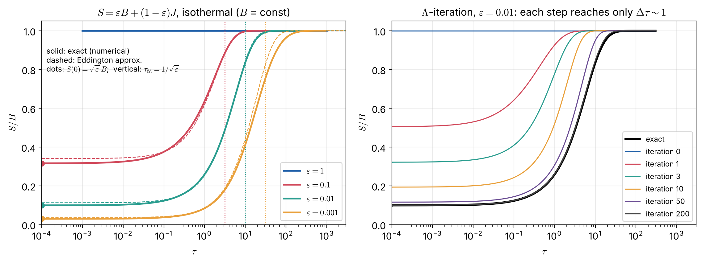

# Lecture 8 — Moment Equations, the Diffusion and Eddington Approximations, and Scattering Atmospheres

> **Sources:** Collins §9.3–9.4 (moments; radiative equilibrium eq. 9.4.3–9.4.5; diffusion approximation eq. 9.4.7–9.4.9; Eddington approximation eq. 9.4.12–9.4.13); Hu Set 1 (scattering, multiple processes, single-scattering albedo); Chandrasekhar Ch. I §§11–14 and Ch. III (isotropic scattering).

## Learning goals

1. Derive the zeroth and first moment equations and the condition of radiative equilibrium.
2. Close the moment hierarchy with the Eddington approximation and its surface boundary condition.
3. Derive the diffusion approximation and the Rosseland mean opacity.
4. Solve an isothermal atmosphere with scattering, obtain the $\sqrt\varepsilon$ law and the thermalisation depth, and understand why $\Lambda$-iteration fails.

---

## 8.1 Moments of the RTE

Take $\mu\,dI_\nu/d\tau_\nu = I_\nu - S_\nu$ ($S_\nu$ isotropic) and apply $\tfrac12\int_{-1}^{1}d\mu$ and $\tfrac12\int_{-1}^1\mu\,d\mu$:
$$\boxed{\;\frac{dH_\nu}{d\tau_\nu} = J_\nu - S_\nu\;}\qquad\qquad\boxed{\;\frac{dK_\nu}{d\tau_\nu} = H_\nu\;}$$
Each equation brings in a higher moment ($J\to H\to K\to\dots$): the **closure problem**, as in the hydrodynamic moments of the Boltzmann equation (Collins §9.4).

### Radiative equilibrium

If radiation carries all the energy and there are no sources, the total flux is constant: $dF/dz = 0$ (Collins eq. 9.4.5). Integrating the zeroth moment over frequency:
$$\frac{dH}{d\tau}\ \propto\ \int_0^\infty\alpha_\nu\left(J_\nu - S_\nu\right)d\nu = 0 .$$
In LTE ($S_\nu = B_\nu$ plus coherent scattering, which cancels out because scattering conserves energy):
$$\boxed{\;\int_0^\infty\kappa_\nu\,J_\nu\,d\nu = \int_0^\infty\kappa_\nu\,B_\nu(T)\,d\nu\;}\qquad\text{(energy absorbed = energy emitted)}$$
This condition **determines $T(\tau)$**. It is the extra equation that turns the RTE into a model atmosphere.

## 8.2 The diffusion approximation (deep interior)

At large depth, $S_\nu = B_\nu$ varies slowly on the scale of a mean free path. Expanding $B_\nu(t)$ in a Taylor series about $\tau$ in the formal solution gives
$$I_\nu(\tau,\mu) = B_\nu + \mu\frac{dB_\nu}{d\tau_\nu} + \mu^2\frac{d^2B_\nu}{d\tau_\nu^2}+\dots$$
The radiation is almost isotropic with a small linear anisotropy. Then (cf. Lecture 2, Worked example 2.3)
$$J_\nu\approx B_\nu,\qquad H_\nu = \frac13\frac{dB_\nu}{d\tau_\nu},\qquad K_\nu = \frac{B_\nu}3\approx\frac{J_\nu}{3}.$$
The flux is therefore
$$F_\nu = 4\pi H_\nu = \frac{4\pi}{3}\frac{dB_\nu}{d\tau_\nu} = -\frac{4\pi}{3}\frac{1}{\alpha_\nu}\frac{\partial B_\nu}{\partial T}\frac{dT}{dz}.$$
Radiation **diffuses** down the temperature gradient, like heat conduction.

### Rosseland mean opacity

Integrate over frequency:
$$F = -\frac{4\pi}{3}\frac{dT}{dz}\int_0^\infty\frac1{\alpha_\nu}\frac{\partial B_\nu}{\partial T}d\nu \equiv -\frac{4\pi}{3}\frac{1}{\alpha_R}\frac{dB}{dT}\frac{dT}{dz},$$
which defines the **Rosseland mean**
$$\boxed{\;\frac1{\alpha_R} = \frac{\displaystyle\int_0^\infty\frac{1}{\alpha_\nu}\frac{\partial B_\nu}{\partial T}d\nu}{\displaystyle\int_0^\infty\frac{\partial B_\nu}{\partial T}d\nu}\;}\qquad\Rightarrow\qquad
\boxed{\;F = -\frac{16\sigma T^3}{3\kappa_R\rho}\frac{dT}{dz}\;}$$
using $dB/dT = 4\sigma T^3/\pi$. It is a **harmonic** mean: energy flows through the frequency "windows" where the opacity is low (Hu: "energy escapes in the channel with the lowest opacity"). This is the radiative-transfer equation of **stellar interiors**.

## 8.3 The Eddington approximation (whole atmosphere)

Eddington assumed $K_\nu = J_\nu/3$ **everywhere**, not only at depth (Collins eq. 9.4.8). At the surface we also need a boundary condition. Assume the outgoing intensity is isotropic, $I(0,\mu>0) = I_0$, with $I(0,\mu<0) = 0$. Then $J(0) = I_0/2$ and $H(0) = I_0/4$ (Lecture 2, Q4), so
$$\boxed{\;J(0) = 2H(0)\;}\qquad\text{(Eddington boundary condition; Collins eq. 9.4.13)}$$
The two errors partly cancel, and the approximation is typically good to about 10 % (Collins), and to a few per cent for the temperature of a gray atmosphere (Lecture 9: $T(0)$ is $0.841\,T_{\rm eff}$ versus the exact $0.811\,T_{\rm eff}$).

Combined, the moment equations become a **second-order ODE**:
$$\frac13\frac{d^2J_\nu}{d\tau_\nu^2} = J_\nu - S_\nu .$$

## 8.4 Atmosphere with scattering: thermalisation

Take the source function of Lecture 4,
$$S = \varepsilon B + (1-\varepsilon)J,\qquad J - S = \varepsilon(J-B),$$
in an **isothermal** atmosphere ($B$ = constant), with $\varepsilon$ constant.

### Eddington solution

$\tfrac13J'' = \varepsilon(J-B)$, so $J = B + Ce^{-\sqrt{3\varepsilon}\,\tau}$ (the growing solution is excluded). The boundary condition $J(0) = 2H(0) = \tfrac23J'(0)$ gives $B + C = -\tfrac23\sqrt{3\varepsilon}\,C$, hence
$$J(\tau) = B\left[1 - \frac{e^{-\sqrt{3\varepsilon}\,\tau}}{1+2\sqrt{\varepsilon/3}}\right],\qquad
S(0) = B\left[\varepsilon+(1-\varepsilon)\frac{2\sqrt{\varepsilon/3}}{1+2\sqrt{\varepsilon/3}}\right]\approx\frac{2}{\sqrt3}\sqrt\varepsilon\,B = 1.15\sqrt\varepsilon\,B\ \ (\varepsilon\ll1).$$

### Exact result

The exact solution of the integral equation $S = \varepsilon B + (1-\varepsilon)\Lambda[S]$ (Chandrasekhar's $H$-function theory) gives the famous
$$\boxed{\;S(0) = \sqrt{\varepsilon}\,B\;}$$
This is one of the most important results in radiative transfer.

*Figure 8.1 — Left: exact numerical solutions (solid; computed with `scripts/lte_solvers.py`) and the Eddington approximation (dashed) for an isothermal atmosphere with $S = \varepsilon B+(1-\varepsilon)J$. Even though $B$ is constant, $S$ drops far below $B$ near the surface, and $S\to B$ only below the thermalisation depth $\tau_{\rm th}\sim1/\sqrt\varepsilon$ (dotted lines). Right: $\Lambda$-iteration for $\varepsilon = 0.01$. Each iteration propagates information only about one optical depth; after 200 iterations it is still not converged.*

**Interpretation.**
- A photon is destroyed with probability $\varepsilon$ per interaction, so it survives $\sim1/\varepsilon$ scatterings and random-walks a distance $\Delta\tau\sim\sqrt{1/\varepsilon}$. That is the **thermalisation length**.
- Within $\tau_{\rm th}$ of the surface, photons "know" about the boundary and leak out. $J$ drops below $B$, so $S<B$: **NLTE behaviour even when the gas is isothermal and in LTE populations.**
- For strong resonance lines $\varepsilon\sim10^{-4}$–$10^{-8}$, so $\tau_{\rm th}\sim10^2$–$10^4$. Thermalisation happens very deep, and line cores are much darker than LTE predicts.

### Why $\Lambda$-iteration fails

The obvious scheme $S^{(n+1)} = \varepsilon B + (1-\varepsilon)\Lambda[S^{(n)}]$ converges at rate $(1-\varepsilon)$ per step. Each step only couples points within $\Delta\tau\sim1$. For $\varepsilon\ll1$ it can appear converged (tiny changes) while still being badly wrong (Figure 8.1, right). Modern codes use **accelerated $\Lambda$-iteration (ALI)**, or solve the linear system directly, as our script does: $(\mathbf 1 - (1-\varepsilon)\mathbf\Lambda)\mathbf S = \varepsilon\mathbf B$.

### Numerical solution: how the script works

1. Choose a grid $\tau_0 = 0<\tau_1<\dots<\tau_N$ (logarithmic).
2. Represent $S(\tau)$ as piecewise linear between grid points.
3. Integrate $J_i = \tfrac12\int S(t)E_1|t-\tau_i|dt$ analytically on each segment, using $\int E_1 = -E_2$ and $\int xE_1\,dx = -xE_2 - E_3$. This gives a matrix $\Lambda_{ik}$ with $J_i = \sum_k\Lambda_{ik}S_k$.
4. Solve the linear system for $S_k$.

The results reproduce $S(0)/B = 0.316,\ 0.099$ for $\varepsilon = 0.1,\ 0.01$, against exact values of $0.316$ and $0.100$.

---

## Worked example 8.1 — Rosseland mean of a two-band opacity

*Suppose the weight $\partial B_\nu/\partial T$ is split equally between two bands with opacities $\kappa_1 = 1$ and $\kappa_2 = 100$ (arbitrary units). Compare the Rosseland mean with the straight (Planck-like) mean.*

$$\frac{1}{\kappa_R} = \frac12\left(\frac1{1}+\frac1{100}\right) = 0.505\ \Rightarrow\ \kappa_R = 1.98;\qquad \kappa_{\rm Planck} = \tfrac12(1+100) = 50.5.$$
The flux flows through the transparent band. Adding many strong lines (line blanketing) raises $\kappa_R$ only modestly, unless they fill the windows.

## Worked example 8.2 — Thermalisation of a resonance line

*A resonance line in a stellar chromosphere has $\varepsilon = 10^{-4}$. Estimate (a) $S(0)/B$, (b) the thermalisation depth, (c) the number of scatterings before destruction.*

(a) $S(0) = \sqrt\varepsilon\,B = 0.01\,B$. (b) $\tau_{\rm th}\approx1/\sqrt\varepsilon = 100$ (Eddington: $1/\sqrt{3\varepsilon} = 58$). (c) $N\approx1/\varepsilon = 10^4$. **Consequence:** an LTE calculation ($S = B$) would predict a line core 100 times brighter than the NLTE one. This is why strong lines like Ca II H & K and Mg II h & k need NLTE treatment.

## Worked example 8.3 — Diffusion flux and the solar interior

*At $r\approx0.5R_\odot$ in the Sun, $T\approx3.4\times10^6$ K, $\rho\approx1.3\times10^3$ kg m$^{-3}$ and $\kappa_R\approx1$ m$^2$ kg$^{-1}$, and the luminosity passing through is $L_\odot$. Find $dT/dr$.*

$F = L_\odot/(4\pi r^2) = 3.828\times10^{26}/(4\pi(3.48\times10^8)^2) = 2.5\times10^{8}$ W m$^{-2}$.
$$\left|\frac{dT}{dr}\right| = \frac{3\kappa_R\rho F}{16\sigma T^3} = \frac{3\times1\times1.3\times10^3\times2.5\times10^8}{16\times5.67\times10^{-8}\times(3.4\times10^6)^3} = 2.7\times10^{-2}\ {\rm K\,m^{-1}}.$$
That is about 27 K per km, or roughly $T/R_\odot\times5$: the right order of magnitude for the solar interior.

---

## Exam questions and answers — Lecture 8

**Q1.** Derive the zeroth and first moment equations of the plane-parallel RTE. Why is the system not closed?

> **A1.** Apply $\frac12\int_{-1}^1d\mu$ to $\mu\,dI/d\tau = I-S$: $dH/d\tau = J - S$. Apply $\frac12\int_{-1}^1\mu\,d\mu$: $dK/d\tau = H - \frac12S\int\mu\,d\mu = H$. The two equations contain three unknowns ($J,H,K$), and each further moment adds another, so a closure relation such as $K = J/3$ is needed.

**Q2.** State radiative equilibrium in integral form. Why do scattering terms drop out?

> **A2.** $\int\alpha_\nu(J_\nu - S_\nu)d\nu = 0$, equivalently $dF/dz = 0$. For coherent scattering the scattering part of $\alpha_\nu(J_\nu - S_\nu)$ is $\alpha^{\rm sc}_\nu(J_\nu - J_\nu) = 0$: scattering redirects photons but neither creates nor destroys energy (Collins §9.4). The condition becomes $\int\kappa_\nu^{a}(J_\nu - B_\nu)d\nu = 0$.

**Q3.** Derive the diffusion approximation and the Rosseland mean opacity. Why is it a harmonic mean?

> **A3.** See §8.2. Deep inside, $I\approx B+\mu\,dB/d\tau$, so $F_\nu = \frac{4\pi}{3}\frac{dB_\nu}{d\tau_\nu} = -\frac{4\pi}{3\alpha_\nu}\frac{\partial B_\nu}{\partial T}\frac{dT}{dz}$. Summing the fluxes over frequencies adds the $1/\alpha_\nu$ ("conductances", like resistors in parallel), hence the harmonic mean weighted by $\partial B_\nu/\partial T$.

**Q4.** State the Eddington approximation and its surface boundary condition. Derive $J(0) = 2H(0)$.

> **A4.** $K = J/3$ at all depths. If the emergent intensity is isotropic over the outward hemisphere, $I(0,\mu>0) = I_0$, and there is no incoming radiation, then $J(0) = \frac12\int_0^1I_0d\mu = I_0/2$ and $H(0) = \frac12\int_0^1I_0\mu\,d\mu = I_0/4$, so $J(0) = 2H(0)$.

**Q5.** For an isothermal atmosphere with $S = \varepsilon B + (1-\varepsilon)J$, solve in the Eddington approximation for $J(\tau)$. Explain why $S\neq B$ near the surface although the atmosphere is isothermal.

> **A5.** $\frac13J'' = \varepsilon(J - B)\Rightarrow J = B + Ce^{-\sqrt{3\varepsilon}\tau}$. With $J(0) = \frac23J'(0)$: $C = -B/(1+2\sqrt{\varepsilon/3})$. Near the surface photons escape, so $J<B$; scattering makes $S$ depend on $J$, so $S$ is also less than $B$. Only below $\tau\sim1/\sqrt{\varepsilon}$ do photons get destroyed (thermalised) before they can escape, and there $S\to B$.

**Q6.** Explain the $\sqrt\varepsilon$ law with a random-walk argument.

> **A6.** A photon is destroyed after $N\sim1/\varepsilon$ interactions; in that time it random-walks $\Delta\tau\sim\sqrt N = 1/\sqrt\varepsilon$. Only photons created within $\sim1/\sqrt\varepsilon$ of the surface can escape, and that loss lowers $J$ (and $S$) there. At the surface, the balance between thermal creation ($\varepsilon B$ per interaction) and escape gives $S(0)\sim\sqrt\varepsilon\,B$.

**Q7.** Why does $\Lambda$-iteration converge so slowly when $\varepsilon\ll1$? Name a better approach.

> **A7.** The $\Lambda$ operator couples points only over $\Delta\tau\sim1$, so each iteration spreads information about the boundary by about one optical depth. The thermalisation depth is $\sim1/\sqrt\varepsilon$, and the error decays as $(1-\varepsilon)^n$, so $\gtrsim1/\varepsilon$ iterations are needed. Remedies: solve the linear system directly (Feautrier method, or matrix inversion as in our script), or use accelerated $\Lambda$-iteration (ALI) with an approximate local operator.

**Q8.** Show that in the Eddington approximation $\frac13J'' = J - S$. What is the analogous equation in the time-dependent case (Collins eq. 9.4.10)?

> **A8.** From $dK/d\tau = H$ with $K = J/3$: $H = \frac13dJ/d\tau$. Then $dH/d\tau = \frac13d^2J/d\tau^2 = J-S$. When time dependence is kept, the moment equations combine into a damped wave (telegraph) equation for the flux, with propagation at speed $c/\sqrt3$. This is relevant for novae and supernovae.
