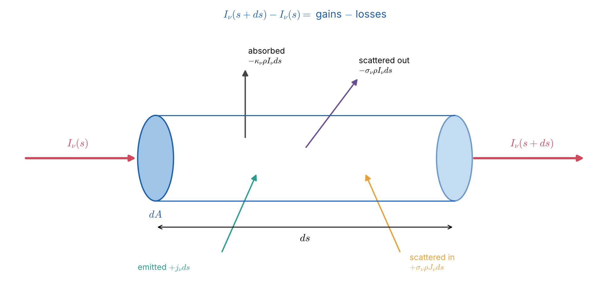
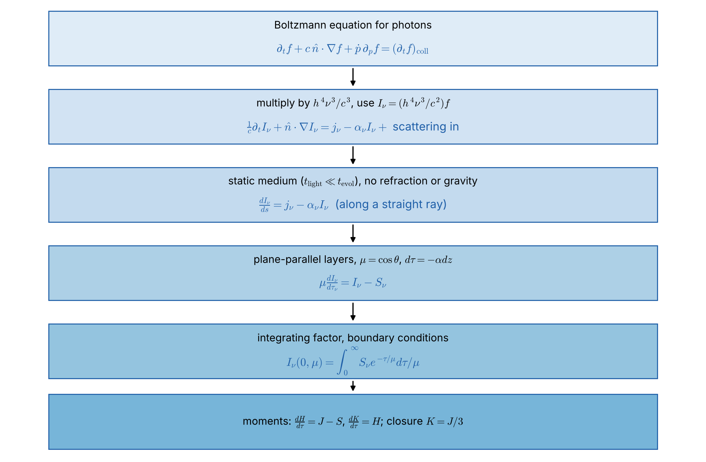

# Lecture 11 — How the Radiative Transfer Equation Is Formed (Part II: Deeper Foundations)

> **Sources:** Collins, *Fundamentals of Stellar Astrophysics*, Ch. 9.2 (photon phase-space density, eq. 9.2.1–9.2.27: Boltzmann equation → general RTE → creation rate, redistribution function, source function); Hu, *Astro 305 Set 1* (Liouville's theorem, $I_\nu/\nu^3$, Boltzmann equation); MIT 8.901 Lec. 7 §7.1 (building the RTE step by step); Chandrasekhar, *Radiative Transfer* (1950), Ch. I §§1–11; Rybicki & Lightman Ch. 1 and 4 (relativistic invariants).

## Learning goals

1. Describe a radiation field by the photon distribution function $f(\mathbf r,\mathbf p,t)$ and relate it to $I_\nu$.
2. Derive the radiative transfer equation from photon conservation (the Boltzmann equation) in a sequence of clear steps.
3. Write each physical gain and loss term (absorption, stimulated emission, spontaneous emission, scattering out and in).
4. Reduce the general equation to the forms used in practice: along a ray, plane-parallel, spherical, time-dependent, moving media.
5. Take energy and momentum moments to obtain the radiation energy equation and the radiation force.

---

## Key concepts in plain words

**Photons are particles in phase space.** A gas of photons can be described exactly like a gas of atoms: by counting how many photons have position near $\mathbf r$ and momentum near $\mathbf p$ at time $t$. That count per unit phase-space volume is the distribution function $f$. Specific intensity is simply $f$ multiplied by constants and by $\nu^3$; it carries the same information in astronomers' units.

**Transfer = conservation with sources and sinks.** In empty space, photons stream in straight lines at speed $c$; nothing is created or destroyed, so $f$ is constant along each photon's path (Liouville's theorem). Matter changes this by removing photons (absorption, scattering out of the beam) and adding photons (emission, scattering into the beam). The RTE is just "rate of change along the path = gains − losses", the same logic as a bank account.

**Why the equation is hard.** The losses are local and simple ($\propto I_\nu$). The gains from scattering, however, depend on the intensity arriving from *all other directions*, which depends on the whole medium. This turns a simple differential equation into an integro-differential equation, which is why most of the history of the subject (Lecture 12) is about clever approximations and numerical methods.

**One equation, many faces.** Every form used in this course (along a ray, plane-parallel with $\mu$, the formal solution, the moment equations) is the same physical statement written under particular assumptions: steady state, straight rays, layered geometry. Knowing *which assumption was made where* tells you when a formula may be used.

---

## 11.1 Step 1 — Describe the photons

Let $dN = f(\mathbf r,\mathbf p,t)\,d^3x\,d^3p$ be the number of photons in a phase-space volume. For photons $p = h\nu/c$, and in spherical momentum coordinates $d^3p = p^2dp\,d\Omega = (h^3\nu^2/c^3)\,d\nu\,d\Omega$.

The photons crossing an area $dA$ (normal at angle $\theta$ to their direction) in time $dt$ fill the volume $d^3x = c\,dt\,dA\cos\theta$. Their energy is
$$dE = h\nu\,f\,d^3x\,d^3p = h\nu\,f\,(c\,dt\,dA\cos\theta)\left(\frac{h^3\nu^2}{c^3}d\nu\,d\Omega\right).$$
Comparing with the definition $dE = I_\nu\cos\theta\,dA\,d\Omega\,d\nu\,dt$ (Lecture 2):
$$\boxed{\;I_\nu = \frac{h^4\nu^3}{c^2}\,f\;}\qquad\text{(Collins eq. 9.2.8)}$$

*Figure 11.1 — Bookkeeping for a pencil of radiation crossing a small cylinder of cross-section $dA$ and length $ds$. Losses: true absorption and scattering out of the beam. Gains: thermal emission and scattering into the beam from other directions.*

## 11.2 Step 2 — Conservation of photons: the Boltzmann equation

The number of photons in a phase-space element changes only through "collisions" with matter:
$$\frac{\partial f}{\partial t} + \dot{\mathbf r}\cdot\nabla f + \dot{\mathbf p}\cdot\nabla_{\mathbf p}f = \left(\frac{\partial f}{\partial t}\right)_{\rm coll}\qquad\text{(Collins eq. 9.2.1, 9.2.9)}$$
For photons $\dot{\mathbf r} = c\,\hat{\mathbf n}$. The term $\dot{\mathbf p}$ is non-zero only if photons are deflected or redshifted on their way (strong gravitational fields, a varying refractive index); Collins keeps it in eq. 9.2.11 for completeness. Without collisions the right-hand side is zero: $f$ is constant along a photon path. This is **Liouville's theorem**, and it is the reason $I_\nu/\nu^3$ is conserved (Hu; Lecture 2).

## 11.3 Step 3 — Convert to intensity

Multiply the Boltzmann equation by $h^4\nu^3/c^3$ and use Step 1. With $\dot{\mathbf p} = 0$:
$$\boxed{\;\frac1c\frac{\partial I_\nu}{\partial t} + \hat{\mathbf n}\cdot\nabla I_\nu = \frac{h^4\nu^3}{c^3}\left(\frac{\partial f}{\partial t}\right)_{\rm coll}\equiv\ (\text{gains}) - (\text{losses})\;}$$
The left-hand side is the rate of change of $I_\nu$ *following the photons*: $\frac1c\partial_t + \hat{\mathbf n}\cdot\nabla = \frac{d}{ds}$ along a ray.

## 11.4 Step 4 — The physical gain and loss terms

| Process | Term in $dI_\nu/ds$ | Comment |
|---|---|---|
| true absorption | $-\kappa_\nu\rho\,I_\nu$ | photon destroyed; energy goes into the gas |
| stimulated emission | $+\kappa^{\rm stim}_\nu\rho\,I_\nu$ | $\propto I_\nu$, so it is combined with absorption: $\kappa_\nu\to\kappa_\nu(1-e^{-h\nu/kT})$ in LTE |
| spontaneous (thermal) emission | $+j_\nu$ | independent of $I_\nu$; in LTE $j_\nu = \kappa_\nu\rho B_\nu$ (Kirchhoff) |
| scattering out of the beam | $-\sigma_\nu\rho\,I_\nu$ | photon redirected, not destroyed |
| scattering into the beam | $+\dfrac{\sigma_\nu\rho}{4\pi}\displaystyle\int_0^\infty\!\!\oint R(\nu',\nu;\hat{\mathbf n}',\hat{\mathbf n})\,I_{\nu'}(\hat{\mathbf n}')\,d\Omega'\,d\nu'$ | $R$ = redistribution function (Collins eq. 9.2.16, 9.2.20) |

Putting everything together gives the **general equation of transfer** (Collins eq. 9.2.23):
$$\boxed{\;\frac1c\frac{\partial I_\nu}{\partial t}+\hat{\mathbf n}\cdot\nabla I_\nu = -(\kappa_\nu+\sigma_\nu)\rho\,I_\nu + j_\nu + \frac{\sigma_\nu\rho}{4\pi}\int_0^\infty\!\!\oint R\,I_{\nu'}\,d\Omega'\,d\nu'\;}$$

Special redistribution functions (Collins §9.2e): **coherent** scattering $R\propto\delta(\nu-\nu')$ (Thomson scattering of optical light); **complete redistribution** $R$ independent of $\nu'$ (strong lines with frequent collisions); **isotropic** $R$ independent of angle. For coherent isotropic scattering, the gain term becomes simply $\sigma_\nu\rho J_\nu$.

Defining the **extinction coefficient** $\chi_\nu = (\kappa_\nu+\sigma_\nu)\rho$ and the **source function**
$$S_\nu = \frac{j_\nu + \sigma_\nu\rho J_\nu}{\chi_\nu} = \varepsilon_\nu B_\nu + (1-\varepsilon_\nu)J_\nu\quad(\text{LTE, coherent isotropic scattering}),$$
the static equation along a ray takes its familiar form, $dI_\nu/d\tau_\nu = S_\nu - I_\nu$ with $d\tau_\nu = \chi_\nu ds$.

## 11.5 Step 5 — Special forms of the equation

*Figure 11.2 — Each simplification adds one assumption. Knowing which assumption was used tells you when a formula is valid.*

| Situation | Form of the RTE | Assumption added |
|---|---|---|
| general, time-dependent | $\frac1c\partial_tI_\nu+\hat{\mathbf n}\cdot\nabla I_\nu = \chi_\nu(S_\nu-I_\nu)$ | none beyond straight rays |
| static medium | $\hat{\mathbf n}\cdot\nabla I_\nu = \chi_\nu(S_\nu-I_\nu)$ | light-travel time ≪ evolution time |
| along one ray | $\dfrac{dI_\nu}{ds} = \chi_\nu(S_\nu-I_\nu)$ | coordinate along the ray |
| 3D Cartesian | $n_x\partial_xI+n_y\partial_yI+n_z\partial_zI = \chi(S-I)$ | none (numerical 3D codes) |
| plane-parallel | $\mu\,\dfrac{dI_\nu}{d\tau_\nu} = I_\nu - S_\nu$ | horizontally homogeneous layers; $\tau$ measured inward (Collins eq. 9.2.26) |
| spherical | $\mu\dfrac{\partial I_\nu}{\partial r}+\dfrac{1-\mu^2}{r}\dfrac{\partial I_\nu}{\partial\mu} = \chi_\nu(S_\nu-I_\nu)$ | spherical symmetry (extended atmospheres, winds) |
| moving medium | write in the **comoving frame**, or use Doppler-shifted $\chi_\nu$, $j_\nu$ | velocities shift frequencies (Sobolev, Lecture 15) |

**Why the spherical term appears.** Along a straight ray with impact parameter $p$, the radius $r$ and the angle to the radial direction both change: $r^2 = p^2+z^2$ and $\mu = z/r$. Then $\frac{d}{dz} = \mu\frac{\partial}{\partial r}+\frac{1-\mu^2}{r}\frac{\partial}{\partial\mu}$. The second term vanishes when $r\to\infty$, recovering the plane-parallel form.

**Relativistic invariants** (Rybicki & Lightman). Between frames in relative motion, $I_\nu/\nu^3$, $\nu\,\chi_\nu$ and $j_\nu/\nu^2$ are invariant; these follow directly from $f$ being a scalar. They give Doppler boosting of jets and the $(1+z)^{-4}$ surface-brightness dimming of Lecture 2.

## 11.6 Step 6 — Energy and momentum of the radiation field

Integrate the general equation over all directions and frequencies (isotropic $j_\nu$ and $\chi_\nu$):

$$\text{energy:}\qquad \frac{\partial u}{\partial t}+\nabla\cdot\mathbf F = 4\pi\int_0^\infty\left(j_\nu-\kappa_\nu\rho J_\nu\right)d\nu$$
$$\text{momentum:}\qquad \frac{1}{c^2}\frac{\partial\mathbf F}{\partial t}+\nabla\cdot\mathsf P = -\frac1c\int_0^\infty\chi_\nu\,\mathbf F_\nu\,d\nu \equiv -\mathbf f_{\rm rad}$$

The first equation says the radiation gains energy where matter emits more than it absorbs. In a static, source-free atmosphere the right side is zero, giving **radiative equilibrium** and constant flux (Lecture 8). The second gives the **radiation force** per unit volume, $\mathbf f_{\rm rad} = \frac1c\int\chi_\nu\mathbf F_\nu d\nu$, which drives the winds of hot stars and sets the Eddington luminosity.

---

## Worked example 11.1 — Check: the black body from the photon distribution

*In equilibrium, photons have occupation number $\bar n = 1/(e^{h\nu/kT}-1)$ per state and there are $2/h^3$ states per unit phase-space volume (two polarizations). Show that $I_\nu = B_\nu$.*

$f = \dfrac{2}{h^3}\bar n$, so $I_\nu = \dfrac{h^4\nu^3}{c^2}\cdot\dfrac{2}{h^3}\cdot\dfrac{1}{e^{h\nu/kT}-1} = \dfrac{2h\nu^3}{c^2}\dfrac{1}{e^{h\nu/kT}-1} = B_\nu(T)$. ✓ The relation $I_\nu = (h^4\nu^3/c^2)f$ is consistent with Lecture 3.

## Worked example 11.2 — When is the time-dependent term needed?

*Compare the photon escape time with the evolution time for (a) the solar photosphere and (b) a supernova 10 days after explosion ($v = 10^4$ km s$^{-1}$, $\tau\approx100$).*

(a) The photosphere is about 500 km thick and $\tau\sim1$, so photons cross it in $\sim500\ {\rm km}/c\approx2$ ms. Granulation changes in about 5 minutes, $10^5$ times slower, so the **static** RTE is excellent.
(b) $R = vt = 10^7\times8.64\times10^5 = 8.6\times10^{12}$ m. The diffusion time is $t_d\approx\tau R/c = 100\times8.6\times10^{12}/3\times10^8\approx2.9\times10^6$ s $\approx$ 33 days, longer than the age. The **time-dependent** equation (or a diffusion treatment with time dependence) is required, which is why supernova light curves have a delayed peak.

## Worked example 11.3 — Doppler boosting from the invariant $I_\nu/\nu^3$

*A jet blob emits $I'_{\nu'}\propto\nu'^{-0.7}$ in its rest frame and moves toward us with Doppler factor $\mathcal D = 10$ ($\nu = \mathcal D\nu'$). How much brighter does it look at a fixed observed frequency?*

$I_\nu/\nu^3 = I'_{\nu'}/\nu'^3\Rightarrow I_\nu = \mathcal D^3I'_{\nu'} = \mathcal D^3I'_{\nu}\,(\nu'/\nu)^{-0.7} = \mathcal D^{3+0.7}I'_\nu$. So the blob is $10^{3.7}\approx5000$ times brighter, which explains the extreme brightness of blazars.

---

## Common misconceptions

1. **"The RTE is an empirical law."** It follows rigorously from photon conservation (the Boltzmann equation); only the coefficients $\kappa_\nu$, $\sigma_\nu$, $j_\nu$ and $R$ need microphysics.
2. **"Stimulated emission is part of the emission coefficient."** Because it is proportional to $I_\nu$, it is conventionally counted as negative absorption inside $\kappa_\nu$.
3. **"The plane-parallel equation works for any star."** It assumes the atmosphere is thin compared with the radius; extended atmospheres need the spherical form.
4. **"Scattering is just another kind of absorption."** Scattering removes photons from one direction but adds them to others; it makes the equation non-local through the in-scattering integral.

## Lecture summary

- Photons are described by $f(\mathbf r,\mathbf p,t)$; $I_\nu = (h^4\nu^3/c^2)f$.
- Photon conservation (Boltzmann) gives $\frac1c\partial_tI_\nu+\hat{\mathbf n}\cdot\nabla I_\nu$ = gains − losses.
- Gains and losses: absorption (with stimulated emission), spontaneous emission, scattering out, scattering in via $R(\nu',\nu;\hat{\mathbf n}',\hat{\mathbf n})$.
- Special forms follow from added assumptions: static, ray, plane-parallel, spherical, comoving frame.
- Moments give the radiation energy equation and the radiation force.

---

## Exam questions and answers — Lecture 11

**Q1.** Starting from the definition of $f$, show that $I_\nu = (h^4\nu^3/c^2)f$.

> **A1.** $dE = h\nu f\,d^3x\,d^3p$, with $d^3x = c\,dt\,dA\cos\theta$ and $d^3p = p^2dp\,d\Omega = (h^3\nu^2/c^3)d\nu\,d\Omega$. So $dE = (h^4\nu^3/c^2)f\cos\theta\,dA\,dt\,d\nu\,d\Omega$; comparing with $dE = I_\nu\cos\theta\,dA\,d\Omega\,d\nu\,dt$ gives the result.

**Q2.** Write the general time-dependent RTE with coherent isotropic scattering and LTE thermal emission. Name each term.

> **A2.** $\frac1c\partial_tI_\nu+\hat{\mathbf n}\cdot\nabla I_\nu = -\kappa_\nu\rho I_\nu$ (absorption, corrected for stimulated emission) $-\sigma_\nu\rho I_\nu$ (scattering out) $+\kappa_\nu\rho B_\nu$ (thermal emission, Kirchhoff) $+\sigma_\nu\rho J_\nu$ (scattering in, coherent and isotropic). Equivalently $\chi_\nu(S_\nu - I_\nu)$ with $S_\nu = \varepsilon B_\nu+(1-\varepsilon)J_\nu$.

**Q3.** Derive the spherical form of the static RTE and explain the origin of the $(1-\mu^2)/r\,\partial I/\partial\mu$ term.

> **A3.** Along a straight ray with impact parameter $p$: $r^2 = p^2+z^2$, $\mu = z/r$. Then $dr/dz = \mu$ and $d\mu/dz = (1-\mu^2)/r$. So $dI/dz = \mu\,\partial_rI+\frac{1-\mu^2}{r}\partial_\mu I = \chi(S-I)$. The second term exists because a straight ray changes its angle to the local radial direction as it moves; for $r\gg$ the atmosphere thickness it is negligible and we recover $\mu\,dI/dz$.

**Q4.** Integrate the static RTE over angle and frequency. Show that a static, source-free atmosphere has constant flux, and state what the momentum moment describes.

> **A4.** $\oint d\Omega$ of $\hat{\mathbf n}\cdot\nabla I_\nu$ gives $\nabla\cdot\mathbf F_\nu$; the right side gives $4\pi(j_\nu-\kappa_\nu\rho J_\nu)$ (scattering terms cancel). With no sources, energy absorbed = energy emitted, so $\int(j_\nu-\kappa_\nu\rho J_\nu)d\nu = 0$ and $\nabla\cdot\mathbf F = 0$; in plane-parallel geometry $F$ = constant $=\sigma T_{\rm eff}^4$. The first moment gives $\nabla\cdot\mathsf P = -\frac1c\int\chi_\nu\mathbf F_\nu d\nu$: the momentum transferred from radiation to matter, i.e. the radiation force.
