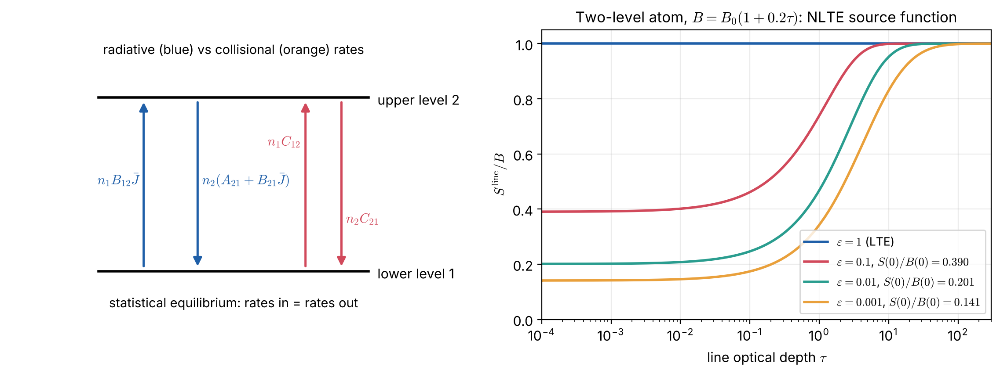

# Lecture 14 — TE, LTE and Non-LTE: Definitions, Examples and Solution Methods

> **Sources:** Collins §9.1 (breakdown of strict TE; assumption of LTE); Chandrasekhar (1950) Ch. I; R. N. Thomas, *Some Aspects of Non-Equilibrium Thermodynamics in the Presence of a Radiation Field* (1965); Mihalas, *Stellar Atmospheres* (1978) Chs. 5, 11–12; Hubeny & Mihalas, *Theory of Stellar Atmospheres* (2014); Osterbrock & Ferland (2006) for nebulae. This lecture extends Lecture 6 (LTE) and Lecture 8 (scattering).

## Learning goals

1. Give precise definitions of **thermodynamic equilibrium (TE)**, **local thermodynamic equilibrium (LTE)** and **non-LTE (NLTE)**, and name astrophysical examples of each.
2. Decide, with a quantitative criterion, which regime applies to a given object.
3. Write the statistical-equilibrium (rate) equations and the NLTE line source function with departure coefficients.
4. Explain the main NLTE mechanisms (photon losses, overionisation, pumping) and their effect on spectra and abundances.
5. Name the main NLTE solution methods and codes (names only).

---

## Key concepts in plain words

**Three levels of "equilibrium".** Think of a crowded hall. In **TE** the hall is closed and has been quiet for a long time: everyone, people (matter) and the air in the room (radiation), shares the same temperature everywhere. In **LTE** the doors are open and air flows through (radiation streams out), but people still bump into each other so often that each corner of the hall keeps its own well-defined local temperature. In **NLTE** the hall is so empty that people rarely meet; how they behave is decided by what blows in through the doors (the radiation field), not by the local temperature.

**What decides the regime: who talks to the atoms?** An atom's levels are populated and emptied by two kinds of events: collisions (with electrons and atoms, which "know" the local temperature) and photons (which may come from far away, at a different temperature, or may escape altogether). If collisions dominate, the populations follow the local temperature: LTE. If photons dominate, the populations follow the radiation field: NLTE.

**NLTE is the rule in low-density gas.** Most of the Universe by volume is NLTE: nebulae, the interstellar medium, stellar chromospheres and coronae, winds, the upper atmospheres of planets. LTE is a very good approximation mainly in dense places such as the deep photospheres of stars and stellar interiors.

**Why it matters for measurements.** If you assume LTE when a line actually forms in NLTE, you misread its strength. You then derive wrong abundances (sometimes by a factor of 2 or more), wrong temperatures and wrong gravities. This is why modern abundance work quotes "NLTE corrections".

---

## 14.1 Definitions

### Thermodynamic equilibrium (TE)

> **Definition.** A system is in **TE** at temperature $T$ when *every* process is balanced by its inverse (detailed balance) and all distributions take their equilibrium form at the **same** $T$: Maxwell velocities, Boltzmann excitation, Saha ionisation, and Planck radiation with $I_\nu = B_\nu(T)$, isotropic. Consequently $J_\nu = B_\nu$, $F_\nu = 0$ and $S_\nu = B_\nu$.

**Examples of TE (or extremely close to it)**

- A closed oven (Hohlraum) with a tiny hole: the classical black body.
- The **deep interior of the Sun**: the photon mean free path ($\sim$ cm) is $10^{-10}$–$10^{-11}$ of the temperature scale height, so the radiation is isotropic to that precision (Worked example 14.1).
- The **early Universe before recombination** ($z\gtrsim1100$): matter and radiation were coupled by Thomson scattering at one temperature. This is why the CMB has a Planck spectrum.

### Local thermodynamic equilibrium (LTE)

> **Definition.** **LTE** holds when the **matter** at each point is in equilibrium at the **local** temperature $T(\mathbf r)$ (Maxwell, Boltzmann, Saha at $T(\mathbf r)$), while the **radiation** is free to differ from $B_\nu$. Then Kirchhoff's law $j_\nu = \kappa_\nu\rho B_\nu(T)$ holds and $S_\nu = B_\nu(T)$, but in general $I_\nu\neq B_\nu$ and $J_\nu\neq B_\nu$.

**Examples of LTE (good approximation)**

- The **continuum** of the solar photosphere (H$^-$ opacity) and **weak metal lines** in dwarf F, G, K stars: the basis of classical abundance analysis.
- The **gray model atmosphere** of Lecture 9 and the Milne–Eddington lines of Lecture 10.
- **Earth's lower atmosphere** in the thermal infrared: the CO$_2$ 15 µm band is in LTE below about 70 km, which is why climate radiative-transfer codes use LTE there.
- Dense laboratory plasmas (arcs, shock tubes).

### Non-LTE (NLTE)

> **Definition.** **NLTE** means that at least some level populations differ from their Saha–Boltzmann values at the local $T$. The populations must then be computed from the **statistical-equilibrium (rate) equations**, which couple them to the radiation field. Then $S_\nu\neq B_\nu(T)$, and the problem becomes non-local and non-linear.

**Examples of NLTE**

- **Strong resonance-line cores** in the Sun (Na I D, Mg I b, Ca II H & K, H$\alpha$ core): photons escape, so $S<B$ and the cores are darker than LTE predicts.
- The **solar chromosphere and corona**: low density; populations controlled by radiation and by non-thermal heating.
- **Hot O and B stars and their winds**: intense UV radiation drives photo-ionisation; He II and N III lines need NLTE. **Supergiants** have low gravity and therefore low density.
- **H II regions and planetary nebulae**: forbidden lines such as [O III] 500.7 nm, with electron densities far below the critical density (Worked example 14.3).
- **Molecular clouds**: high rotational lines of CO are "subthermally" excited ($T_{\rm ex}<T_{\rm kin}$).
- **Masers** (OH, H$_2$O, SiO): extreme NLTE with population inversion, $T_{\rm ex}<0$.
- **Earth's upper atmosphere**: aurorae, airglow, and CO$_2$ cooling above about 70 km.

### Side-by-side comparison

| | **TE** | **LTE** | **NLTE** |
|---|---|---|---|
| temperature | one $T$ everywhere | local $T(\mathbf r)$ | kinetic $T(\mathbf r)$, but populations not set by it |
| velocities | Maxwell($T$) | Maxwell($T(\mathbf r)$) | usually Maxwell($T(\mathbf r)$) |
| excitation, ionisation | Boltzmann, Saha($T$) | Boltzmann, Saha($T(\mathbf r)$) | rate equations: $n_i = b_in_i^{\rm LTE}$ |
| source function | $S_\nu = B_\nu$ | $S_\nu = B_\nu(T(\mathbf r))$ | $S_\nu\neq B_\nu$, depends on $J_\nu$ |
| radiation field | $I_\nu = B_\nu$, isotropic, $F = 0$ | $I_\nu\neq B_\nu$, carries flux | $I_\nu\neq B_\nu$ |
| local or global? | trivial | local: $T\to$ populations $\to\kappa_\nu, j_\nu$ | global: populations ↔ radiation everywhere |
| criterion | closed and isothermal over $\gg\ell_\gamma$ | collision rates ≫ radiative rates | radiative rates ≳ collision rates |
| examples | oven, stellar core, early Universe | photospheric continuum, weak lines, Earth's troposphere | resonance-line cores, chromospheres, hot stars, nebulae, masers |

### A practical criterion

For a transition $u\to l$, collisions win if
$$n_e\,q_{ul}\ \gg\ A_{ul}\,\beta_{\rm esc},$$
where $q_{ul}$ is the collisional de-excitation rate coefficient and $\beta_{\rm esc}\approx1/\tau$ (for $\tau\gg1$) is the probability that an emitted photon escapes. In words: compare the **critical density** $n_{\rm crit} = A_{ul}\beta_{\rm esc}/q_{ul}$ with the actual electron density. Optically thick lines trap their photons ($\beta_{\rm esc}\ll1$), which lowers the effective critical density and pushes them back toward LTE deep inside an atmosphere. Near the surface, where $\tau\to0$, that help disappears.

## 14.2 Statistical equilibrium

For each level $i$ of an atom or ion:
$$\boxed{\;n_i\sum_{j\neq i}\left(R_{ij}+C_{ij}\right) = \sum_{j\neq i}n_j\left(R_{ji}+C_{ji}\right)\;}\qquad\text{(rates out = rates in)}$$

- **Radiative bound–bound rates:** $R_{lu} = B_{lu}\bar J$ (upward); $R_{ul} = A_{ul}+B_{ul}\bar J$ (downward).
- **Radiative bound–free rates:** photo-ionisation $R_{i\kappa} = 4\pi\int\frac{\sigma_i(\nu)}{h\nu}J_\nu d\nu$, plus spontaneous and stimulated recombination.
- **Collisional rates:** $C_{ij} = n_eq_{ij}(T)$, obeying detailed balance at the local $T$.

Because $J_\nu$ depends on the populations everywhere through the RTE, and the populations depend on $J_\nu$, the problem is **non-linear and non-local**.

**Departure coefficients** $b_i = n_i/n_i^{\rm LTE}$ ($b_i = 1$ in LTE). The line source function is
$$S^{\rm line}_\nu = \frac{2h\nu^3}{c^2}\,\frac{1}{\dfrac{b_l}{b_u}e^{h\nu/kT}-1}\ \approx\ \frac{b_u}{b_l}\,B_\nu(T)\quad(\text{Wien limit}).$$
For a two-level atom this becomes $S = (1-\varepsilon)\bar J+\varepsilon B$ (Lecture 6).

*Figure 14.1 — Left: the four rate processes that set the populations of a two-level atom. Right: the exact line source function (Λ-matrix solution with `scripts/lte_solvers.py`) in an atmosphere whose Planck function rises gently inward. As collisions become rarer ($\varepsilon\downarrow$), the surface source function falls far below $B$, and thermalisation ($S\to B$) happens deeper, at $\tau\sim1/\sqrt\varepsilon$.*

## 14.3 NLTE mechanisms and their effects

| Mechanism | What happens | Effect on spectra | Typical cases |
|---|---|---|---|
| **photon losses** (resonance scattering) | line photons escape near the surface, so $\bar J<B$, $b_u<b_l$ and $S<B$ | deeper line cores than LTE | Na D, Ca II H & K, H$\alpha$ core, Mg II h & k |
| **overionisation** | UV $J_\nu>B_\nu$ ionises minority species | weaker lines → LTE underestimates abundance (positive NLTE correction) | Fe I, Mg I in metal-poor stars |
| **overrecombination** | recombination cascades overpopulate upper levels | emission features | He I, H I in nebulae and winds |
| **photon pumping / fluorescence** | a strong radiation field populates particular upper levels | emission lines, line-strength changes | Bowen fluorescence (O III), masers |
| **photon suction** | cascades drain a level through strong lines | modified populations | high-excitation lines in the solar spectrum |

Typical **NLTE abundance corrections** $\Delta_{\rm NLTE} = \log\varepsilon_{\rm NLTE}-\log\varepsilon_{\rm LTE}$: about −0.2 dex for the O I 777 nm triplet in the Sun, and up to a few tenths of a dex for Fe I and Mg I in metal-poor giants.

## 14.4 NLTE solution methods: names only

*Formal solvers (for a given source function):*
Feautrier method · long characteristics · short characteristics (linear, parabolic, Bézier/monotonic) · DELO and Hermitian methods · discontinuous finite elements · discrete ordinates · Monte Carlo radiative transfer.

*Iterative schemes for scattering and statistical equilibrium:*
classical Λ-iteration · core saturation (Rybicki) · operator perturbation / accelerated Λ-iteration (ALI) with diagonal, tridiagonal or nonlocal approximate operators · multilevel ALI (MALI) · Gauss–Seidel and successive over-relaxation (GS/SOR) · multigrid · Ng acceleration · Krylov-subspace methods (GMRES, BiCGStab) with preconditioning · complete linearization · hybrid complete-linearization/ALI (CL/ALI) · variable Eddington factors · equivalent two-level atom · escape-probability and Sobolev methods · comoving-frame methods · partial-redistribution (PRD) schemes.

*Codes (examples):*
MULTI, MULTI3D, RH, Lightweaver, DETAIL/SURFACE, TLUSTY/SYNSPEC, PHOENIX, CMFGEN, FASTWIND, PoWR, Balder, Cloudy, MOCASSIN, LIME, RADEX.

---

## Worked example 14.1 — How close to TE is the centre of the Sun?

*With a photon mean free path $\ell\approx2$ cm (Lecture 4) and a temperature scale height $H_T = T/|dT/dr|\approx R_\odot\approx7\times10^8$ m, estimate the anisotropy of the radiation, $F/(cu)$.*

Diffusion gives $F = \frac{c\ell}{3}|\nabla u|$ with $u\propto T^4$, so $|\nabla u|/u = 4/H_T$. Then $F/(cu) = \frac{4\ell}{3H_T} = \frac{4\times0.02}{3\times7\times10^8}\approx4\times10^{-11}$. The radiation is isotropic and Planckian to about 1 part in $10^{11}$, essentially TE, although this tiny anisotropy carries the entire solar luminosity.

## Worked example 14.2 — Is the Na D line in LTE?

*Na I D$_2$ has $A_{21} = 6.2\times10^7$ s$^{-1}$; electron collisions give $q_{21}\approx6\times10^{-13}$ m$^3$ s$^{-1}$ (order of magnitude, $T\approx5000$ K). Compare with $n_e\approx6\times10^{19}$ m$^{-3}$ at $\tau_{500} = 1$ and $n_e\approx10^{17}$ m$^{-3}$ in the upper photosphere where the line core forms.*

$n_{\rm crit} = A/q\approx10^{20}$ m$^{-3}$. At $\tau_{500} = 1$: $C/A = n_eq/A\approx0.6$, close to LTE only if line trapping helps. Where the core forms: $C/A\approx10^{-3}$, so $\varepsilon\approx10^{-3}$, strongly NLTE. In the model of Figure 14.1, $\varepsilon = 10^{-3}$ gives $S(0)/B(0)\approx0.14$. The observed Na D cores are indeed much darker than LTE models predict.

## Worked example 14.3 — A planetary nebula

*[O III] 500.7 nm has a critical density of about $6\times10^{11}$ m$^{-3}$ ($6\times10^5$ cm$^{-3}$). A planetary nebula has $n_e\approx10^{10}$ m$^{-3}$. Which regime applies, and what does this make possible?*

$n_e/n_{\rm crit}\approx0.016$: every collisional excitation is followed by a radiative decay rather than a collisional de-excitation, which is extreme NLTE. The line emissivity is then $\propto n_en_{\rm ion}q_{lu}(T_e)$, and the ratio of lines from different upper levels ([O III] 436.3 / 500.7 nm) depends only on $T_e$. This is how nebular electron temperatures (about 10 000 K) are measured. In LTE such a ratio would just reflect $e^{-\Delta E/kT}$, and the forbidden lines would be very weak.

## Worked example 14.4 — The CMB: TE in the past, a Planck spectrum today

*After recombination ($z\approx1100$) photons stopped interacting with matter. Why is the CMB still a perfect Planck spectrum today, at $T = 2.725$ K?*

Before recombination matter and radiation were in TE at $T\approx3000$ K. Afterwards the photons stream freely: $I_\nu/\nu^3$ is conserved along each ray (Lecture 2), and every frequency redshifts by the same factor $1+z$. A Planck spectrum at $T$ becomes a Planck spectrum at $T/(1+z)$, so $3000/1100\approx2.7$ K. Today's CMB is **not** in TE with any matter (the radiation is decoupled), yet its spectrum is still exactly Planckian. A Planck spectrum alone does not prove equilibrium at present.

---

## Common misconceptions

1. **"NLTE means the gas has no temperature."** The electrons and atoms usually still have a Maxwellian distribution with a well-defined kinetic $T$; only the level populations (and therefore $S_\nu$) depart from their LTE values.
2. **"A Planck spectrum proves TE."** The CMB today is Planckian but decoupled; conversely, LTE matter can emit non-Planckian spectra.
3. **"NLTE always weakens lines."** Photon losses deepen line cores; overionisation weakens lines of minority species; pumping can create emission. The sign depends on the mechanism.
4. **"High density guarantees LTE everywhere in a star."** Near the surface photons escape ($\beta_{\rm esc}\to1$), so even dense atmospheres show NLTE in strong lines.

## Lecture summary

- **TE:** one $T$ for everything, $I_\nu = B_\nu$. Examples: oven, stellar core, early Universe.
- **LTE:** matter at local $T$, so $S_\nu = B_\nu(T)$, but $I_\nu\neq B_\nu$. Examples: photospheric continuum, weak lines, Earth's troposphere.
- **NLTE:** populations from rate equations, $S_\nu\neq B_\nu$. Examples: resonance-line cores, chromospheres, hot stars, nebulae, masers.
- Criterion: compare $n_e$ with $n_{\rm crit} = A\beta_{\rm esc}/q$.
- Mechanisms: photon losses, overionisation, overrecombination, pumping. Methods: Λ-iteration, ALI/MALI, complete linearization, CL/ALI, GS/SOR, Monte Carlo, among others.

---

## Exam questions and answers — Lecture 14

**Q1.** Define TE, LTE and NLTE precisely and give two astrophysical examples of each.

> **A1.** **TE:** all distributions (Maxwell, Boltzmann, Saha, Planck) at one temperature, with detailed balance for every process and $I_\nu = B_\nu$; examples: the solar core, the pre-recombination Universe. **LTE:** matter in equilibrium at the local temperature, $S_\nu = B_\nu(T(\mathbf r))$, but the radiation can differ from $B_\nu$; examples: the solar photospheric continuum, weak Fe lines in the Sun (or Earth's troposphere in the infrared). **NLTE:** some populations differ from Saha–Boltzmann and must be computed from rate equations coupled to the radiation; examples: the cores of Na D and Ca II H & K, planetary nebulae (forbidden lines), astrophysical masers.

**Q2.** Write the statistical-equilibrium equation for level $i$ and explain why NLTE problems are non-local and non-linear.

> **A2.** $n_i\sum_j(R_{ij}+C_{ij}) = \sum_jn_j(R_{ji}+C_{ji})$. The radiative rates $R$ depend on $J_\nu$, which by the RTE depends on the emissivities and opacities, i.e. on the populations, at all points of the atmosphere (non-local). The opacities are products of populations and radiation-dependent quantities, and the populations depend on $J$ (non-linear). The two sets of equations must be solved together iteratively.

**Q3.** Why are the cores of strong resonance lines darker in NLTE than in LTE? Use departure coefficients.

> **A3.** Near the surface the line photons escape, so $\bar J<B$ and fewer atoms are radiatively excited: the upper level is underpopulated relative to the lower, $b_u<b_l$. Then $S^{\rm line}\approx(b_u/b_l)B<B$. The emergent core intensity ($\approx S$ at $\tau_\nu\approx1$, Eddington–Barbier) is therefore lower than the LTE value $B(T)$, and the core is darker.

**Q4.** Name four methods used to solve NLTE radiative-transfer problems and two NLTE codes.

> **A4.** Methods (any four): Λ-iteration, accelerated Λ-iteration (ALI), multilevel ALI (MALI), complete linearization, hybrid CL/ALI, Gauss–Seidel/SOR, Feautrier formal solution, short characteristics, Monte Carlo, escape-probability/Sobolev methods. Codes (any two): MULTI, RH, TLUSTY, PHOENIX, CMFGEN, FASTWIND, DETAIL/SURFACE, Cloudy.
