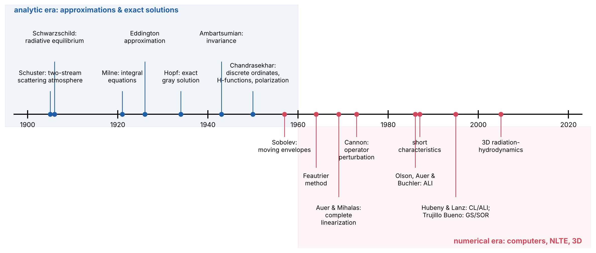

# Lecture RT10 — Historical Context: How the Approximations and Solutions Were Found

> **Sources:** Chandrasekhar, *Radiative Transfer* (1950), Preface and bibliographical notes of Chs. II–V (Schuster, Schwarzschild, Milne, Eddington, Hopf, Bronstein, Wiener–Hopf, Ambartsumian); Collins Ch. 9 and its supplemental reading (Eddington 1916; Mihalas 1978; Sobolev 1963; Mustel 1958); A670 Lecture RT1 (historical background); Hubeny & Mihalas, *Theory of Stellar Atmospheres* (2014), for the numerical era.

## Learning goals

1. Place the main approximations of this course (two-stream, Eddington, diffusion, Milne–Eddington, Eddington–Barbier) in their historical setting.
2. Know who found the exact solutions of the classical problems, and by which methods.
3. Name the main numerical methods of the computer era and the problem each one solved.
4. Compare the accuracy of the historical approximations on the gray atmosphere.

---

## Key concepts in plain words

**Why approximations came first.** Until the 1960s there were no computers able to solve integro-differential equations. Astronomers needed answers they could compute with pencil, paper and tables. They invented approximations that replace the full angular dependence of the radiation by one or two numbers (two streams, or the Eddington closure $K = J/3$). Remarkably, these simple ideas already explained limb darkening, the temperature structure of the Sun and the formation of absorption lines.

**Exact solutions as benchmarks.** Between 1930 and 1950, mathematicians and astrophysicists (Hopf, Wiener, Ambartsumian, Chandrasekhar) solved a few idealised problems *exactly*: the gray atmosphere, isotropic scattering, the polarization of scattered light. These solutions, such as the Hopf function and the $H$-functions, are still used to test every new numerical code, exactly as we did with our own solver in Lecture SA5.

**The numerical era: solving the hard problems.** Real atmospheres need thousands of frequencies, many atomic levels and NLTE populations that depend on the radiation field. From the 1960s onwards, new algorithms turned this into problems computers could solve: Feautrier's method, complete linearization, accelerated Λ-iteration, short characteristics, Monte Carlo. Today's 3D radiation-hydrodynamic simulations build on all of them.

**Old approximations never die.** Two-stream and Eddington approximations are still used in climate models, exoplanet atmospheres and supernova codes. The Milne–Eddington model is the basis of solar magnetic-field measurements. Understanding the history explains why these "old" formulas appear in modern papers.

---

## 10.1 Before transfer theory (1729–1917)

| Year | Who | Contribution |
|---|---|---|
| 1729, 1760, 1852 | Bouguer, Lambert, Beer | exponential attenuation of light, $I = I_0e^{-\tau}$ |
| 1859–1860 | Kirchhoff (with Bunsen) | emission/absorption ratio is universal; spectral analysis; dark solar lines explained |
| 1900 | Planck | the universal function $B_\nu(T)$ |
| 1917 | Einstein | $A$ and $B$ coefficients; stimulated emission |
| 1920 | Saha | ionisation equation, which made the spectral sequence a temperature sequence |

## 10.2 The birth of stellar radiative transfer (1905–1930)

- **Schuster (1905)**, "Radiation through a foggy atmosphere": the first transfer problem with scattering, treated with **two streams** (one up, one down). He explained how a scattering layer can produce absorption or emission lines.
- **Karl Schwarzschild (1906)**: showed that the solar photosphere is in **radiative equilibrium**, not convective (adiabatic) equilibrium. With a two-stream approximation he found $T^4 = \tfrac12T_{\rm eff}^4(1+2\tau)$ and the limb-darkening law $I(\mu)/I(1) = (1+2\mu)/3$, close to the observed solar limb darkening. In 1914 he wrote the theory of scattering lines.
- **Rosseland (1924)**: the diffusion limit and the **Rosseland mean** opacity (Lecture RT8).
- **Milne (1921)**: formulated the transfer problem as **integral equations** (the Schwarzschild–Milne equations and the "Milne problem" of Lecture SA5), and with Eddington the line-formation model now called **Milne–Eddington** (Lecture SA6).
- **Eddington (1916, 1926)**: radiative equilibrium of whole stars; the **Eddington approximation** $K = J/3$ with $J(0) = 2H(0)$ (Lecture RT8), which gave $T^4 = \frac34T_{\rm eff}^4(\tau+\frac23)$.
- **Unsöld (1928–1938)**: quantitative abundance analysis; the solar atmosphere is mostly hydrogen. His book *Physik der Sternatmosphären* (1938) became the standard text.

## 10.3 The era of exact solutions (1930–1960)

- **Hopf (1930–1934)** and **Bronstein (1929)**: exact solution of the Milne problem; Hopf–Bronstein relation $J(0) = \sqrt3H$; Hopf function $q(\tau)$ with $q(\infty) = 0.7104$.
- **Wiener & Hopf (1931)**: the Wiener–Hopf technique for integral equations on a half-line, first motivated by this problem.
- **Wildt (1939)**: the negative hydrogen ion H$^-$ is the main continuum opacity of the Sun. Chandrasekhar then computed its cross-sections (1940s).
- **Barbier (1943)**: the relation $I(0,\mu)\approx S(\tau = \mu)$, now the **Eddington–Barbier relation** (Lecture RT7).
- **Ambartsumian (1943)**: **principles of invariance**. Adding a thin layer to a semi-infinite atmosphere cannot change its reflected light, which gives equations for the emergent radiation without solving for the interior.
- **Chandrasekhar (1944–1950)**: the **method of discrete ordinates** (Gaussian quadrature in angle), the **$H$-functions**, the exact law of darkening, the polarization of electron-scattering atmospheres (11.7 % at the limb, 1946) and the sunlit-sky (Rayleigh) problem. Collected in *Radiative Transfer* (1950).
- **Kourganoff (1952)**, *Basic Methods in Transfer Problems*; **Sobolev (1947, 1957, 1963)**: the **Sobolev approximation** for rapidly expanding envelopes and his *Treatise on Radiative Transfer*.
- **R. N. Thomas (1957–1965)**: NLTE line source functions, the two-level atom, thermalisation length (Lectures RT8 and SA7).

## 10.4 The numerical era (1960–today)

*Figure 10.1 — Two eras. Above the axis: approximations and exact solutions. Below: numerical methods. Dates are approximate and refer to the first major publication.*

| Year | Method | Problem it solved |
|---|---|---|
| 1964 | **Feautrier** method (second-order difference equations) | stable solution of the RTE with scattering |
| 1969 | **Complete linearization** (Auer & Mihalas) | first self-consistent NLTE model atmospheres |
| 1970 | **Variable Eddington factors** (Auer & Mihalas) | closes the moment equations accurately |
| 1970 | **ATLAS** code (Kurucz) | LTE line-blanketed model atmosphere grids |
| 1971–1973 | **Rybicki method**; **operator perturbation** (Cannon) | efficient scattering problems; seed of ALI |
| 1975 | **MARCS** (Gustafsson et al.) | models of cool stars with molecules |
| 1981–1986 | **Accelerated Λ-iteration** (Scharmer; Werner & Husfeld; Olson, Auer & Buchler) | fast NLTE solutions with an approximate Λ operator |
| 1987 | **Short characteristics** (Olson & Kunasz) | multi-dimensional formal solutions |
| 1991 | **MALI** (Rybicki & Hummer) | multi-level NLTE atoms |
| 1995 | **Hybrid CL/ALI** (Hubeny & Lanz); **Gauss–Seidel/SOR** (Trujillo Bueno & Fabiani Bendicho) | NLTE metal-line-blanketed models; faster convergence |
| 1982–today | **3D radiation-hydrodynamics** (Nordlund; Stein & Nordlund; Asplund et al.) | convection and granulation; revised solar abundances |
| 1960s–today | **Monte Carlo** radiative transfer | complex geometry: dust, disks, winds, polarization |

## 10.5 How good were the historical approximations?

Applied to the same gray atmosphere:

| Approximation | $T^4/T_{\rm eff}^4$ | $T(0)/T_{\rm eff}$ | limb darkening $I(\mu)/I(1)$ | $I(0)/I(1)$ |
|---|---|---|---|---|
| Schwarzschild (two-stream, $\mu = \pm\frac12$) | $\tau+\frac12$ | 0.841 | $(1+2\mu)/3$ | 0.333 |
| Two-stream with $\mu = \pm1/\sqrt3$ | $\frac34(\tau+0.577)$ | 0.811 | $(1+\sqrt3\mu)/(1+\sqrt3)$ | 0.366 |
| Eddington | $\frac34(\tau+\frac23)$ | 0.841 | $(2+3\mu)/5$ | 0.400 |
| **Exact** (Hopf, Chandrasekhar) | $\frac34(\tau+q(\tau))$ | **0.811** | $H(\mu)/H(1)$ | **0.344** |

All the approximations are within about 15 % of the exact answer, accurate enough to have guided astrophysics for half a century.

---

## Worked example 10.1 — Reproducing Schwarzschild's 1906 result

*Use two streams at $\mu = \pm\frac12$ ($I^+$ outward, $I^-$ inward) in a gray LTE atmosphere in radiative equilibrium.*

With these streams: $J = \frac12(I^++I^-)$, $H = \frac14(I^+-I^-)$, $K = \frac18(I^++I^-) = J/4$. Radiative equilibrium gives $H$ = const and $dK/d\tau = H$, so $J = 4H\tau + C$. At the surface $I^- = 0$: $J(0) = I^+/2$ and $H(0) = I^+/4$, so $J(0) = 2H$ and $C = 2H$. Then $J = 4H(\tau+\frac12)$, and with $J = \sigma T^4/\pi$, $H = \sigma T_{\rm eff}^4/4\pi$:
$$T^4 = T_{\rm eff}^4\left(\tau+\tfrac12\right) = \tfrac12T_{\rm eff}^4(1+2\tau).$$
The emergent intensity, by Eddington–Barbier (exact for linear $S$), is $\propto1+2\mu$, which is Schwarzschild's limb-darkening law.

## Worked example 10.2 — Which approximation is closest at the limb?

*Using the table, compute the error of $I(0)/I(1)$ for each approximation.*

Schwarzschild: $(0.333-0.344)/0.344 = -3.2\,\%$. Two-stream with $\mu = 1/\sqrt3$: $+6.4\,\%$. Eddington: $+16\,\%$. The oldest approximation is the most accurate at the limb, although Eddington's is better on average and for the temperature deep in the atmosphere ($q(\infty) = 0.710$ against Eddington's 0.667).

---

## Common misconceptions

1. **"The Eddington approximation is obsolete."** Variable-Eddington-factor methods, climate models and many astrophysical codes still use it as a closure.
2. **"Exact solutions exist for realistic atmospheres."** They exist only for idealised problems (gray, isotropic scattering); realistic problems are numerical.
3. **"Numerical methods replaced the theory."** Numerical codes are tested against the exact solutions (Hopf, $H$-functions), as our own solver was.
4. **"Radiative transfer started with computers."** The key physical ideas (radiative equilibrium, limb darkening, line formation, scattering) were all established before 1930.

## Lecture summary

- 1905–1930: Schuster and Schwarzschild (two streams), Milne (integral equations), Eddington ($K = J/3$), Rosseland (diffusion).
- 1930–1960: exact solutions by Hopf, Wiener–Hopf, Ambartsumian and Chandrasekhar; Sobolev's approximation for moving media.
- 1960–today: Feautrier, complete linearization, ALI/MALI, short characteristics, Monte Carlo, 3D radiation-hydrodynamics.
- The historical approximations are within about 15 % of the exact gray solution, and they are still used today.

---

## Exam questions and answers — Lecture RT10

**Q1.** What did Karl Schwarzschild show in 1906, and why was it important?

> **A1.** He showed that the solar photosphere is in radiative, not adiabatic (convective), equilibrium. Using a two-stream approximation he derived $T^4 = \frac12T_{\rm eff}^4(1+2\tau)$ and the limb-darkening law $(1+2\mu)/3$, which matched solar observations. This established radiative equilibrium and the transfer equation as the basis of stellar-atmosphere theory.

**Q2.** Explain the difference between the two-stream approximation and the Eddington approximation.

> **A2.** The two-stream approximation replaces the full angular distribution by two beams at fixed angles $\mu = \pm\mu_0$, solving two coupled ordinary differential equations. The Eddington approximation keeps the full angular range but closes the moment equations with $K = J/3$ (exact for a field linear in $\mu$) and uses the surface condition $J(0) = 2H(0)$. For $\mu_0 = 1/\sqrt3$ the two-stream method also has $K = J/3$, but its surface condition is $J(0) = \sqrt3H$.

**Q3.** Name three contributions of Chandrasekhar to radiative transfer.

> **A3.** (1) The method of discrete ordinates (Gaussian quadrature in angle) with explicit solutions in every order. (2) The $H$-functions and the exact laws of darkening for isotropic and Rayleigh scattering. (3) The polarized transfer equation and the prediction of 11.7 % limb polarization in electron-scattering atmospheres; he also solved the sunlit-sky (Rayleigh scattering) problem.

**Q4.** Which numerical method first made self-consistent NLTE model atmospheres possible, and which later family of methods made them fast?

> **A4.** Complete linearization (Auer & Mihalas 1969) first produced self-consistent NLTE models. Accelerated Λ-iteration (operator perturbation: Cannon 1973; Scharmer 1981; Olson, Auer & Buchler 1986), its multi-level form MALI (Rybicki & Hummer 1991) and the hybrid CL/ALI scheme (Hubeny & Lanz 1995) made them fast enough for many atomic levels and lines.
