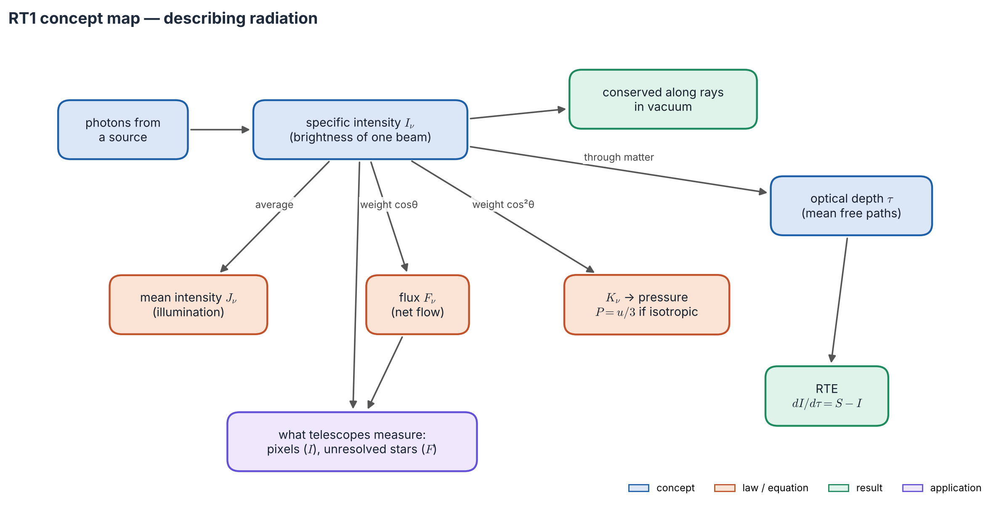
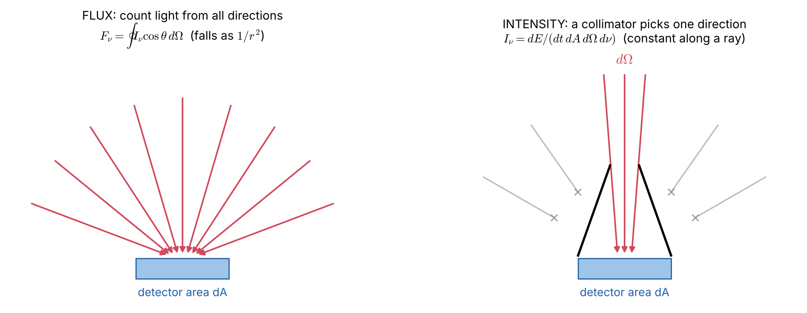

# Lecture RT1 — Radiation and How We Describe It

> **Sources:** A670 *Advanced Astrophysics* Lecture 1; W. Hu, *Astro 305 Set 1*; MIT 8.901 (2019) Lecture 7; G. W. Collins II, *The Fundamentals of Stellar Astrophysics*, Ch. 9.2–9.3; S. Chandrasekhar, *Radiative Transfer* (1950), Ch. I; E. Novotny, *Introduction to Stellar Atmospheres and Interiors* (1973), Ch. 2.1.

*Concept map — read it from the top left. Everything starts with the **specific intensity**, the brightness of one beam. Averaging it over directions gives the mean intensity, the flux and the pressure. Sending it through matter introduces optical depth and leads to the transfer equation.*

## Learning goals

1. Say in words what radiative transfer is and why astronomy depends on it.
2. Tell intensity apart from flux, and explain why intensity does not fall with distance.
3. Build $J_\nu$, $F_\nu$ and $K_\nu$ from $I_\nu$ and give the physical meaning of each.
4. Read the transfer equation $dI_\nu/d\tau_\nu = S_\nu - I_\nu$ term by term.

## The five big ideas of this lecture

1. **Radiative transfer is photon bookkeeping.** Follow one beam of light. Along the way matter *removes* photons (absorption, scattering out of the beam) and *adds* photons (emission, scattering into the beam). The transfer equation is this account: *change of the beam = gains − losses*.
2. **Intensity is the brightness of one beam.** It is what one camera pixel measures when it looks at an extended object.
3. **Intensity is conserved in empty space.** A lamp twice as far away delivers four times less energy, but it also looks four times smaller in area, so each patch of it looks equally bright.
4. **Flux is net flow.** It adds up the intensity from all directions, weighted by how squarely each beam crosses the surface. Light that is the same in all directions (isotropic) carries no net flux: a star shines only because its light is slightly *anisotropic*.
5. **Optical depth is distance measured in "fog units".** On a foggy day with 50 m visibility, an object 50 m away is at $\tau \approx 1$; at 500 m, $\tau \approx 10$, and it is gone. What we can see is set by $\tau$, not by kilometres.

---

## 1.1 What radiative transfer does

Almost all we know about the Universe beyond the Solar System arrives as **photons** that have been emitted, absorbed and scattered by atoms, ions, electrons, molecules and dust. Radiative transfer (RT) connects the **physical state** of the gas ($T$, $\rho$, composition, velocity) with the **spectrum** we record.

*Figure 1.1 — A beam enters a medium. Absorption ($\alpha_\nu$) removes energy, emission ($j_\nu$) adds energy, and scattering does both by redirecting photons. We observe what comes out.*

The same theory is used in two directions:

| Problem | Given | Find | Example |
|---|---|---|---|
| **Forward (modelling)** | $T(z)$, $\rho(z)$, composition | the emergent spectrum | a synthetic stellar spectrum |
| **Inverse (diagnostics)** | the observed spectrum | $T$, $\rho$, abundances | an abundance analysis |

## 1.2 Specific intensity: the brightness of one beam

*Figure 1.2 — Energy $dE$ crosses an area $dA$, tilted by $\theta$ from the beam direction, into a small cone $d\Omega$, in frequency interval $d\nu$ and time $dt$.*

$$
\boxed{\;dE = I_\nu\;\cos\theta\;dA\;d\Omega\;d\nu\;dt\;}
\qquad [I_\nu] = \text{W m}^{-2}\,\text{Hz}^{-1}\,\text{sr}^{-1}.
$$

**In words:** $I_\nu$ is energy per second, per square metre *facing the beam* (hence $\cos\theta$), per hertz, per steradian of sky. The **steradian** is the two-dimensional angle: the whole sky is $4\pi$ sr, and the Sun seen from Earth covers $6.8\times10^{-5}$ sr.

Per unit wavelength, $I_\lambda = (c/\lambda^2)I_\nu$, and $\nu I_\nu = \lambda I_\lambda$. A spectrum's peak therefore sits at different places in the two representations.

*Figure 1.3 — Left: a bare detector collects light from every direction, each beam weighted by $\cos\theta$; that is the **flux**. Right: a collimator (or one telescope pixel) admits only a narrow cone; that is the **intensity**.*

## 1.3 Why intensity does not fall with distance

*Figure 1.4 — The flux from the Sun falls as $r^{-2}$, and so does the solid angle it covers. Their ratio, the intensity, stays fixed.*

**Proof in two lines.** Take two small areas $dA_1$, $dA_2$ a distance $r$ apart, facing each other. The light crossing both leaves $dA_1$ into $d\Omega_1 = dA_2/r^2$ and arrives at $dA_2$ from $d\Omega_2 = dA_1/r^2$. With no matter in between, the energies are equal:
$$I_1\,dA_1\frac{dA_2}{r^2} = I_2\,dA_2\frac{dA_1}{r^2}\;\Rightarrow\; I_1 = I_2,\qquad \frac{dI_\nu}{ds}=0 \text{ in vacuum.}$$

**Consequence:** a resolved object's surface brightness does not depend on its distance. (In an expanding Universe, $I_\nu/\nu^3$ is the conserved quantity, which is why surface brightness dims as $(1+z)^{-4}$.)

## 1.4 Moments: replacing directions by averages

Following $I_\nu$ in every direction is hard, so we use direction averages. With $\mu = \cos\theta$ and a plane-parallel field (no dependence on azimuth):

| Moment | Definition | Plane-parallel form | Physical meaning |
|---|---|---|---|
| $J_\nu$ (0th) | $\frac{1}{4\pi}\oint I_\nu\,d\Omega$ | $\frac12\int_{-1}^1 I_\nu\,d\mu$ | how strongly a point is bathed in light |
| $F_\nu$ (1st) | $\oint I_\nu\cos\theta\,d\Omega$ | $2\pi\int_{-1}^1 I_\nu\mu\,d\mu$ | net energy flow |
| $H_\nu$ (1st) | $F_\nu/4\pi$ | $\frac12\int_{-1}^1 I_\nu\mu\,d\mu$ | the "Eddington flux" |
| $K_\nu$ (2nd) | $\frac{1}{4\pi}\oint I_\nu\cos^2\theta\,d\Omega$ | $\frac12\int_{-1}^1 I_\nu\mu^2\,d\mu$ | momentum flow: pressure $P_\nu = 4\pi K_\nu/c$ |

The energy density is $u_\nu = 4\pi J_\nu/c$.

> **Three different "fluxes" in the literature** (Collins §9.3b): the physical flux $F_\nu$, the Eddington flux $H_\nu = F_\nu/4\pi$ and the "astrophysical flux" $\mathcal F_\nu = F_\nu/\pi$. In this course $F$ is always the physical flux, and $F = \sigma T_{\rm eff}^4$.

**Three special fields to remember:**

- **Isotropic** ($I$ the same in all directions): $J = I$, $F = 0$, $K = J/3$, so $P = u/3$. Light is intense but there is no net flow, as deep inside a star.
- **One-sided** (uniform $I$ outward, nothing inward, as at a stellar surface): $J = I/2$, $F = \pi I$, $K = I/6$. This is where the factor $\pi$ in $F = \pi B = \sigma T^4$ comes from: slanted beams cross the surface less efficiently.
- **Linear in $\mu$** ($I = I_0 + I_1\mu$): $J = I_0$, $H = I_1/3$, $K = I_0/3$. The field carries a flux, yet $K = J/3$ still holds exactly. This is the basis of the Eddington approximation (Lecture RT4).

**Flux from a star.** A sphere of radius $R$ with uniform surface intensity $I$, seen from distance $d$, gives $F = \pi I (R/d)^2$. At its surface $F = \pi I$, far away $F\propto d^{-2}$, while $I$ itself never changes.

## 1.5 Into matter: optical depth and the transfer equation (preview)

Inside matter, a beam loses a fixed *fraction* of itself per unit length (absorption) and gains energy from the gas whether or not light is present (emission):

$$
\boxed{\;\frac{dI_\nu}{ds} = -\alpha_\nu I_\nu + j_\nu\;}
$$

| Symbol | Name | Units |
|---|---|---|
| $\alpha_\nu = n\sigma_\nu = \rho\kappa_\nu$ | absorption coefficient | m$^{-1}$ |
| $\kappa_\nu$ | opacity (per unit mass) | m$^2$ kg$^{-1}$ |
| $j_\nu$ | emission coefficient | W m$^{-3}$ Hz$^{-1}$ sr$^{-1}$ |

Measuring distance in mean free paths, $d\tau_\nu = \alpha_\nu\,ds$, and defining the **source function** $S_\nu = j_\nu/\alpha_\nu$ gives the form used everywhere:
$$\frac{dI_\nu}{d\tau_\nu} = S_\nu - I_\nu .$$

**Read it as a law of relaxation:** if the beam is brighter than $S_\nu$ it fades; if fainter, it brightens. After a few optical depths the beam "forgets" where it came from and takes the value of $S_\nu$. Lecture RT2 says what $S_\nu$ is made of; Lecture RT3 solves the equation.

**TE, LTE and NLTE in one sentence each.** In **TE** (a closed oven) matter and light share one temperature, and $I_\nu = B_\nu$. In **LTE**, collisions keep the *matter* at the local temperature, so $S_\nu = B_\nu(T)$, while the *light* streams freely and $I_\nu \ne B_\nu$. In **NLTE**, collisions are too rare and the radiation field itself sets the atomic populations. Course B (Lecture SA1) develops this with examples.

**Where RT is used:** stellar atmospheres (spectra, $T_{\rm eff}$, abundances), the ISM (extinction $A_V = 1.086\,\tau_V$, the 21-cm line), H II regions and planetary nebulae, planetary and exoplanet atmospheres, accretion disks and AGN, the CMB, and stellar interiors (the diffusion limit and the Rosseland mean).

---

## Worked example 1.1 — The Sun: from luminosity to intensity

*Given $L_\odot = 3.828\times10^{26}$ W, $R_\odot = 6.957\times10^8$ m and 1 AU $= 1.496\times10^{11}$ m, find the surface flux, $T_{\rm eff}$, the mean intensity of the disk, and the solar constant computed two ways.*

**Solution.**

- $F_\odot = L_\odot/4\pi R_\odot^2 = 6.294\times10^7$ W m$^{-2}$, so $T_{\rm eff} = (F/\sigma)^{1/4} = 5772$ K.
- $\bar I = F/\pi = 2.003\times10^7$ W m$^{-2}$ sr$^{-1}$.
- The Sun's solid angle at 1 AU is $\Omega_\odot = \pi(R_\odot/\text{AU})^2 = 6.794\times10^{-5}$ sr. Intensity is conserved, so $F_\oplus = \bar I\,\Omega_\odot = 1361$ W m$^{-2}$. The inverse-square law gives the same: $F_\odot(R_\odot/\text{AU})^2 = 1361$ W m$^{-2}$.

## Worked example 1.2 — Extinction through a slab

*A beam crosses a slab of thickness $L = 10^{12}$ m with $\alpha_\nu = 2\times10^{-12}$ m$^{-1}$ and no emission. What fraction emerges, and what is the extinction in magnitudes?*

**Solution.** $\tau_\nu = \alpha_\nu L = 2$, so the transmitted fraction is $e^{-2} = 0.135$. In magnitudes, $A = 2.5\log_{10}e^{\tau} = 1.086\,\tau = 2.17$ mag.

## Worked example 1.3 — Radiation pressure at the Sun's centre

*At the centre, $T_c = 1.57\times10^7$ K and $P_{\rm gas}\approx 2.3\times10^{16}$ Pa. Find $P_{\rm rad}$.*

**Solution.** The radiation there is in TE and isotropic, so $P_{\rm rad} = u/3 = aT^4/3$ with $a = 4\sigma/c = 7.566\times10^{-16}$ J m$^{-3}$ K$^{-4}$. This gives $P_{\rm rad} = 1.5\times10^{13}$ Pa, only $7\times10^{-4}$ of the gas pressure. Radiation pressure matters only in very massive stars.

---

## Common misconceptions

1. **"Intensity falls as $1/r^2$."** Flux does; intensity (surface brightness) does not, in empty space.
2. **"Zero flux means no light."** An isotropic field can be extremely intense and still carry no net flux.
3. **"Optical depth is a distance."** It counts mean free paths. One kilometre of air and one millimetre of stellar interior can have wildly different $\tau$.
4. **"In LTE the intensity equals the Planck function."** In LTE the *source function* equals $B_\nu(T)$; the intensity follows from the transfer equation and generally differs from $B_\nu$.

## Lecture summary

- RT is bookkeeping of photons gained and lost along a beam.
- $I_\nu$ is the brightness of one beam, and it is conserved along rays in vacuum.
- $J_\nu$, $F_\nu$ and $K_\nu$ are the 0th, 1st and 2nd moments: illumination, net flow and pressure. Isotropic light has $F = 0$ and $P = u/3$; a uniformly bright surface emits $F = \pi I$.
- In matter, $dI_\nu/d\tau_\nu = S_\nu - I_\nu$: the beam relaxes toward the source function over about one optical depth.

---

## Exam questions and answers — Lecture RT1

**Q1.** Prove that $I_\nu$ is constant along a ray in vacuum. Hence explain why the Sun's disk looks equally bright from Earth and from Mars.

> **A1.** Energy conservation between two areas $dA_1$, $dA_2$ a distance $r$ apart gives $I_1dA_1(dA_2/r^2) = I_2dA_2(dA_1/r^2)$, so $I_1 = I_2$. From Mars (1.52 AU) the flux is lower by $1/1.52^2 = 0.43$, but the Sun's solid angle is smaller by the same factor. The brightness per steradian, $I_\nu$, is unchanged.

**Q2.** A surface emits $I(\mu) = I_0$ for $\mu>0$ and nothing for $\mu<0$. Find $J$, $F$ and $K$ at the surface. Why is $F = \pi I_0$ and not $2\pi I_0$?

> **A2.** $J = \frac12\int_0^1 I_0\,d\mu = I_0/2$; $F = 2\pi\int_0^1 I_0\mu\,d\mu = \pi I_0$; $K = \frac12\int_0^1 I_0\mu^2\,d\mu = I_0/6$. The outward hemisphere is $2\pi$ sr, but each beam is weighted by $\cos\theta$, the projected area it crosses; the average of $\mu$ over the hemisphere is $1/2$. Note $J = 2H$, Eddington's surface condition (Lecture SA4).

**Q3.** What is the difference between TE and LTE? Is the statement "in LTE, $I_\nu = B_\nu$" true?

> **A3.** In TE matter and radiation are both in equilibrium at one temperature: $I_\nu = J_\nu = B_\nu(T)$, isotropic, with no net flux. In LTE only the *matter* is in equilibrium at the local $T$ (Maxwell, Boltzmann and Saha hold), so $j_\nu = \alpha_\nu B_\nu$ and $S_\nu = B_\nu(T)$. The statement is **false**: at a stellar surface, for instance, $I_\nu(\mu<0) = 0$ while $B_\nu \ne 0$.

**Q4.** A medium has $\tau_\nu = 0.01$ at one frequency and $\tau_\nu = 100$ at another. Describe what an observer sees at each.

> **A4.** At $\tau = 0.01$ (optically thin) 99 % of the background passes, and the medium adds only $\approx\tau S_\nu$: we see through it, and its own glow is faint and proportional to its column density. At $\tau = 100$ (optically thick) the background is blocked ($e^{-100}$), and we see only the medium's outer layers, $I_\nu \approx S_\nu$ evaluated near $\tau \approx 1$.
