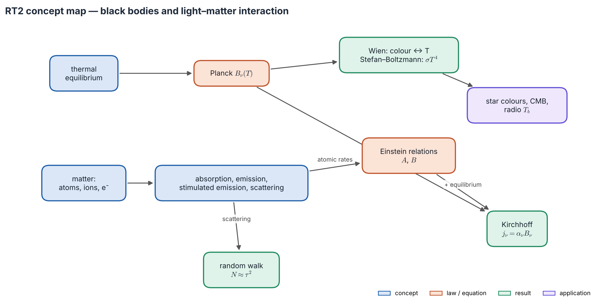
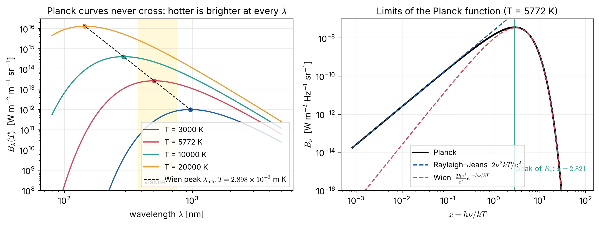
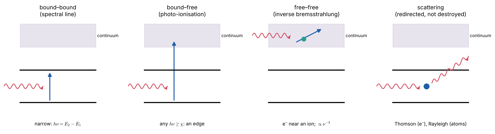
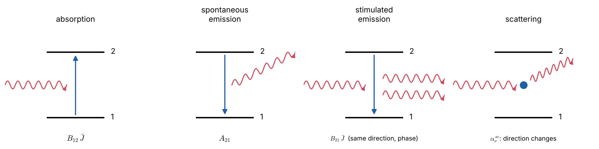
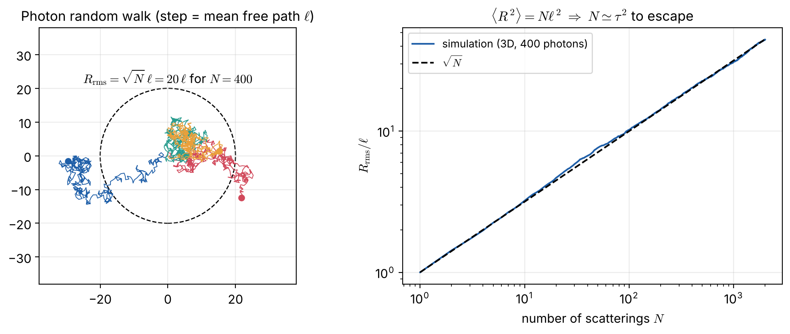

# Lecture RT2 — Black Bodies and How Light Interacts with Matter

> **Sources:** MIT 8.901 Lec. 7 (Stefan–Boltzmann, Wien, $\alpha_\nu = n\sigma_\nu = \rho\kappa_\nu$); Hu, *Astro 305 Set 1* (emission, absorption, scattering, random walk); Collins Ch. 9.1–9.2; Chandrasekhar Ch. I §§7–11; Novotny Ch. 2.2; Rybicki & Lightman Ch. 1.

*Concept map — two threads meet in this lecture. The top thread is **light in equilibrium**: the Planck function and its laws. The bottom thread is **matter**: the processes by which atoms absorb, emit and scatter. Einstein's relations tie the two together, and Kirchhoff's law follows.*

## Learning goals

1. Explain why the Planck spectrum depends only on temperature, and use Wien's and Stefan–Boltzmann's laws.
2. Name the four light–matter interactions and the coefficients $\alpha_\nu$, $j_\nu$, $\sigma_\nu$, $\kappa_\nu$ that describe them.
3. Derive the Einstein relations and the stimulated-emission correction.
4. Distinguish absorption from scattering, and write $S_\nu = \varepsilon B_\nu + (1-\varepsilon)J_\nu$.
5. Estimate photon escape times with the random walk.

## The big ideas in plain words

**A black body is a perfect absorber, and therefore a perfect emitter.** The best example is a closed oven with a tiny hole. Light entering the hole is absorbed long before it can come out, so the hole looks black when the oven is cold. When the oven is hot, the light leaking out has a spectrum that depends **only on temperature**, not on what the oven is made of. That universal spectrum is the Planck function $B_\nu(T)$.

**Why the Planck curve rises and falls.** At higher frequency there are more "slots" (modes) for photons, growing as $\nu^2$. But each photon costs $h\nu$, and the thermal energy $kT$ cannot pay for expensive photons: their occupation falls as $e^{-h\nu/kT}$. Rising slots times falling occupation gives a peak.

**Colour is a thermometer, brightness a steep one.** The peak moves to shorter wavelength as $T$ rises (Wien). Total power grows as $T^4$ (Stefan–Boltzmann): double the temperature and the power rises sixteen-fold.

**Matter talks to light in four ways** (Figure 2.2): a photon is absorbed by an atom; an excited atom emits spontaneously; a passing photon *stimulates* an excited atom to emit a twin; or a photon simply bounces off (scattering).

**Sponge versus pinball.** In *true absorption* the photon's energy becomes heat in the gas, and the gas later emits according to its temperature. In *scattering* the photon only changes direction, keeping its energy; it does not "know" the gas temperature. The number $\varepsilon$ is the probability that an interaction is a true absorption.

**Light leaves stars by a drunkard's walk.** After $N$ random steps a photon is only $\sqrt N$ steps from where it started, so escaping from optical depth $\tau$ takes about $\tau^2$ steps.

---

## 2.1 The Planck function

Radiation inside an opaque cavity in thermodynamic equilibrium (*Hohlraum* radiation) is isotropic, unpolarised, and depends only on $T$:
$$\boxed{\;B_\nu(T) = \frac{2h\nu^3}{c^2}\,\frac{1}{e^{h\nu/kT}-1}\;}
\qquad
\boxed{\;B_\lambda(T) = \frac{2hc^2}{\lambda^5}\,\frac{1}{e^{hc/\lambda kT}-1}\;}$$

**Derivation in three steps.**

1. Count the modes: the number per unit volume in $d\nu$ is $8\pi\nu^2/c^3$, including two polarisations.
2. Find the occupation: photons are bosons with zero chemical potential, so $\bar n = 1/(e^{h\nu/kT}-1)$.
3. Combine: $u_\nu = (8\pi\nu^2/c^3)\,h\nu\,\bar n$. For isotropic light $u_\nu = 4\pi I_\nu/c$ (Lecture RT1), so $I_\nu = B_\nu$.

*Figure 2.1 — Left: $B_\lambda$ at four temperatures, with the Wien peak marked. A hotter body is brighter at **every** wavelength, so Planck curves never cross. Right: the Rayleigh–Jeans and Wien limits.*

| Law | Formula | Meaning |
|---|---|---|
| Rayleigh–Jeans ($h\nu\ll kT$, radio) | $B_\nu\approx 2\nu^2kT/c^2$ | linear in $T$, so radio astronomers quote **brightness temperatures** |
| Wien tail ($h\nu\gg kT$, UV) | $B_\nu\approx(2h\nu^3/c^2)e^{-h\nu/kT}$ | exponentially sensitive to $T$ |
| Wien displacement | $\lambda_{\max}T = 2.898\times10^{-3}$ m K; $h\nu_{\max} = 2.821\,kT$ | colour ↔ temperature; note $\lambda_{\max}\ne c/\nu_{\max}$ |
| Stefan–Boltzmann | $F = \pi B = \sigma T^4$, $\sigma = 2\pi^5k^4/15c^2h^3$ | total power |
| Energy density, pressure | $u = aT^4$, $P = u/3$, $a = 4\sigma/c$ | radiation as a gas |
| Photon gas | $n_\gamma = 2.03\times10^7\,T^3$ m$^{-3}$, $\langle h\nu\rangle = 2.70\,kT$ | |

**Many temperatures, one per question.**

| Temperature | Defined by | Question it answers |
|---|---|---|
| effective $T_{\rm eff}$ | $F = \sigma T_{\rm eff}^4$ | which black body emits the same total flux? |
| brightness $T_b(\nu)$ | $I_\nu = B_\nu(T_b)$ | which black body is equally bright at this $\nu$? |
| colour $T_c$ | the spectral slope | which black body has the same shape? |
| excitation $T_{\rm ex}$ | $n_2/n_1 = (g_2/g_1)e^{-h\nu/kT_{\rm ex}}$ | which $T$ explains these level populations? |

They coincide only for a true black body.

## 2.2 The four interactions

*Figure 2.2 — Where opacity comes from. **Bound–bound:** a narrow line at $h\nu = E_u - E_l$. **Bound–free:** any photon above the ionisation energy, which gives an absorption *edge*. **Free–free:** a free electron absorbs a photon while passing an ion. **Scattering:** the photon is redirected, not destroyed.*

*Figure 2.3 — Absorption, spontaneous emission, stimulated emission and scattering in a two-level atom. Stimulated emission copies the incoming photon exactly, so it acts as **negative absorption**.*

**Coefficients.** The absorption coefficient is the probability per metre that a photon is removed:
$$\boxed{\;\alpha_\nu = n\sigma_\nu = \rho\kappa_\nu\;},\qquad \ell_\nu = 1/\alpha_\nu .$$
Here $\sigma_\nu$ is the *effective target area* of one absorber (an electron has no size, yet $\sigma_T = 6.652\times10^{-29}$ m$^2$), and $\kappa_\nu$ is the opacity per kilogram. The emission coefficient $j_\nu$ is the power emitted per volume, frequency and steradian; for isotropic emission $j_\nu = P_\nu/4\pi$.

**The opacity sources of stars** (details in Lecture SA2):

| Process | Frequency dependence | Where it matters |
|---|---|---|
| bound–bound (lines) | narrow profile $\phi(\nu)$ | spectral lines |
| bound–free | edges, $\propto\nu^{-3}$ above each | Balmer jump; H$^-$ in the Sun |
| free–free | $\propto\nu^{-3}$ (optical), $\nu^{-2}$ (radio) | hot stars, H II regions |
| Thomson scattering | gray | O stars, interiors, disks; $\kappa_{\rm es} = 0.020(1+X)$ m$^2$ kg$^{-1}$ |

## 2.3 Einstein coefficients: linking matter to the Planck function

For a transition $1\leftrightarrow2$ with $h\nu_0 = E_2 - E_1$, weights $g_1, g_2$ and profile $\phi(\nu)$ (with $\int\phi\,d\nu=1$), the rates per unit volume are: spontaneous emission $n_2A_{21}$, absorption $n_1B_{12}\bar J$ and stimulated emission $n_2B_{21}\bar J$, where $\bar J = \int J_\nu\phi\,d\nu$.

**The argument.** In TE, detailed balance holds, the populations are Boltzmann, and $\bar J = B_\nu(T)$ at *every* temperature. That is possible only if
$$\boxed{\;g_1B_{12} = g_2B_{21},\qquad A_{21} = \frac{2h\nu^3}{c^2}B_{21}\;}$$
These are properties of the atom, so they hold out of equilibrium too.

**Macroscopic coefficients and the line source function:**
$$j_\nu = \frac{h\nu}{4\pi}n_2A_{21}\phi,\qquad
\alpha_\nu = \frac{h\nu}{4\pi}n_1B_{12}\Big(1-\frac{g_1n_2}{g_2n_1}\Big)\phi,\qquad
S_\nu = \frac{2h\nu^3}{c^2}\frac{1}{\dfrac{g_2n_1}{g_1n_2}-1}.$$

- The bracket is the **stimulated-emission correction**. If $n_2/g_2 > n_1/g_1$ (an inversion), $\alpha_\nu<0$ and light is amplified: a **maser**.
- With Boltzmann populations at $T$, $S_\nu = B_\nu(T)$ exactly. This is **Kirchhoff's law**, $j_\nu = \alpha_\nu B_\nu$, the foundation of LTE (Lecture SA1).

## 2.4 Scattering and the mixed source function

For coherent, isotropic scattering, energy taken from all directions is re-emitted evenly: $j^{\rm sc}_\nu = \alpha^{\rm sc}_\nu J_\nu$, so $S^{\rm sc}_\nu = J_\nu$. The transfer equation becomes an **integro-differential equation**, because $J$ depends on $I$ in all directions.

With both processes the coefficients add, and
$$\boxed{\;S_\nu = \varepsilon_\nu B_\nu + (1-\varepsilon_\nu)J_\nu,\qquad \varepsilon_\nu = \frac{\alpha^a_\nu}{\alpha^a_\nu+\alpha^{\rm sc}_\nu}\;}$$
where $1-\varepsilon$ is the single-scattering albedo. This one equation is the seed of all non-LTE physics (Lectures RT4 and SA3).

## 2.5 Random walk and thermalisation

*Figure 2.4 — Left: random photon paths; the dashed circle has radius $\sqrt N\ell$. Right: a 3D simulation confirms $R_{\rm rms} = \sqrt N\,\ell$.*

Random unit steps give $\langle R^2\rangle = N\ell^2$, so escaping from optical depth $\tau$ takes $N\approx\tau^2$ steps (or $\approx\tau$ if $\tau<1$). If each interaction destroys the photon with probability $\varepsilon$, it survives about $1/\varepsilon$ steps and wanders a net optical distance $\tau_{\rm th}\approx 1/\sqrt\varepsilon$: the **thermalisation depth**, a key idea in Lecture RT4.

---

## Worked example 2.1 — The cosmic microwave background

*$T = 2.725$ K. Find the peaks of $B_\nu$ and $B_\lambda$ and the photon density.*

**Solution.**

- $\nu_{\max} = 5.879\times10^{10}\times2.725 = 160$ GHz.
- $\lambda_{\max} = 2.898\times10^{-3}/2.725 = 1.06$ mm. Note that $c/\nu_{\max} = 1.87$ mm is a different number.
- $n_\gamma = 2.03\times10^7\times2.725^3 = 4.1\times10^8$ m$^{-3}$, which is **411 photons per cm³**.

## Worked example 2.2 — Brightness temperature of a radio source

*At 1.4 GHz a source has $I_\nu = 2.0\times10^{-19}$ W m$^{-2}$ Hz$^{-1}$ sr$^{-1}$. Find $T_b$.*

**Solution.** $h\nu/k = 0.067$ K, so Rayleigh–Jeans applies and $T_b = c^2I_\nu/(2k\nu^2) = 332$ K. If it is an optically thin H II region with $T_e = 8000$ K, then $T_b\approx T_e\tau$ (Lecture RT3), so $\tau \approx 0.04$.

## Worked example 2.3 — How long does light take to leave the Sun?

*Uniform Sun, fully ionised, $X = 0.7$, Thomson scattering only.*

**Solution.**

1. $\bar\rho = M_\odot/(\frac43\pi R_\odot^3) = 1410$ kg m$^{-3}$ and $n_e = \bar\rho(1+X)/(2m_H) = 7.2\times10^{29}$ m$^{-3}$.
2. $\ell = 1/(n_e\sigma_T) = 2.1$ cm, so $\tau = R_\odot/\ell = 3.3\times10^{10}$.
3. $t = N\ell/c = R_\odot^2/(\ell c) = 7.7\times10^{10}$ s $\approx$ **2400 yr**, against 2.3 s for straight flight.

(Real opacities in the core are higher, giving $10^4$–$10^5$ yr.)

## Worked example 2.4 — When is stimulated emission important?

*Compare the correction $1-e^{-h\nu/kT}$ for the 21-cm line at 100 K and for H$\alpha$ in the Sun.*

**Solution.** For 21 cm, $h\nu/kT = 6.8\times10^{-4}$: stimulated emission cancels **99.93 %** of the absorption. For H$\alpha$ at 5772 K, $h\nu/kT = 3.8$, and the factor is 0.98, only a 2 % correction. The rule: stimulated emission matters whenever $h\nu \lesssim kT$, i.e. in the radio.

---

## Common misconceptions

1. **"Black bodies look black."** Only when cold. The Sun is very nearly a black body.
2. **"Brightness temperature is the real temperature."** Only for an optically thick thermal source. Thin gas has $T_b\approx\tau T < T$; masers can have $T_b$ far above any physical temperature.
3. **"Scattering removes energy from the radiation."** It takes photons from one beam and puts them in others; no energy is lost to the gas.
4. **"A photon from the core reaches us directly."** Energy random-walks out over thousands of years, absorbed and re-emitted countless times.

## Lecture summary

- $B_\nu(T)$ is the spectrum of light in equilibrium. Wien: $\lambda_{\max}T = 2.898$ mm K. Stefan–Boltzmann: $F = \sigma T^4$.
- Matter interacts through bound–bound, bound–free, free–free and scattering processes, described by $\alpha_\nu = n\sigma_\nu = \rho\kappa_\nu$ and $j_\nu$.
- Einstein relations are atomic properties. With Boltzmann populations they give Kirchhoff's law, $S_\nu = B_\nu$.
- Stimulated emission is negative absorption; it matters in the radio and makes masers possible.
- Scattering gives $S = J$; mixing gives $S = \varepsilon B + (1-\varepsilon)J$; escape takes $\sim\tau^2$ steps.

---

## Exam questions and answers — Lecture RT2

**Q1.** Derive the Planck function from the density of photon states and Bose–Einstein statistics, and show that its peak lies at $h\nu = 2.821\,kT$.

> **A1.** Modes per unit volume per $d\nu$: $8\pi\nu^2/c^3$. Mean energy per mode: $h\nu/(e^{h\nu/kT}-1)$. So $u_\nu = (8\pi h\nu^3/c^3)/(e^{h\nu/kT}-1)$ and $B_\nu = cu_\nu/4\pi$. With $x = h\nu/kT$, $B_\nu\propto x^3/(e^x-1)$; setting $d/dx = 0$ gives $3(1-e^{-x}) = x$, with root $x = 2.821$ (iterate $x_{n+1} = 3(1-e^{-x_n})$).

**Q2.** Derive the Einstein relations. Why do they hold even when the gas is not in TE?

> **A2.** In TE, $n_1B_{12}\bar J = n_2A_{21} + n_2B_{21}\bar J$ with Boltzmann populations gives $\bar J = (A_{21}/B_{21})/[(g_1B_{12}/g_2B_{21})e^{h\nu/kT}-1]$. This must equal $B_\nu(T)$ at every $T$, which requires $g_1B_{12} = g_2B_{21}$ and $A_{21} = (2h\nu^3/c^2)B_{21}$. The coefficients depend only on atomic wavefunctions, not on the environment, so they hold everywhere.

**Q3.** Derive $S_\nu = \varepsilon B_\nu + (1-\varepsilon)J_\nu$ and explain the meaning of $\varepsilon$.

> **A3.** $j = \alpha^aB + \alpha^{\rm sc}J$ (thermal emission by Kirchhoff, plus scattering) and $\alpha = \alpha^a + \alpha^{\rm sc}$. Dividing gives the result, with $\varepsilon = \alpha^a/(\alpha^a + \alpha^{\rm sc})$ the probability that an interaction destroys the photon (turns it into heat).

**Q4.** A cloud has $\tau = 100$ for pure scattering. About how many scatterings does a photon undergo before escaping, and how far does it travel in total?

> **A4.** $N\approx\tau^2 = 10^4$. The total path is $N\ell = \tau^2\ell = 100\,L$, where $L = \tau\ell$ is the cloud size, so the escape time is $100\,L/c$.
