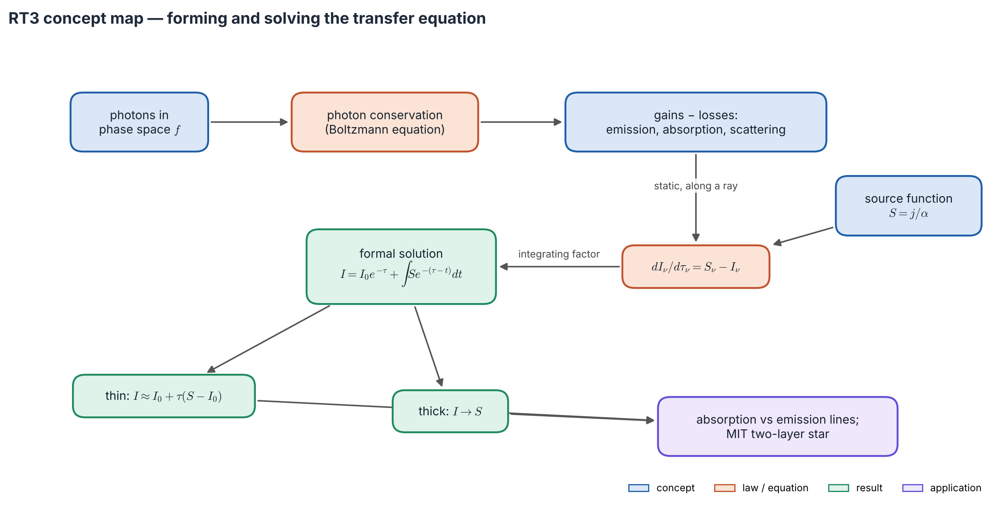
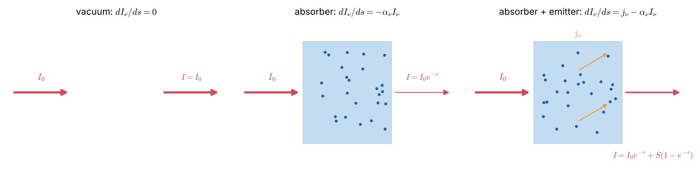
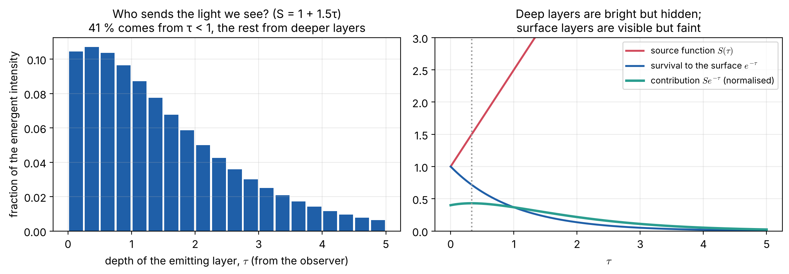
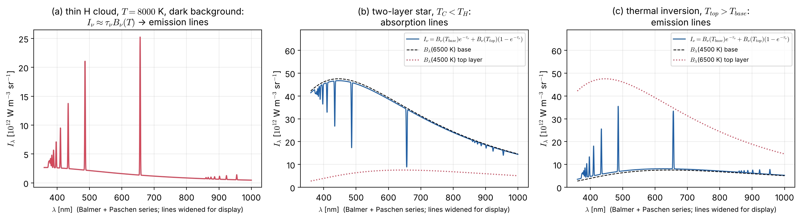

# Lecture RT3 — The Transfer Equation: Where It Comes From and How to Solve It

> **Sources:** MIT 8.901 Lec. 7 §§7.1–7.3 (the RTE built in three steps; Kirchhoff's law for thick and thin lumps; thin H cloud; two-layer star; thermal inversions); Hu, *Astro 305 Set 1* (Liouville's theorem, formal solution); Collins Ch. 9.2 (Boltzmann equation → general RTE, redistribution function); Chandrasekhar Ch. I; Novotny Ch. 2.3–2.4; Rybicki & Lightman Ch. 1.

*Concept map — the top row **forms** the equation: photons are particles, their number is conserved, and matter adds and removes them. The middle row writes it along a ray. The bottom row **solves** it with an integrating factor and reads off the thin and thick limits, which explain why spectra show absorption or emission lines.*

## Learning goals

1. Derive the transfer equation from photon conservation and name every gain and loss term.
2. Know which assumption leads to which special form (static, ray, plane-parallel, spherical).
3. Derive the formal solution and interpret it as "light from every layer, dimmed by the layers in front".
4. Solve the uniform slab, and use it to explain absorption lines, emission lines and thermal inversions.

## The big ideas in plain words

**The equation is just conservation.** Photons are particles. In empty space they fly straight and nothing changes. Matter adds photons (emission, scattering *into* the beam) and removes them (absorption, scattering *out of* the beam). Rate of change along the path = gains − losses. That is the whole equation.

**The equation is a tug of war.** If the beam is brighter than the source function $S_\nu$, absorption wins and the beam fades; if fainter, emission wins and it brightens. After about one optical depth the beam forgets its origin and approaches $S_\nu$.

**The solution is a foggy street of lamps.** Looking down a foggy street, the light reaching you is the sum of every lamp, each dimmed by the fog between it and you. Near lamps dominate; far lamps fade as $e^{-\tau}$. So we "see" about one optical depth into anything (Figure 3.4).

**Thin versus thick.** A thin medium ($\tau\ll1$) is a light mist: you see through it, and its own glow is proportional to how much gas there is. A thick medium ($\tau\gg1$) is a wall: you see only its surface, glowing at $S_\nu$.

**Lines are thermometers of height.** At line frequencies the gas is more opaque, so we see *higher* layers. If the temperature falls outward, the line looks darker than the continuum: an absorption line. If it rises outward (a chromosphere), the line is in emission.

---

## 3.1 Forming the equation

### Step 1 — describe the photons

Count photons in phase space: $dN = f(\mathbf r,\mathbf p,t)\,d^3x\,d^3p$. With $p = h\nu/c$, the energy crossing $dA$ in $dt$ is $h\nu f\,(c\,dt\,dA\cos\theta)(h^3\nu^2/c^3)\,d\nu\,d\Omega$. Comparing with the definition of $I_\nu$:
$$\boxed{\;I_\nu = \frac{h^4\nu^3}{c^2}\,f\;}\qquad\text{(Collins eq. 9.2.8)}$$
In equilibrium, $f = (2/h^3)/(e^{h\nu/kT}-1)$, and this gives exactly $B_\nu$, a useful check.

### Step 2 — conserve them

Photon number changes only through interactions with matter (the Boltzmann equation):
$$\frac{\partial f}{\partial t} + c\,\hat{\mathbf n}\cdot\nabla f = \Big(\frac{\partial f}{\partial t}\Big)_{\rm coll}.$$
With no matter the right side is zero: $f$, and hence $I_\nu/\nu^3$, is constant along a ray (Liouville's theorem, Lecture RT1).

### Step 3 — write the gains and losses

*Figure 3.1 — A pencil of light crosses a small cylinder. Losses: true absorption and scattering out of the beam. Gains: thermal emission and scattering into the beam from other directions.*

| Process | Term in $dI_\nu/ds$ | Comment |
|---|---|---|
| true absorption | $-\kappa_\nu\rho I_\nu$ | energy goes into the gas |
| stimulated emission | $+\kappa^{\rm stim}_\nu\rho I_\nu$ | $\propto I$, so it is folded into $\kappa_\nu$ as negative absorption |
| thermal emission | $+j_\nu$ | in LTE $j_\nu = \kappa_\nu\rho B_\nu$ (Kirchhoff) |
| scattering out | $-\sigma_\nu\rho I_\nu$ | photon redirected, not destroyed |
| scattering in | $+\frac{\sigma_\nu\rho}{4\pi}\iint R(\nu',\nu;\hat{\mathbf n}',\hat{\mathbf n})\,I_{\nu'}\,d\Omega'd\nu'$ | the redistribution function $R$ says where photons go |

Together they give the **general transfer equation** (Collins eq. 9.2.23):
$$\boxed{\;\frac1c\frac{\partial I_\nu}{\partial t}+\hat{\mathbf n}\cdot\nabla I_\nu = \chi_\nu\,(S_\nu - I_\nu)\;},\qquad \chi_\nu = (\kappa_\nu+\sigma_\nu)\rho,$$
and, for coherent isotropic scattering (where the in-scattering term is just $\sigma_\nu\rho J_\nu$), $S_\nu = \varepsilon_\nu B_\nu + (1-\varepsilon_\nu)J_\nu$.

**Why it is hard:** the losses are local, but in-scattering depends on light arriving from *every* direction, so the equation is integro-differential. Most of the history of the subject (Lecture RT6) is the search for ways around this.

### Step 4 — choose the geometry

*Figure 3.2 — Each simplification adds one assumption. Knowing which one was made tells you when a formula is valid.*

| Situation | Form | Assumption |
|---|---|---|
| static | $\hat{\mathbf n}\cdot\nabla I_\nu = \chi_\nu(S_\nu-I_\nu)$ | light-crossing time ≪ evolution time |
| along a ray | $dI_\nu/d\tau_\nu = S_\nu - I_\nu$ | $d\tau_\nu = \chi_\nu\,ds$ |
| plane-parallel | $\mu\,dI_\nu/d\tau_\nu = I_\nu - S_\nu$ | thin horizontal layers; $\tau$ measured *inward* |
| spherical | $\mu\,\partial_rI + \frac{1-\mu^2}{r}\partial_\mu I = \chi(S-I)$ | extended atmospheres, winds |
| moving | comoving frame, Doppler-shifted $\chi_\nu$ | winds, supernovae (Lecture SA5) |

The extra spherical term exists because a straight ray changes its angle to the local radius as it travels; it vanishes when $r$ is large compared with the atmosphere's thickness.

**Energy and momentum.** Integrating over angle and frequency gives $\partial_t u + \nabla\cdot\mathbf F = 4\pi\int(j_\nu - \kappa_\nu\rho J_\nu)\,d\nu$. If matter emits exactly what it absorbs (**radiative equilibrium**), the flux is constant: the basis of the gray atmosphere (Lecture SA4). The next moment gives the **radiation force** $\mathbf f_{\rm rad} = \frac1c\int\chi_\nu\mathbf F_\nu\,d\nu$, which drives hot-star winds.

## 3.2 Solving it: the formal solution

*Figure 3.3 — After MIT 8.901 Fig. 9: (left) vacuum, $dI/ds = 0$; (centre) pure absorption, $I = I_0e^{-\tau}$; (right) absorption plus emission.*

Multiply $dI_\nu/d\tau_\nu + I_\nu = S_\nu$ by the integrating factor $e^{\tau_\nu}$ and integrate:
$$\boxed{\;I_\nu(\tau_\nu) = I_\nu(0)\,e^{-\tau_\nu} + \int_0^{\tau_\nu}S_\nu(t)\,e^{-(\tau_\nu-t)}\,dt\;}$$

**Read it as:** the background dimmed by the whole column, plus light from each layer $t$, dimmed by the gas between it and the observer.

*Figure 3.4 — Who sends the light we see? For $S = 1 + 1.5\tau$, deep layers are bright but hidden, surface layers are visible but faint; their product, the **contribution function** $S\,e^{-\tau}$, peaks near $\tau \approx 1/3$. About 41 % of the emergent light comes from $\tau<1$, and the rest from deeper.*

**Why "formal"?** If $S_\nu$ depends on $I_\nu$ (scattering, NLTE), this is an integral equation, not an answer. In **LTE without scattering**, $S_\nu = B_\nu(T)$ is known once $T(\tau)$ is known, and the formal solution *is* the solution.

## 3.3 The uniform slab and why lines exist

For constant $S$:
$$\boxed{\;I_\nu = I_\nu(0)\,e^{-\tau_\nu} + S_\nu\big(1-e^{-\tau_\nu}\big)\;}$$

*Figure 3.5 — Left: whatever the starting intensity, $I\to S$ within a few optical depths. Right: if the line centre is more opaque than the wings, a background brighter than $S$ gives an absorption line, and a fainter one gives an emission line.*

| Limit | Result | Meaning |
|---|---|---|
| thin, $\tau\ll1$ | $I\approx I_0 + \tau(S - I_0)$ | the change is proportional to the column density |
| thick, $\tau\gg1$ | $I\to S$ | the background is forgotten |
| thick and LTE | $I = B_\nu(T)$ | only an **isothermal** thick body radiates as a black body |

**Kirchhoff's three laws of spectroscopy, explained.** (1) A hot, opaque body gives a continuum. (2) A thin gas on a dark sky gives $I = \tau_\nu B_\nu$: bright only where $\tau_\nu$ is large, so **emission lines**. (3) Gas in front of a brighter background ($I_0 > S$) pulls the opaque frequencies down toward $S$: **absorption lines**. The real criterion is *background versus source function*, not "cold versus hot".

**MIT's toy stars** (Figure 3.6) put this to work:

- (a) a hot, thin hydrogen cloud on a dark sky shows emission lines at the Rydberg wavelengths, $1/\lambda = R_{\rm H}(1/n_1^2 - 1/n_2^2)$;
- (b) a thick base at $T_H$ under a cooler thin layer at $T_C$ gives $I_\nu = B_\nu(T_H)e^{-\tau_\nu} + B_\nu(T_C)(1-e^{-\tau_\nu})$. In the continuum we see the hot base; at the lines we see the cool layer. The result is absorption lines;
- (c) a **thermal inversion** ($T_C > T_H$) turns the same lines into emission lines, as in the solar chromosphere, planetary stratospheres and hot Jupiters.

*Figure 3.6 — The MIT 8.901 toy models computed exactly: (a) thin 8000 K cloud, emission lines; (b) 6500 K base under a 4500 K layer, absorption lines; (c) inverted case, emission lines. Line widths are exaggerated.*

**Radio H II regions.** For free–free absorption, $T_b = T_e(1-e^{-\tau_\nu})$ with $\tau_\nu\propto\nu^{-2.1}$. With $T_e = 8000$ K, $T_b$ is 80, 761, 5057, 7602 and 8000 K for $\tau$ = 0.01, 0.1, 1, 3 and 10. The spectrum is a black body ($\propto\nu^2$) at low frequency and almost flat ($\propto\nu^{-0.1}$) at high frequency, with the turnover at $\tau\approx1$.

---

## Worked example 3.1 — The two-layer star at H$\alpha$ (MIT model)

*Base $T_H = 6500$ K, layer $T_C = 4500$ K. At 656.3 nm the layer has $\tau = 0.02$ in the continuum and $\tau = 2.02$ at line centre. Find the line depth, test the linearised formula, and find the maximum possible depth.*

**Solution.** $B_\lambda(6500) = 3.474\times10^{13}$ and $B_\lambda(4500) = 7.551\times10^{12}$ W m$^{-3}$ sr$^{-1}$.

- Continuum: $I_c = B_He^{-0.02} + B_C(1-e^{-0.02}) = 0.9845\,B_H$. Line: $I_l = B_He^{-2.02} + B_C(1-e^{-2.02}) = 0.321\,B_H$. **Depth $= 1 - I_l/I_c = 0.67$.**
- The linear form $B_H - \tau(B_H - B_C)$ is excellent at $\tau = 0.02$ but gives $-0.57\,B_H$ at $\tau = 2$, which is negative and meaningless. Strong lines need the exponential.
- As $\tau\to\infty$, $I_l\to B_C$, so the deepest possible line has depth $1 - B_C/I_c = 0.78$. **A saturated line's depth measures the temperature contrast of the atmosphere.**

## Worked example 3.2 — A linear source function: the seed of Eddington–Barbier

*$S(t) = a + bt$, $I(0) = 0$, total optical depth $\tau$. Find $I(\tau)$ and its thick limit.*

**Solution.** With $u = \tau - t$:
$$I = \int_0^\tau[a + b(\tau-u)]e^{-u}du = (a+b\tau)(1-e^{-\tau}) - b[1-(1+\tau)e^{-\tau}] \xrightarrow{\tau\to\infty} a + b(\tau-1).$$
**The emerging intensity equals the source function one optical depth back from the observer.** Lecture RT4 turns this into the Eddington–Barbier relation.

## Worked example 3.3 — When does time matter?

*Compare photon escape and evolution times for (a) the solar photosphere and (b) a supernova 10 days after explosion ($v = 10^4$ km s$^{-1}$, $\tau\approx100$).*

**Solution.**

- (a) Photons cross the ~500 km photosphere in ~2 ms, while granulation changes in ~5 minutes. The **static** equation is excellent.
- (b) $R = vt = 8.6\times10^{12}$ m, and the diffusion time is $t_d\approx\tau R/c\approx 2.9\times10^6$ s ≈ 33 days, longer than the age. The **time-dependent** equation is needed, which is why supernova light curves peak late.

---

## Common misconceptions

1. **"The RTE is an empirical law."** It follows from photon conservation. Only the coefficients $\kappa_\nu$, $\sigma_\nu$, $j_\nu$ and $R$ need microphysics.
2. **"The formal solution solves the problem."** Only when $S_\nu$ is known in advance. With scattering, $S$ depends on $I$.
3. **"An optically thick object always emits a black body."** Only if it is also isothermal. A star is thick but not isothermal, so its spectrum is not exactly Planckian.
4. **"Emission lines need hot gas."** They need $S_\nu$ larger than the background: thin gas on a dark sky, or temperature rising outward.

## Lecture summary

- Photon conservation plus five gain and loss terms gives the general transfer equation, $\frac1c\partial_tI + \hat{\mathbf n}\cdot\nabla I = \chi(S - I)$.
- Each special form (static, ray, plane-parallel, spherical) adds one assumption.
- Formal solution: background dimmed by $e^{-\tau}$, plus each layer's emission dimmed by the gas in front; we see about one optical depth in.
- Slab: thin, $I\approx I_0 + \tau(S - I_0)$; thick, $I\to S$.
- Absorption lines need background $>S$; emission lines need the reverse. The MIT models (cloud, two-layer star, inversion) show all three cases.

---

## Exam questions and answers — Lecture RT3

**Q1.** Write the general time-dependent transfer equation with LTE thermal emission and coherent isotropic scattering. Name each term, and say which term makes the equation hard to solve.

> **A1.** $\frac1c\partial_tI_\nu + \hat{\mathbf n}\cdot\nabla I_\nu = -\kappa_\nu\rho I_\nu$ (absorption, corrected for stimulated emission) $-\,\sigma_\nu\rho I_\nu$ (scattering out) $+\,\kappa_\nu\rho B_\nu$ (thermal emission, Kirchhoff) $+\,\sigma_\nu\rho J_\nu$ (scattering in). The scattering-in term couples all directions through $J_\nu$, which makes the equation integro-differential and non-local.

**Q2.** Starting from $dI_\nu/ds = -\alpha_\nu I_\nu + j_\nu$, derive the formal solution and the uniform-slab result. Discuss the thin and thick limits.

> **A2.** With $d\tau = \alpha\,ds$ and $S = j/\alpha$: $dI/d\tau + I = S$. Multiply by $e^\tau$: $d(Ie^\tau)/d\tau = Se^\tau$, so $I(\tau) = I(0)e^{-\tau} + \int_0^\tau S(t)e^{-(\tau-t)}dt$. For constant $S$, $\int_0^\tau e^{-(\tau-t)}dt = 1 - e^{-\tau}$. Thin: $I\approx I_0 + \tau(S - I_0)$, linear in the column density. Thick: $I\to S$, independent of $I_0$.

**Q3.** "Absorption lines form because the gas in a stellar atmosphere is cooler than the gas below it." Rephrase this precisely using $I_\nu$ and $S_\nu$.

> **A3.** At line frequencies $\tau_\nu$ is larger, so the emergent intensity is set by $S_\nu$ in *higher* layers. If $S_\nu$ decreases outward (in LTE, $S_\nu = B_\nu(T)$ with $T$ falling outward), line photons come from layers of smaller $S_\nu$ than continuum photons: an absorption line. If $S_\nu$ increases outward (a chromosphere, or NLTE effects), the line is in emission.

**Q4.** (MIT 8.901.) A star has an optically thick base at $T_H$ and a thin layer at $T_C$. Show that $I_\nu\approx B_\nu(T_H) - \tau_\nu[B_\nu(T_H) - B_\nu(T_C)]$ for $\tau_\nu\ll1$, explain the absorption lines, and say what changes in a thermal inversion.

> **A4.** The thick base gives $I_\nu(0) = B_\nu(T_H)$; the layer has $S_\nu = B_\nu(T_C)$. So $I_\nu = B_\nu(T_H)e^{-\tau} + B_\nu(T_C)(1 - e^{-\tau})$, and $e^{-\tau}\approx 1 - \tau$ gives the result. Where $\alpha_\nu$ is large (the lines), the intensity drops toward $B_\nu(T_C) < B_\nu(T_H)$: absorption lines. In an inversion $T_C > T_H$, so the same lines appear in emission. For strong lines the linear form fails and the full exponential is needed (Worked example 3.1).
