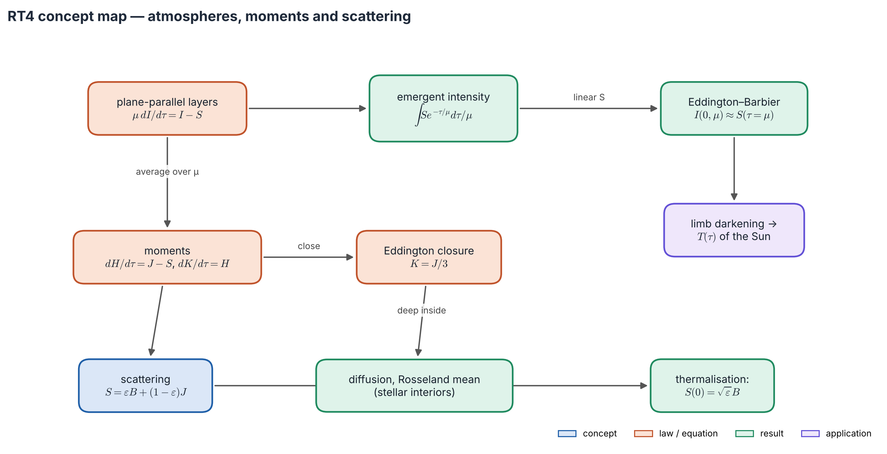
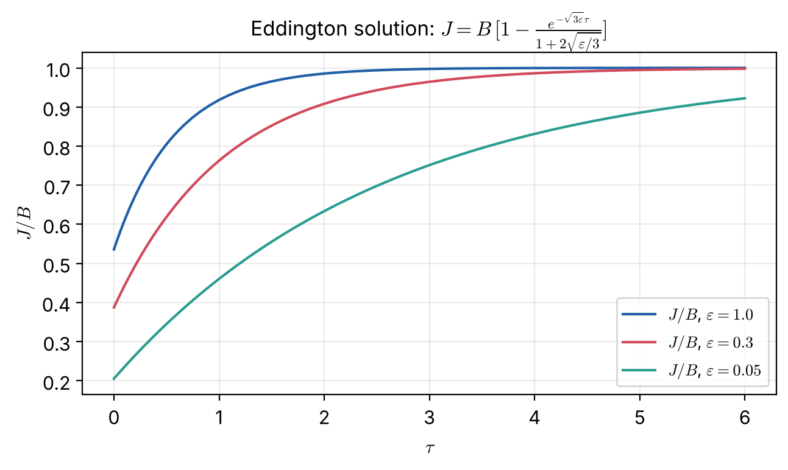

# Lecture RT4 — Atmospheres: Plane-Parallel Layers, Moments and Scattering

> **Sources:** Collins Ch. 9.2–9.4 (plane-parallel RTE, moments, radiative equilibrium, Eddington approximation); Chandrasekhar Ch. I–III (Schwarzschild–Milne equations, $\Lambda$ operator); Hu, *Astro 305 Set 1* (diffusion, Rosseland mean); Novotny Ch. 2.4–2.5 (solution of the equation of transfer, solar examples).

*Concept map — the top row is about **what we see**: in plane-parallel layers the emergent intensity is a weighted average of $S$, and Eddington–Barbier says where we look. The bottom rows are about **what is inside**: moments need a closure, deep layers behave like diffusion, and scattering makes $S$ fall below $B$ near the surface.*

## Learning goals

1. Write the plane-parallel equation and its emergent-intensity solution.
2. Derive and use the Eddington–Barbier relations, and read temperatures from limb darkening.
3. Form the moment equations, state radiative equilibrium, and apply the Eddington closure.
4. Derive the diffusion approximation and the Rosseland mean.
5. Explain the $\sqrt\varepsilon$ law, the thermalisation depth, and why $\Lambda$-iteration fails.

## The big ideas in plain words

**A star's atmosphere is a stack of thin layers.** It is thin compared with the star's radius, so each layer is a flat sheet. Only depth matters, and the angle $\theta$ of a ray to the vertical, through $\mu = \cos\theta$.

**We see down to about one optical depth *along the line of sight*.** Looking straight down (disk centre) we reach vertical depth $\tau\approx1$; looking obliquely (near the limb) we reach only $\tau\approx\mu$, higher up. If the temperature falls outward, the limb looks darker. Limb darkening is a thermometer that reads temperature at different heights.

**The flux comes from $\tau\approx2/3$.** Averaging over the disk, the light leaving a star represents conditions at $\tau\approx2/3$. That is where the "photosphere" is, and why $T(2/3)\approx T_{\rm eff}$.

**Deep inside, light diffuses like heat.** Many mean free paths down, the radiation is almost isotropic with a tiny excess outward, proportional to the temperature gradient. Energy then leaks out like heat through a wall, mostly through the frequency "windows" where opacity is low: the **Rosseland mean**.

**Scattering lets photons leak out from deep layers.** If a photon is destroyed only with probability $\varepsilon$ per interaction, it can random-walk about $1/\sqrt\varepsilon$ optical depths before thermalising. Within that depth of the surface the light "feels" the open boundary, and $S$ falls to $\sqrt\varepsilon\,B$ at the top even if the gas is isothermal.

---

## 4.1 The plane-parallel equation and what we see

*Figure 4.1 — $z$ points outward, $\mu = \cos\theta$, outgoing rays have $\mu>0$. Optical depth increases **inward**: $d\tau_\nu = -\alpha_\nu dz$.*

$$\boxed{\;\mu\,\frac{dI_\nu}{d\tau_\nu} = I_\nu - S_\nu\;}$$
with no light entering from above ($I(0,\mu<0) = 0$). Integrating outward from great depth gives the emergent intensity:
$$\boxed{\;I_\nu(0,\mu) = \int_0^\infty S_\nu(t)\,e^{-t/\mu}\,\frac{dt}{\mu}\;}$$
This is a **Laplace transform** of $S_\nu(\tau)$: scanning the disk from centre ($\mu = 1$) to limb ($\mu\to0$) samples $S$ at different depths.

**Schwarzschild–Milne equations.** Inserting the formal solution into the moments gives, with exponential integrals $E_n(x) = \int_1^\infty e^{-xt}t^{-n}dt$:
$$J_\nu(\tau) = \tfrac12\int_0^\infty S_\nu(t)E_1|t-\tau|\,dt \equiv \Lambda_\tau[S_\nu],\qquad
F_\nu(\tau) = 2\pi\Big[\int_\tau^\infty SE_2(t-\tau)dt - \int_0^\tau SE_2(\tau-t)dt\Big].$$
The **lambda operator** $\Lambda$ turns a source function into a mean intensity. Example: constant $S$ gives $J(0) = S/2$ (half the sky is empty) and $J\to S$ deep down.

*Figure 4.2 — $E_1$ diverges logarithmically at 0 but is integrable; all $E_n$ decay roughly as $e^{-x}/x$. $E_n(0) = 1/(n-1)$.*

## 4.2 Eddington–Barbier: where we look

For $S = a + b\tau$, using $\int_0^\infty e^{-t/\mu}dt/\mu = 1$ and $\int_0^\infty te^{-t/\mu}dt/\mu = \mu$:
$$\boxed{\;I_\nu(0,\mu) = S_\nu(\tau_\nu = \mu)\;}\qquad\boxed{\;F_\nu(0) = \pi S_\nu(\tau_\nu = 2/3)\;}$$
These are exact for linear $S$ and approximate otherwise; a quadratic term $c\tau^2$ adds an error $c\mu^2$.

*Figure 4.3 — Left: the weighting kernel $e^{-\tau/\mu}/\mu$ has mean depth $\mu$. Right: limb darkening. At disk centre we see down to $\tau\approx1$ (hot); near the limb we see higher layers (cool).*

**Limb darkening as a thermometer.** In LTE, $S_\nu = B_\nu(T)$. Measure $I(0,\mu)$, read off $S(\tau = \mu)$, and invert the Planck function:
$$T = \frac{hc/\lambda k}{\ln\!\big(1 + 2hc^2/\lambda^5 S\big)} .$$
This is how the first empirical models of the solar photosphere were built (Worked example 4.1).

## 4.3 Moments, radiative equilibrium and the Eddington closure

Averaging the plane-parallel equation over $\mu$, with weights 1 and $\mu$:
$$\boxed{\;\frac{dH_\nu}{d\tau_\nu} = J_\nu - S_\nu,\qquad \frac{dK_\nu}{d\tau_\nu} = H_\nu\;}$$
Each equation brings in a higher moment ($J\to H\to K\to\dots$). This **closure problem** must be cut somewhere.

**Radiative equilibrium.** If radiation carries all the energy, the flux is constant and energy absorbed equals energy emitted:
$$\boxed{\;\int_0^\infty\kappa_\nu J_\nu\,d\nu = \int_0^\infty\kappa_\nu B_\nu(T)\,d\nu\;}$$
Coherent scattering drops out, because it moves energy without destroying it. **This condition fixes $T(\tau)$**: it is what turns the transfer equation into a model atmosphere (Lecture SA4).

**The Eddington approximation.** Assume $K = J/3$ everywhere. This is exact for isotropic or linear-in-$\mu$ fields (Lecture RT1), so it is good at depth. At the surface, assuming isotropic outgoing light gives
$$\boxed{\;J(0) = 2H(0)\;}$$
Combined, $\frac13\,d^2J_\nu/d\tau_\nu^2 = J_\nu - S_\nu$: a simple second-order ODE. It is typically good to a few per cent.

## 4.4 Deep inside: diffusion and the Rosseland mean

Where $S = B$ varies slowly over a mean free path, $I_\nu\approx B_\nu + \mu\,dB_\nu/d\tau_\nu$, so
$$F_\nu = \frac{4\pi}{3}\frac{dB_\nu}{d\tau_\nu} = -\frac{4\pi}{3\alpha_\nu}\frac{\partial B_\nu}{\partial T}\frac{dT}{dz}.$$
Summing over frequency adds the "conductances" $1/\alpha_\nu$, like resistors in parallel:
$$\boxed{\;\frac1{\kappa_R} = \frac{\int\kappa_\nu^{-1}\,\partial B_\nu/\partial T\,d\nu}{\int\partial B_\nu/\partial T\,d\nu}\;}\qquad\Rightarrow\qquad
\boxed{\;F = -\frac{16\sigma T^3}{3\kappa_R\rho}\frac{dT}{dz}\;}$$
This is radiative transfer in **stellar interiors**. As a harmonic mean, the Rosseland mean is dominated by the most transparent frequencies.

## 4.5 Scattering and thermalisation

With $S = \varepsilon B + (1-\varepsilon)J$ in an **isothermal** atmosphere, the Eddington equation becomes $\frac13J'' = \varepsilon(J - B)$, whose solution is
$$J(\tau) = B\Big[1 - \frac{e^{-\sqrt{3\varepsilon}\,\tau}}{1 + 2\sqrt{\varepsilon/3}}\Big],\qquad S(0)\approx1.15\sqrt\varepsilon\,B.$$
The exact theory (Chandrasekhar's $H$-functions) gives the famous
$$\boxed{\;S(0) = \sqrt\varepsilon\,B\;},\qquad \tau_{\rm th}\sim\frac{1}{\sqrt\varepsilon}.$$

*Figure 4.4 — Left: exact solutions (solid, from `scripts/lte_solvers.py`) and the Eddington approximation (dashed). Although $B$ is constant, $S$ falls far below $B$ near the surface and reaches $B$ only below $\tau_{\rm th}$ (dotted). Right: $\Lambda$-iteration for $\varepsilon = 0.01$ after up to 200 steps, still far from converged.*

*Figure 4.5 — The Eddington solution $J/B$ for three values of $\varepsilon$. The smaller $\varepsilon$, the deeper the radiation "feels" the open surface: the deficit $J<B$ reaches down to $\tau\sim1/\sqrt{3\varepsilon}$.*

**Why it matters.** This is NLTE behaviour in a gas whose temperature is perfectly uniform: escape alone drives $S$ below $B$. For strong resonance lines $\varepsilon\sim10^{-4}$–$10^{-8}$, so thermalisation happens hundreds to thousands of optical depths down, and line cores are far darker than LTE predicts (Lecture SA3).

**Why $\Lambda$-iteration fails.** The obvious scheme $S^{(n+1)} = \varepsilon B + (1-\varepsilon)\Lambda[S^{(n)}]$ spreads information only about one optical depth per step, and its error shrinks only as $(1-\varepsilon)^n$. It can *look* converged while being badly wrong. Our script instead builds $\Lambda$ as a matrix (piecewise-linear $S$, analytic $E_n$ integrals) and solves $(\mathbf 1 - (1-\varepsilon)\mathbf\Lambda)\mathbf S = \varepsilon\mathbf B$ directly. Modern codes use **accelerated $\Lambda$-iteration (ALI)**.

---

## Worked example 4.1 — The Sun's temperature from limb darkening

*At 500 nm, $I(\mu)/I(1) = 0.36 + 0.64\mu$ and $I(1) = 4.0\times10^{13}$ W m$^{-3}$ sr$^{-1}$. Assuming LTE, find $T$ at $\tau_{500}$ = 0, 0.5 and 1.*

**Solution.** By Eddington–Barbier, $S(\tau) = I(1)(0.36 + 0.64\tau)$. Invert the Planck function with $hc/\lambda k = 28\,776$ K and $2hc^2/\lambda^5 = 3.811\times10^{15}$:

| $\tau_{500}$ | $S/I(1)$ | $T$ [K] |
|---|---|---|
| 0 | 0.36 | 5155 |
| 0.5 | 0.68 | 5814 |
| 1 | 1.00 | 6300 |

The temperature rises inward by about 1100 K over one optical depth. This is observational proof that the Sun is not isothermal, and the reason it shows absorption lines.

## Worked example 4.2 — Thermalisation of a resonance line

*A chromospheric resonance line has $\varepsilon = 10^{-4}$. Estimate $S(0)/B$, the thermalisation depth and the number of scatterings.*

**Solution.** $S(0) = \sqrt\varepsilon\,B = 0.01\,B$; $\tau_{\rm th}\approx 1/\sqrt\varepsilon = 100$ (Eddington: $1/\sqrt{3\varepsilon} = 58$); $N\approx 1/\varepsilon = 10^4$. An LTE model would make the line core 100 times too bright, which is why Ca II H & K and Mg II h & k need NLTE.

## Worked example 4.3 — Rosseland versus straight mean

*Split $\partial B_\nu/\partial T$ equally between two bands with $\kappa_1 = 1$ and $\kappa_2 = 100$.*

**Solution.** $1/\kappa_R = \frac12(1 + 0.01) = 0.505$, so $\kappa_R = 1.98$, while the straight mean is 50.5. The flux flows through the transparent band. Line blanketing raises $\kappa_R$ only modestly unless the lines fill the windows.

---

## Common misconceptions

1. **"The limb is darker because it is farther away."** The extra distance is negligible; we see higher, cooler layers there.
2. **"Eddington–Barbier is exact."** Only for a source function linear in $\tau$.
3. **"An isothermal atmosphere has $S = B$ everywhere."** With scattering, $S$ falls to $\sqrt\varepsilon B$ at the surface.
4. **"If an iteration changes little, it has converged."** $\Lambda$-iteration can creep along with tiny steps while still far from the answer.

## Lecture summary

- Plane-parallel: $\mu\,dI/d\tau = I - S$; the emergent intensity is a Laplace transform of $S$.
- Eddington–Barbier: $I(0,\mu)\approx S(\mu)$ and $F\approx\pi S(2/3)$; limb darkening measures $T(\tau)$.
- Moments $dH/d\tau = J - S$, $dK/d\tau = H$ need a closure: $K = J/3$ and $J(0) = 2H(0)$.
- Radiative equilibrium, $\int\kappa_\nu(J_\nu - B_\nu)d\nu = 0$, fixes $T(\tau)$.
- Deep inside: diffusion with the Rosseland (harmonic) mean.
- Scattering: $S(0) = \sqrt\varepsilon B$, $\tau_{\rm th}\sim1/\sqrt\varepsilon$, and $\Lambda$-iteration is too slow.

---

## Exam questions and answers — Lecture RT4

**Q1.** Prove the Eddington–Barbier relations $I(0,\mu) = S(\tau = \mu)$ and $F(0) = \pi S(\tau = 2/3)$ for $S = a + b\tau$, and explain limb darkening. When would we see limb *brightening*?

> **A1.** $I(0,\mu) = \int_0^\infty(a+bt)e^{-t/\mu}dt/\mu = a + b\mu = S(\mu)$; $F = 2\pi\int_0^1(a+b\mu)\mu\,d\mu = \pi(a + 2b/3) = \pi S(2/3)$. Near the limb the line of sight reaches only vertical depth $\mu$, in higher layers; if $S$ (in LTE, $T$) falls outward, the limb is darker. Where $S$ rises outward (the chromosphere in the UV, EUV and radio), the limb is brighter.

**Q2.** State radiative equilibrium in integral form. Why do scattering terms drop out, and what does the condition determine?

> **A2.** $\int\alpha_\nu(J_\nu - S_\nu)d\nu = 0$, equivalently $dF/dz = 0$. For coherent scattering that part is $\alpha^{\rm sc}(J - J) = 0$: scattering redirects energy without creating or destroying it. What remains, $\int\kappa_\nu(J_\nu - B_\nu)d\nu = 0$, determines the temperature structure $T(\tau)$.

**Q3.** Derive the diffusion approximation and the Rosseland mean. Why is it a harmonic mean?

> **A3.** Deep inside, $I\approx B + \mu\,dB/d\tau$, so $F_\nu = \frac{4\pi}{3}dB_\nu/d\tau_\nu = -\frac{4\pi}{3\alpha_\nu}\frac{\partial B_\nu}{\partial T}\frac{dT}{dz}$. Summing over frequency adds the $1/\alpha_\nu$, like conductances in parallel. This gives $1/\kappa_R$ as the $\partial B_\nu/\partial T$-weighted mean of $1/\kappa_\nu$, and $F = -\frac{16\sigma T^3}{3\kappa_R\rho}\frac{dT}{dz}$.

**Q4.** For an isothermal atmosphere with $S = \varepsilon B + (1-\varepsilon)J$, explain physically why $S < B$ near the surface, estimate the depth where $S\to B$, and explain why $\Lambda$-iteration converges slowly.

> **A4.** Near the surface photons escape, so $J<B$; scattering ties $S$ to $J$, so $S<B$ too, reaching $\sqrt\varepsilon B$ at $\tau = 0$. A photon survives about $1/\varepsilon$ scatterings and random-walks $\sim1/\sqrt\varepsilon$ optical depths, so $S\to B$ below $\tau_{\rm th}\sim1/\sqrt\varepsilon$. $\Lambda$ couples points only over $\Delta\tau\sim1$, so each iteration moves information by one optical depth, and the error decays as $(1-\varepsilon)^n$; about $1/\varepsilon$ iterations are needed. The remedy is direct solution (Feautrier, matrix inversion) or ALI.
