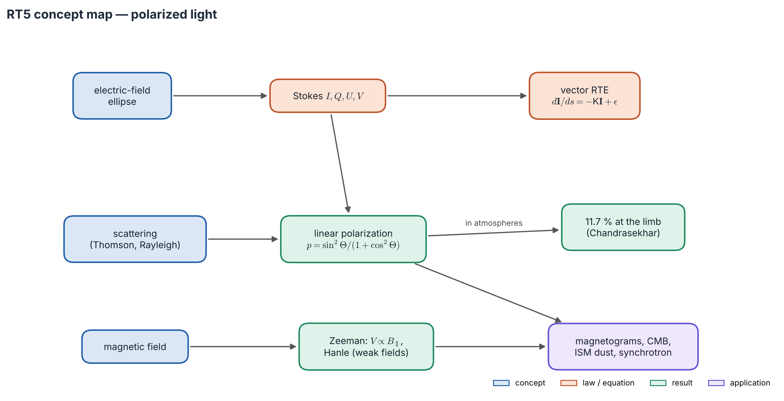
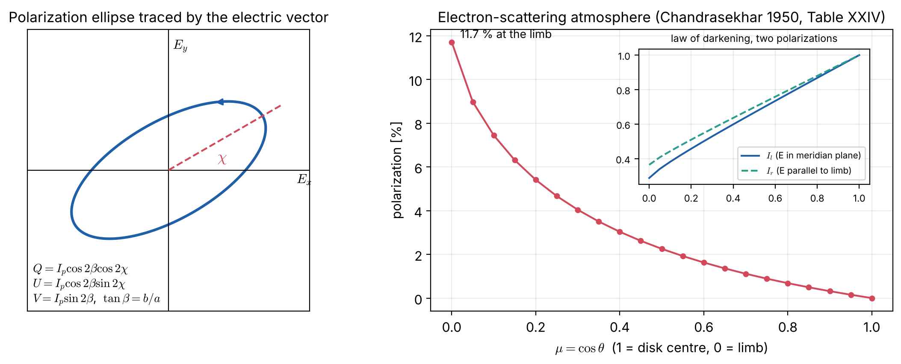

# Lecture RT5 — Polarized Light

> **Sources:** Hu, *Astro 305 Set 1* (Stokes parameters as differences of filtered intensities); Chandrasekhar, *Radiative Transfer* (1950), Ch. I §15–17 (Stokes parameters, Rayleigh phase matrix) and Ch. X §68 (exact laws of darkening in the two states of polarization; Table XXIV); Landi Degl'Innocenti & Landolfi, *Polarization in Spectral Lines* (2004); Stenflo, *Solar Magnetic Fields* (1994).

*Concept map — polarization is described by four Stokes numbers. Two physical agents create it: **scattering** (left) gives linear polarization, up to 11.7 % at the limb of an electron-scattering star; **magnetic fields** (bottom) give Zeeman and Hanle signatures. Transporting the four numbers needs the vector transfer equation.*

## Learning goals

1. Define the Stokes parameters $I, Q, U, V$ and the degree and angle of polarization.
2. Write the polarized transfer equation in matrix form and name its terms.
3. Explain polarization by scattering (Thomson, Rayleigh) and Chandrasekhar's result for electron-scattering atmospheres.
4. Explain how the Zeeman and Hanle effects let us measure magnetic fields, and estimate Zeeman splittings.

---

## The big ideas in plain words

**Light is a transverse wave.** The electric field oscillates perpendicular to the direction of travel. If its oscillation has a preferred orientation, the light is *polarized*. Natural thermal emission is unpolarized because countless independent emitters oscillate in random directions. Polarization appears when something breaks the symmetry: a scattering geometry, a magnetic field, aligned dust grains, or relativistic electrons spiralling in a field.

**Four numbers describe any beam.** Hu's picture is the clearest: put filters in front of a detector. $I$ is the total intensity. $Q$ is the difference between light passing a horizontal and a vertical polarizer. $U$ is the same difference for polarizers rotated by 45°. $V$ is the difference between right- and left-circular filters. These four Stokes parameters all have units of intensity, so they can be transported exactly like $I_\nu$.

**Why scattering polarizes.** An electron hit by light oscillates along the incoming electric field and re-radiates like a small antenna, which emits nothing along its axis of oscillation. Light scattered at 90° therefore contains only one direction of oscillation: it is 100 % linearly polarized. This is why the blue sky is polarized and why the limb of a hot star should be slightly polarized.

**Magnetic fields leave fingerprints.** In a magnetic field, atomic levels split (the Zeeman effect) into components with definite polarization. A field along the line of sight produces *circular* polarization ($V$); a field across the line of sight produces *linear* polarization ($Q$, $U$). Measuring the Stokes profiles of spectral lines is how solar magnetograms are made. Very weak fields instead modify scattering polarization (the Hanle effect).

---

## 5.1 Stokes parameters

For a monochromatic wave $E_x = a_1\cos(\omega t-\delta_1)$, $E_y = a_2\cos(\omega t-\delta_2)$, with $\delta = \delta_2-\delta_1$ (up to a common constant):
$$I = a_1^2+a_2^2,\quad Q = a_1^2-a_2^2,\quad U = 2a_1a_2\cos\delta,\quad V = 2a_1a_2\sin\delta.$$
Operationally (Hu): $I = I_1+I_2$, $Q = I_1-I_2$, $U = I_{1'}-I_{2'}$ (axes rotated by 45°), $V = I_+-I_-$.

*Figure 5.1 — Left: the electric vector traces an ellipse with orientation $\chi$ and ellipticity $\tan\beta = b/a$. Right: Chandrasekhar's exact result for a semi-infinite electron-scattering atmosphere. The polarization rises from 0 at disk centre to 11.7 % at the limb (data: Chandrasekhar 1950, Table XXIV). Inset: the limb darkening differs for the two polarization states.*

| Quantity | Definition |
|---|---|
| degree of polarization | $p = \sqrt{Q^2+U^2+V^2}\,/\,I\le1$ |
| degree of linear polarization | $p_L = \sqrt{Q^2+U^2}\,/\,I$ |
| polarization angle | $\chi = \tfrac12\arctan(U/Q)$ |
| circular polarization | $p_V = V/I$ |
| fully polarized light | $I^2 = Q^2+U^2+V^2$ |

**Rotation of axes** by an angle $\phi$: $Q' = Q\cos2\phi+U\sin2\phi$, $U' = -Q\sin2\phi+U\cos2\phi$, with $I$ and $V$ unchanged. The factor $2\phi$ means linear polarization is a "spin-2" quantity, the basis of the E- and B-mode decomposition of CMB polarization.

## 5.2 The polarized transfer equation

Write the Stokes vector $\mathbf I = (I,Q,U,V)^T$. The transfer equation becomes a matrix equation:
$$\boxed{\;\frac{d\mathbf I_\nu}{ds} = -\mathsf K_\nu\,\mathbf I_\nu + \boldsymbol\epsilon_\nu\;}\qquad
\mathsf K = \begin{pmatrix}\eta_I&\eta_Q&\eta_U&\eta_V\\ \eta_Q&\eta_I&\rho_V&-\rho_U\\ \eta_U&-\rho_V&\eta_I&\rho_Q\\ \eta_V&\rho_U&-\rho_Q&\eta_I\end{pmatrix}$$

- $\eta_I$: ordinary absorption. $\eta_{Q,U,V}$: **dichroism**, meaning different absorption for different polarization states.
- $\rho_{Q,U,V}$: **magneto-optical (Faraday) effects**, rotating the polarization plane and converting linear into circular polarization.
- $\boldsymbol\epsilon$: emission vector. In LTE $\boldsymbol\epsilon = \mathsf K\,(B_\nu,0,0,0)^T$, the polarized form of Kirchhoff's law.
- For an unmagnetized, isotropic medium $\mathsf K = \alpha_\nu\mathbf 1$, and the equations for $I, Q, U, V$ decouple.
- **Scattering** adds a gain term with the **phase matrix** $\mathsf P(\hat{\mathbf n}',\hat{\mathbf n})$ (Chandrasekhar's Rayleigh phase matrix for Thomson and Rayleigh scattering).
- With Zeeman-split absorption profiles these are the **Unno–Rachkovsky equations** (Unno 1956; Rachkovsky 1962). Sign conventions differ between authors (see Landi Degl'Innocenti & Landolfi 2004).

## 5.3 Polarization by scattering

For Thomson or Rayleigh scattering of unpolarized light through a scattering angle $\Theta$:
$$I_{\rm sc}\propto\frac{1+\cos^2\Theta}{2},\qquad p_L = \frac{1-\cos^2\Theta}{1+\cos^2\Theta} = \frac{\sin^2\Theta}{1+\cos^2\Theta}.$$
So the light is unpolarized in the forward and backward directions and 100 % polarized at $\Theta = 90°$.

**Chandrasekhar's electron-scattering atmosphere (1946).** In a semi-infinite atmosphere where Thomson scattering dominates (hot O and B stars), the radiation emerging near the limb has travelled mostly parallel to the surface before its last scattering. It is therefore polarized, with the electric vector **parallel to the limb**. The exact solution of the polarized transfer equation gives:

| $\mu$ | 0 (limb) | 0.1 | 0.2 | 0.4 | 0.6 | 0.8 | 1 (centre) |
|---|---|---|---|---|---|---|---|
| degree of polarization | 11.71 % | 7.45 % | 5.41 % | 3.03 % | 1.63 % | 0.68 % | 0 |

For an unresolved spherical star the polarization cancels by symmetry. It becomes observable when the symmetry is broken: in eclipsing binaries (where it is measured during eclipses), rapidly rotating oblate stars, or disks.

## 5.4 Magnetic fields: the Zeeman and Hanle effects

**Zeeman splitting.** A field $B$ splits a line by
$$\Delta\lambda_B = 4.67\times10^{-13}\,g_{\rm eff}\,\lambda^2\,B,$$
with $\lambda$ and $\Delta\lambda_B$ in ångström (Å) and $B$ in gauss (G),
where $g_{\rm eff}$ is the effective Landé factor. The $\sigma$ components are circularly polarized when viewed along the field and linearly polarized when viewed across it; the $\pi$ component is linearly polarized.

**Weak-field approximation** (splitting much smaller than the Doppler width): $V(\lambda)\approx-\Delta\lambda_B\cos\gamma\,\dfrac{\partial I}{\partial\lambda}$, where $\gamma$ is the angle between field and line of sight. $V$ is antisymmetric about line centre and proportional to the longitudinal field, which is the principle of **magnetographs** (e.g. SDO/HMI).

**Hanle effect.** Weak fields (roughly 1–100 G, depending on the line) change the polarization of *scattered* line radiation (depolarization and rotation). The linearly polarized spectrum of the solar limb, the "second solar spectrum" (Stenflo & Keller 1997), is a diagnostic of turbulent magnetic fields that the Zeeman effect cannot detect.

## 5.5 Where polarized transfer is used

| Field | Mechanism | Example |
|---|---|---|
| solar physics | Zeeman, Hanle | sunspot and quiet-Sun magnetic maps; Milne–Eddington inversions of Stokes profiles |
| hot stars, binaries, disks | Thomson scattering | eclipse polarization; Be-star disk polarization |
| interstellar medium | dichroic extinction by aligned dust (Hiltner and Hall, 1949) | Galactic magnetic-field direction |
| radio galaxies, pulsars, blazars | synchrotron emission | up to ~70 % linear polarization; Faraday rotation measures |
| cosmology | Thomson scattering of a quadrupole anisotropy | CMB E-modes (first detected by DASI in 2002); B-modes |
| planets and exoplanets | Rayleigh scattering | sky polarization; reflected light of planets |

---

## Worked example 5.1 — Stokes parameters from filter measurements

*Through six filters a detector measures (in units of the total): horizontal 0.70, vertical 0.30, +45° 0.60, −45° 0.40, right-circular 0.50, left-circular 0.50. Find $I, Q, U, V$, $p$ and $\chi$.*

$I = 0.70+0.30 = 1.00$, $Q = 0.40$, $U = 0.20$, $V = 0$. So $p = \sqrt{0.40^2+0.20^2} = 0.447$ (44.7 % linearly polarized) and $\chi = \tfrac12\arctan(0.20/0.40) = 13.3°$.

## Worked example 5.2 — Polarization of scattered light

*Unpolarized sunlight is Thomson-scattered by electrons. Find the degree of polarization at $\Theta = 90°$, $60°$ and $30°$.*

$p = \sin^2\Theta/(1+\cos^2\Theta)$: 90° → $1/1 = 100\,\%$; 60° → $0.75/1.25 = 60\,\%$; 30° → $0.25/1.75 = 14\,\%$. The same law gives the polarization pattern of the blue sky (Rayleigh scattering) and of the solar corona (the K-corona, Thomson scattering by free electrons).

## Worked example 5.3 — Is a line split in a sunspot?

*The Fe I line at 6302.5 Å has $g_{\rm eff} = 2.5$. Compute the Zeeman splitting for $B = 3000$ G (sunspot umbra) and $B = 100$ G (plage), and compare with the Doppler width (about 28 mÅ at 5800 K, Lecture SA2).*

$\Delta\lambda_B = 4.67\times10^{-13}\times2.5\times(6302.5)^2\times B = 4.64\times10^{-5}\,B$ Å.

- 3000 G: $\Delta\lambda_B = 0.139$ Å $= 139$ mÅ, 5 times the Doppler width. The line is visibly split (strong-field regime).
- 100 G: $\Delta\lambda_B = 4.6$ mÅ, much smaller than the Doppler width. The line is not split, but $V\propto\partial I/\partial\lambda$ still measures the field (weak-field regime).

---

## Common misconceptions

1. **"Thermal emission is polarized."** Isotropic thermal emission in LTE is unpolarized; polarization requires an asymmetry (scattering geometry, magnetic field, aligned grains).
2. **"$Q$ and $U$ are properties of the source alone."** They depend on the chosen reference axes; only $p$ and, after fixing axes, $\chi$ have direct physical meaning.
3. **"A star's limb polarization is easy to see."** For an unresolved round star it averages to zero; it is measured only when the symmetry is broken (eclipses, disks, rotation).
4. **"The Zeeman effect only works for strong fields."** Even when the splitting is much smaller than the line width, circular polarization measures the longitudinal field (weak-field approximation).

## Lecture summary

- Stokes vector $(I,Q,U,V)$: total, two linear polarizations (0°/90° and ±45°), circular.
- Polarized RTE: $d\mathbf I/ds = -\mathsf K\mathbf I+\boldsymbol\epsilon$, with absorption, dichroism and magneto-optical terms; the Unno–Rachkovsky equations.
- Thomson and Rayleigh scattering: $p = \sin^2\Theta/(1+\cos^2\Theta)$; an electron-scattering atmosphere has 11.7 % polarization at the limb (Chandrasekhar).
- Zeeman: $\Delta\lambda_B = 4.67\times10^{-13}g\lambda^2B$; $V$ measures the longitudinal field. Hanle effect: weak fields.

---

## Exam questions and answers — Lecture RT5

**Q1.** Define the four Stokes parameters operationally. Show that for completely polarized light $I^2 = Q^2+U^2+V^2$.

> **A1.** $I = I_1+I_2$, $Q = I_1-I_2$ (0°/90° polarizers), $U = I_{1'}-I_{2'}$ (±45°), $V = I_+-I_-$ (circular). For a fully polarized wave, $I = a_1^2+a_2^2$, $Q = a_1^2-a_2^2$, $U = 2a_1a_2\cos\delta$, $V = 2a_1a_2\sin\delta$, so $Q^2+U^2+V^2 = (a_1^2-a_2^2)^2+4a_1^2a_2^2 = (a_1^2+a_2^2)^2 = I^2$.

**Q2.** Why is light scattered by an electron at 90° completely polarized? What is the degree of polarization at 45°?

> **A2.** The electron oscillates along the incident electric field, which is perpendicular to the incoming direction. A dipole does not radiate along its axis, so at 90° only the component of oscillation perpendicular to the scattering plane is seen: 100 % linear polarization. At 45°: $p = \sin^245°/(1+\cos^245°) = 0.5/1.5 = 33\,\%$.

**Q3.** Describe Chandrasekhar's result for the polarization of an electron-scattering atmosphere. Why is it hard to observe, and how can it be detected?

> **A3.** In a semi-infinite pure Thomson-scattering atmosphere, the emergent polarization rises from 0 at disk centre to 11.7 % at the limb, with the electric vector parallel to the limb. For a spherical, unresolved star the contributions from opposite limbs cancel. It becomes observable when symmetry is broken: during eclipses of binaries, in rotationally flattened stars, or in circumstellar disks.

**Q4.** What is the Zeeman splitting of a line with $g = 1.5$ at 5000 Å in a 1000 G field? In which regime is it, and how would you measure the field?

> **A4.** $\Delta\lambda_B = 4.67\times10^{-13}\times1.5\times(5000)^2\times1000 = 0.0175$ Å $= 17.5$ mÅ. This is smaller than a typical Doppler width (about 20–30 mÅ), so it is in the weak-field regime and the line is not visibly split. Measure the circular polarization: $V\approx-\Delta\lambda_B\cos\gamma\,\partial I/\partial\lambda$ gives the longitudinal component $B\cos\gamma$.
