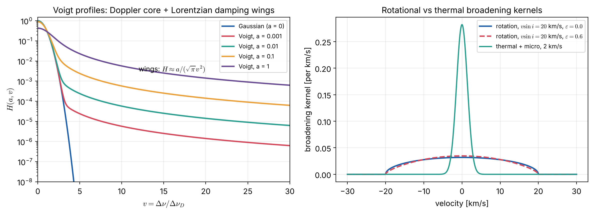

# Lecture SA4 — Physical Processes III: Line Absorption and Line Broadening

> **Sources:** D. Mihalas, *Stellar Atmospheres* (1978), line absorption and spectral line broadening; D. F. Gray, *The Observation and Analysis of Stellar Photospheres* (2005), Chs. 11 (line absorption coefficient) and 18 (rotation); Rybicki & Lightman Ch. 10; Unsöld (1955) for van der Waals broadening; Anstee, Barklem & O'Mara (1995–2000, "ABO theory") for modern hydrogen-collision widths.
> **Prerequisites:** RT4 (Einstein coefficients), SA1 (populations), SA6 uses this lecture's profiles.

## Learning goals

1. Write the line absorption coefficient in terms of the oscillator strength and a normalised profile.
2. Derive the natural (radiation-damping) width, and compute Doppler widths with microturbulence.
3. Classify pressure broadening by the power law of the interaction ($C_n/r^n$: linear Stark, resonance, quadratic Stark, van der Waals) and name the impact and quasi-static limits.
4. Build the Voigt profile, compute the damping parameter $a$, and add rotational and macroturbulent broadening.

---

## Key concepts in plain words

**Why a line has a width at all.** An atomic transition has a definite energy, so in principle it absorbs at a single frequency. Three things smear it out. (1) *Uncertainty:* excited states live only a finite time, so their energy is slightly uncertain (natural broadening). (2) *Motion:* atoms move, so each one sees the light Doppler-shifted by a different amount (thermal and turbulent broadening). (3) *Neighbours:* nearby charged or neutral particles perturb the energy levels during collisions (pressure broadening). The first and third give a Lorentzian shape with broad wings; the second gives a Gaussian core. Their combination is the Voigt profile.

**Two parts of a line tell different stories.** The core of a strong line is shaped mainly by the Doppler effect, so it measures temperature and turbulence. The far wings are shaped by collisions, so they measure pressure, and through hydrostatic equilibrium the surface gravity. This is why the wings of Balmer lines and of the Mg I b and Ca II lines are used to measure $\log g$.

**The star itself can broaden lines.** Rotation makes one limb approach us and the other recede. Every line is then smeared by $\pm v\sin i$, with a characteristic rounded profile. Large-scale motions (macroturbulence, granulation) add further broadening. The instrument adds its own profile. All these broadenings act on the emergent spectrum, unlike the atomic ones, which act on the absorption coefficient.

---

## 4.1 The line absorption coefficient

For a transition $l\to u$ with oscillator strength $f_{lu}$ and normalised profile $\phi(\nu)$ ($\int\phi\,d\nu = 1$), in LTE:
$$\alpha^{\rm line}_\nu = \frac{\pi e^2}{m_ec}\,f_{lu}\,n_l\,\phi(\nu)\left(1-e^{-h\nu/kT}\right)\quad\text{(Gaussian units)},\qquad \frac{\pi e^2}{m_ec} = 0.02654\ \text{cm}^2\,\text{Hz}.$$
The oscillator strength links to the Einstein coefficients: $g_lf_{lu} = \dfrac{m_ec^3}{8\pi^2e^2\nu^2}\,g_uA_{ul}$, so $A_{ul} = 0.6670\,\dfrac{g_l}{g_u}\,\dfrac{f_{lu}}{\lambda^2}$ s$^{-1}$ with $\lambda$ in cm. Spectroscopists usually quote $\log gf\equiv\log(g_lf_{lu})$.

## 4.2 Natural (radiation) broadening

An excited state decaying with total rate $\Gamma_u = \sum_{j<u}A_{uj}$ has a Lorentzian energy distribution. For a transition between two levels, both of which decay:
$$\phi(\nu) = \frac{\gamma/4\pi^2}{(\nu-\nu_0)^2+(\gamma/4\pi)^2},\qquad \gamma_{\rm rad} = \Gamma_u+\Gamma_l,\qquad \Delta\lambda_{\rm FWHM} = \frac{\lambda^2\gamma}{2\pi c}.$$
The classical (damped-oscillator) value $\gamma_{\rm cl} = 8\pi^2e^2\nu^2/(3m_ec^3) = 2.47\times10^{-22}\nu^2$ s$^{-1}$ is a useful order-of-magnitude estimate.

## 4.3 Doppler broadening

With a Maxwellian distribution plus Gaussian microturbulence $\xi$:
$$\phi_D(\nu) = \frac{1}{\sqrt\pi\,\Delta\nu_D}e^{-(\nu-\nu_0)^2/\Delta\nu_D^2},\qquad \Delta\nu_D = \frac{\nu_0}{c}\sqrt{\frac{2kT}{m}+\xi^2}.$$
Light atoms (H) have broad Doppler cores; heavy atoms (Fe) narrow ones, so microturbulence matters most for metal lines.

## 4.4 Pressure (collisional) broadening

A perturber at distance $r$ shifts the line frequency by $\Delta\nu = C_n/r^n$:

| $n$ | Name | Perturbers | Where it matters |
|---|---|---|---|
| 2 | **linear Stark** | ions and electrons | hydrogen and He II lines in A, B stars and white dwarfs (very broad Balmer wings) |
| 3 | **resonance** (self) broadening | atoms of the same species | lines connected to the ground state, e.g. Balmer lines in cool stars |
| 4 | **quadratic Stark** | electrons, ions | non-hydrogenic atoms in hot stars |
| 6 | **van der Waals** | neutral H (and He, H$_2$) | metal lines in cool stars (Sun: Na D, Mg I b wings) |

Two limits of the theory:

- **impact approximation:** collisions are brief and separated. They interrupt the radiation, giving a **Lorentzian** with width $\gamma_n\propto N_{\rm pert}\,C_n^{2/(n-1)}\,\bar v^{(n-3)/(n-1)}$ (for van der Waals, $\gamma_6\propto N_{\rm H}C_6^{2/5}\bar v^{3/5}$, Unsöld's classical estimate);
- **quasi-static approximation:** perturbers barely move during the emission. The statistical distribution of their fields gives the profile (the **Holtsmark** distribution for linear Stark broadening by ions).

Modern van der Waals widths use the **ABO theory** (Anstee, Barklem & O'Mara), which corrects Unsöld's values by factors of about 1.5–2.5.

## 4.5 The Voigt profile

Natural plus pressure broadening (Lorentzian, total $\gamma = \gamma_{\rm rad}+\gamma_4+\gamma_6+\dots$) convolved with Doppler broadening (Gaussian):
$$\phi(\nu) = \frac{H(a,v)}{\sqrt\pi\,\Delta\nu_D},\qquad H(a,v) = \frac a\pi\int_{-\infty}^{\infty}\frac{e^{-y^2}}{(v-y)^2+a^2}dy,\qquad a = \frac{\gamma}{4\pi\Delta\nu_D},\quad v = \frac{\nu-\nu_0}{\Delta\nu_D}.$$
Core: $H\approx e^{-v^2}$. Far wings: $H\approx a/(\sqrt\pi v^2)$. The wings take over at $|v|\approx2$–3 for $a\sim0.01$.

*Figure 4.1 — Left: Voigt functions for increasing damping $a$; the Lorentzian wings rise above the Gaussian core beyond $v\approx2$–3. Right: the rotational broadening kernel for $v\sin i = 20$ km s$^{-1}$, without and with limb darkening ($\varepsilon = 0.6$), compared with a 2 km s$^{-1}$ thermal-plus-microturbulent Gaussian.*

## 4.6 Broadening of the emergent spectrum

- **Rotation:** the flux profile is convolved with the kernel $G(\Delta\lambda) = \dfrac{2(1-\varepsilon)\sqrt{1-x^2}+\frac{\pi\varepsilon}{2}(1-x^2)}{\pi\Delta\lambda_L(1-\varepsilon/3)}$, with $x = \Delta\lambda/\Delta\lambda_L$, $\Delta\lambda_L = \lambda v\sin i/c$, and $\varepsilon$ the linear limb-darkening coefficient (Gray, Ch. 18).
- **Macroturbulence:** large-scale motions (granulation), modelled with a radial–tangential profile; 3D models produce it naturally.
- **Instrumental profile:** set by the resolving power $R = \lambda/\Delta\lambda$.
- **Zeeman splitting** (RT9) and hyperfine or isotopic structure.

---

## Worked example 4.1 — Natural width of H$\alpha$

*For H$\alpha$ (656.28 nm) the upper level $n = 3$ decays with $A_{31}+A_{32}\approx5.58\times10^7+4.41\times10^7$ s$^{-1}$, and the lower level $n = 2$ decays by Ly$\alpha$ with $A_{21} = 6.27\times10^8$ s$^{-1}$. Compute the natural FWHM and compare with the Doppler width at 5800 K (0.21 Å, SA6).*

$\gamma = 1.0\times10^8+6.27\times10^8 = 7.3\times10^8$ s$^{-1}$, so $\Delta\lambda = \lambda^2\gamma/(2\pi c) = (6.5628\times10^{-7})^2\times7.3\times10^8/(2\pi\times3\times10^8) = 1.7\times10^{-13}$ m $= 0.0017$ Å. This is about 120 times narrower than the Doppler core. Natural broadening matters only in the far wings, and only where pressure broadening is weak.

## Worked example 4.2 — Damping parameter of a solar iron line

*An Fe I line at 500 nm in the Sun has a total damping constant (mostly van der Waals) $\gamma\approx10^9$ s$^{-1}$. With $T = 5772$ K and $\xi = 1$ km s$^{-1}$, compute $a$.*

$v_D = \sqrt{2kT/m_{\rm Fe}+\xi^2} = 1.65$ km s$^{-1}$, $\Delta\nu_D = v_D/\lambda = 3.3\times10^9$ Hz, so $a = \gamma/(4\pi\Delta\nu_D) = 10^9/(4\pi\times3.3\times10^9) = 0.024$. This is why $a\approx0.01$–0.03 is used for solar metal lines (and in the curve of growth of SA6).

## Worked example 4.3 — When does rotation dominate?

*Compare the rotational broadening of a 500 nm line for $v\sin i = 2$ km s$^{-1}$ (the Sun) and 50 km s$^{-1}$ (a typical A star) with the Fe Doppler width.*

$\Delta\lambda_L = \lambda v\sin i/c$: 2 km s$^{-1}$ → 0.0033 nm (33 mÅ), comparable to the Doppler width (about 27 mÅ including microturbulence); 50 km s$^{-1}$ → 0.083 nm (0.83 Å), 30 times larger. In rapid rotators the line shapes are dominated by rotation, weak lines blend together, and abundance analysis becomes harder.

---

## Common misconceptions

1. **"The natural width is what we see."** It is usually 10–1000 times smaller than the Doppler and pressure widths; it matters only in the far wings.
2. **"All broadening affects the absorption coefficient."** Rotation, macroturbulence and the instrument broaden the *emergent* spectrum but leave the equivalent width unchanged; atomic broadening changes the absorption profile and hence, for saturated lines, the equivalent width.
3. **"Pressure broadening is the same for all lines."** It depends on the type of interaction (Stark, van der Waals) and on the perturbers (electrons, ions, neutral H), so different lines respond differently to gravity.
4. **"The Voigt core is Lorentzian."** The core is essentially Gaussian; the Lorentzian shows only in the wings.

## Lecture summary

- $\alpha^{\rm line}_\nu = (\pi e^2/m_ec)f_{lu}n_l\phi(\nu)(1-e^{-h\nu/kT})$; $\log gf$ measures line strength.
- Natural: Lorentzian with $\gamma_{\rm rad} = \Gamma_u+\Gamma_l$. Doppler: Gaussian with $\Delta\nu_D = (\nu_0/c)\sqrt{2kT/m+\xi^2}$.
- Pressure: $C_n/r^n$ with $n = 2,3,4,6$ (linear Stark, resonance, quadratic Stark, van der Waals); impact (Lorentz) versus quasi-static (Holtsmark) limits; ABO theory for van der Waals.
- Voigt: $H(a,v)$ with $a = \gamma/(4\pi\Delta\nu_D)$; Gaussian core, $a/(\sqrt\pi v^2)$ wings.
- Emergent-spectrum broadening: rotation ($v\sin i$), macroturbulence, instrument, Zeeman.

---

## Exam questions and answers — Lecture SA4

**Q1.** Name the three atomic broadening mechanisms and the profile shape each produces. Which part of a strong line does each control?

> **A1.** Natural (finite lifetimes) gives a Lorentzian; pressure/collisional (perturbing particles) gives a Lorentzian in the impact limit, or a Holtsmark-type profile in the quasi-static limit; Doppler (thermal and turbulent motion) gives a Gaussian. The convolution is the Voigt profile. The Doppler part controls the core (temperature, microturbulence); the Lorentzian parts control the far wings (pressure, hence gravity, and atomic data).

**Q2.** Define the damping parameter $a$ and compute it for a line at 600 nm with $\gamma = 5\times10^8$ s$^{-1}$, $T = 6000$ K, atomic mass 40 and $\xi = 0$.

> **A2.** $a = \gamma/(4\pi\Delta\nu_D)$. $v_D = \sqrt{2kT/m} = \sqrt{2\times1.381\times10^{-23}\times6000/(40\times1.661\times10^{-27})} = 1.58$ km s$^{-1}$; $\Delta\nu_D = v_D/\lambda = 2.63\times10^9$ Hz; $a = 5\times10^8/(4\pi\times2.63\times10^9) = 0.015$.

**Q3.** Which pressure-broadening mechanism dominates (a) the Balmer lines of an A0 star, (b) the Na D wings in the Sun, (c) Si III lines in a B star? Explain.

> **A3.** (a) Linear Stark broadening by ions and electrons: hydrogen has degenerate levels, so the first-order Stark effect acts, and A stars have abundant free charges. (b) Van der Waals broadening by neutral hydrogen: the solar photosphere is mostly neutral H, and Na is non-hydrogenic. (c) Quadratic Stark broadening by electrons: a non-hydrogenic ion in a hot, ionised atmosphere.

**Q4.** Why do the wings of strong lines measure surface gravity? Give the chain of reasoning.

> **A4.** Wing strength $\propto\gamma_{\rm pressure}\propto$ the number density of perturbers (electrons, ions or neutral H) where the wings form. By hydrostatic equilibrium the pressure at a given optical depth scales as $P\approx g\tau/\kappa$, so higher $g$ means higher density, larger damping, and broader wings at fixed $T_{\rm eff}$ and abundance. Comparing observed wing profiles (Balmer lines in hot stars, Mg I b or Ca II in cool stars) with synthetic spectra therefore gives $\log g$.
