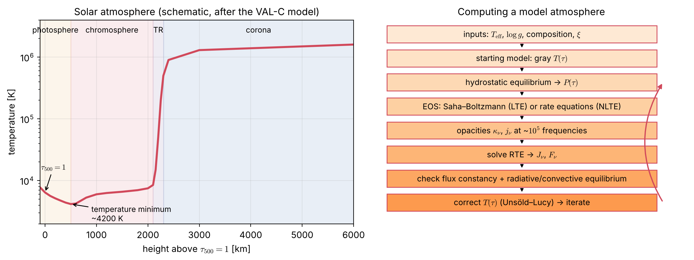

# Lecture SA8 — Stellar Atmospheres: From the Gray Model to Real Stars

> **Sources:** Collins Part II, Ch. 9 (assumptions of normal stellar atmospheres §9.1, the role of the atmosphere in setting boundary conditions); Gray, *The Observation and Analysis of Stellar Photospheres* (2005); Mihalas, *Stellar Atmospheres* (1978); Hubeny & Mihalas (2014); Vernazza, Avrett & Loeser (1981) for the VAL-C solar model; A670 Lecture RT1 (applications).

## Learning goals

1. List the equations of a classical model atmosphere and the iteration used to solve them.
2. Explain the effects of non-gray opacity: line blanketing, surface cooling and backwarming; know the dominant opacity sources across the spectral sequence.
3. Decide when convection, sphericity, winds or 3D effects must be included.
4. Describe the layers of the solar atmosphere and why the upper layers need non-radiative heating and NLTE.
5. Know how $T_{\rm eff}$, $\log g$ and abundances are measured, and name the main model-atmosphere grids and codes.

---

## Key concepts in plain words

**The atmosphere is the star's "skin" and its only messenger.** Everything we learn about a star comes through its atmosphere, a layer usually less than 0.1 % of the stellar radius. It sets the observed spectrum, and it also sets the outer boundary condition for the stellar interior.

**A model atmosphere is a self-consistent recipe.** Give it three numbers (the effective temperature, the surface gravity and the chemical composition) and it computes, depth by depth, the temperature, pressure, density, ionisation, opacity and radiation field. All of these must agree with each other: the energy must flow outward at a constant rate, gas pressure must balance gravity, and the populations must follow from $T$ and $P$ (in LTE) or from the rate equations (in NLTE).

**Real opacity is not gray.** Thousands of spectral lines block radiation in some frequency windows. The energy is pushed into other windows and back into the deeper layers, which heat up ("backwarming"), while the upper layers cool. This line blanketing changes colours, temperature structures and derived abundances.

**Beyond the classical picture.** Cool stars have convection reaching into the photosphere, visible as granulation. Giants and supergiants have extended atmospheres where the plane-parallel approximation fails. Hot stars lose mass in radiation-driven winds. The Sun has a chromosphere and a million-degree corona heated by non-radiative energy. Each of these requires physics beyond the gray LTE model of Lecture SA5, and modern models handle them with spherical, NLTE, time-dependent or 3D methods.

---

## 8.1 The equations of a classical model atmosphere

**Assumptions** (Collins §9.1d, extended): plane-parallel, static, 1D, horizontally homogeneous, LTE (or NLTE), energy carried by radiation and convection, no energy sources.

| Equation | Form | Role |
|---|---|---|
| hydrostatic equilibrium | $\dfrac{dP_{\rm gas}}{d\tau} = \dfrac{g}{\kappa} - \dfrac{dP_{\rm rad}}{d\tau}\ (-\ \text{turbulent pressure})$ | pressure structure |
| energy conservation | $F_{\rm rad}+F_{\rm conv} = \sigma T_{\rm eff}^4$ | temperature structure |
| radiative transfer | $\mu\,dI_\nu/d\tau_\nu = I_\nu - S_\nu$ at about $10^4$–$10^6$ frequencies | radiation field |
| convection | mixing-length theory when $\nabla_{\rm rad}>\nabla_{\rm ad}$ | $F_{\rm conv}$ |
| equation of state | ideal gas + Saha–Boltzmann (LTE) or rate equations (NLTE) | populations, $n_e$, $\rho$ |
| opacity | $\kappa_\nu(T,P,\text{composition})$: continuum + lines + molecules | couples everything |

*Figure 8.1 — Left: the layers of the solar atmosphere (schematic, after the VAL-C model of Vernazza, Avrett & Loeser 1981): the temperature falls through the photosphere to a minimum near 4200 K, rises in the chromosphere, jumps through the thin transition region (TR), and reaches 1–2 MK in the corona. Right: how a model atmosphere is computed. Start from the gray $T(\tau)$ of Lecture SA5 and iterate until the flux is constant at every depth.*

**Temperature correction.** At each iteration the error in flux constancy is used to correct $T(\tau)$. The classical scheme is the **Unsöld–Lucy** correction; others include the Avrett–Krook method and complete linearization.

## 8.2 Non-gray effects and opacity sources

| Spectral type | $T_{\rm eff}$ [K] | Dominant continuum opacity | Notable spectral features |
|---|---|---|---|
| O, early B | 30 000–50 000 | electron scattering; He II and He I bound-free | He II lines; winds; NLTE essential |
| late B, A | 10 000–20 000 | H I bound-free (Balmer, Paschen continua) | strongest Balmer lines and Balmer jump near A0 |
| F, G, K | 4 000–7 500 | **H$^-$** bound-free and free-free | metal lines, G band (CH), Ca II H & K |
| M | 2 500–4 000 | H$^-$ + molecules (TiO, VO, H$_2$O) | molecular bands dominate |
| L, T (brown dwarfs) | < 2 500 | molecules (H$_2$O, CH$_4$), dust clouds | methane bands, clouds |

**Line blanketing** (blocked flux in line-crowded regions, mainly the UV) has three effects:

1. **Blocking:** the UV flux is reduced, so colours change.
2. **Backwarming:** to carry the same total flux through the blocked layers, the deeper layers become hotter.
3. **Surface cooling:** lines are efficient emitters in the cool upper layers, which lowers the boundary temperature below the gray value.

## 8.3 Convection in atmospheres

The **Schwarzschild criterion**: convection occurs if $\nabla_{\rm rad}\equiv\left(\dfrac{d\ln T}{d\ln P}\right)_{\rm rad}>\nabla_{\rm ad}$ ($\nabla_{\rm ad} = 0.4$ for a monatomic ideal gas, smaller where hydrogen ionises).

For the gray atmosphere with constant $\kappa$ ($P\propto\tau$, $T^4\propto\tau+\frac23$): $\nabla_{\rm rad} = \dfrac{\tau}{4(\tau+2/3)}<\dfrac14<0.4$, so it is **stable**. In real cool stars $\kappa$ rises steeply with $T$ (H$^-$), and hydrogen ionisation lowers $\nabla_{\rm ad}$, so convection starts just below the photosphere. Its top is seen as **granulation** (cells about 1000 km across, lifetimes of about 5–10 min on the Sun). 1D models use mixing-length theory and a "microturbulence" parameter; **3D radiation-hydrodynamic** models (e.g. Stagger, CO5BOLD, MURaM, Bifrost) simulate convection directly.

## 8.4 The solar atmosphere: layers and physics

| Layer | Height [km] | $T$ | Physics | Diagnostics |
|---|---|---|---|---|
| photosphere | 0–500 | 6400 → 4200 K | radiative equilibrium, mostly LTE, convective overshoot | visible continuum, weak lines, limb darkening |
| temperature minimum | about 500 | about 4200 K | | UV continuum near 160 nm, far IR |
| chromosphere | 500–2100 | 6000–20 000 K | non-radiative (wave and magnetic) heating; NLTE; partial ionisation | H$\alpha$, Ca II H & K, Mg II h & k, mm-wave continuum |
| transition region | about 2100–2300 | $10^4\to10^6$ K | steep conduction-dominated gradient | UV lines of C IV, Si IV, O V |
| corona | > 2300 | 1–2 × 10$^6$ K | magnetic heating, collisional ionisation equilibrium (coronal approximation) | EUV and X-ray lines (Fe IX–XVI), white-light K-corona (Thomson scattering) |

The rise of $T$ above the temperature minimum **cannot** be produced by radiative equilibrium. It requires mechanical or magnetic heating, and its spectral lines (H$\alpha$, Ca II, Mg II) must be modelled in NLTE (Lecture SA7). In LTE, the temperature rise produces emission cores in strong lines, the thermal-inversion effect of the MIT toy model (Lecture RT5).

## 8.5 Beyond plane-parallel and static

- **Sphericity.** The atmosphere's thickness is roughly $10H$, where $H = kT/(\mu m_Hg)$ is the pressure scale height. When $10H/R$ exceeds a few per cent (giants, supergiants), spherical models are needed (e.g. spherical MARCS, PHOENIX).
- **Stellar winds.** Hot stars drive winds by the radiation force on lines (radiation-driven wind theory of Castor, Abbott & Klein, 1975). Lines form in expanding gas and show **P Cygni profiles** (blue-shifted absorption plus emission). The transfer is solved with the **Sobolev approximation** or in the comoving frame (CMFGEN, PoWR, FASTWIND).
- **3D and time dependence.** Granulation, magnetic structures, pulsation and shocks (Miras) need 3D or time-dependent radiation-hydrodynamics. 3D NLTE analyses lowered the solar oxygen abundance by about 0.2 dex in the 2000s (Asplund et al. 2009).

## 8.6 Model grids and codes

| Code or grid | Type | Typical use |
|---|---|---|
| ATLAS9, ATLAS12 (Kurucz) | 1D, LTE, plane-parallel, line-blanketed | A–K stars; classic grids |
| MARCS (Gustafsson et al.) | 1D, LTE, plane-parallel or spherical, molecules | F–M stars, giants |
| PHOENIX (Hauschildt & Baron) | 1D or 3D, spherical, NLTE capable | cool stars, brown dwarfs, novae, supernovae |
| TLUSTY (Hubeny & Lanz) | 1D NLTE, plane-parallel | O and B stars, white dwarfs, accretion disks (OSTAR, BSTAR grids) |
| CMFGEN, PoWR, FASTWIND | spherical NLTE with winds | massive stars, Wolf–Rayet stars, supernovae |
| Stagger, CO5BOLD, MURaM, Bifrost | 3D radiation-(magneto)hydrodynamics | granulation, solar atmosphere, abundances |
| SYNTHE, MOOG, Turbospectrum, SME, SYNSPEC | spectrum synthesis and analysis | abundances, line profiles |

## 8.7 How stellar parameters are measured

| Parameter | Main diagnostics |
|---|---|
| $T_{\rm eff}$ | spectral energy distribution and colours; infrared flux method; Balmer-line wings (F–G); excitation balance of Fe I lines; line-depth ratios; interferometric angular diameter + bolometric flux |
| $\log g$ | pressure-broadened wings (Mg I b, Ca II, Balmer lines in hot stars); ionisation balance (Fe I/Fe II); asteroseismology; mass and radius from binaries |
| abundances | equivalent widths on the linear part of the curve of growth (Lecture SA6); spectrum synthesis with LTE or NLTE and 1D or 3D models |
| microturbulence $\xi$ | Fe I abundance independent of equivalent width (flat part of the curve of growth) |
| magnetic field | Zeeman splitting and Stokes $V$ (Lecture RT9) |

---

## Worked example 8.1 — When is an atmosphere plane-parallel?

*Compute the pressure scale height $H = kT/(\mu m_Hg)$ with $\mu = 1.3$ for (a) the Sun ($T = 5772$ K, $g = 274$ m s$^{-2}$), (b) a red supergiant ($T = 4000$ K, $\log g = 0$ cgs, i.e. $g = 0.01$ m s$^{-2}$, $R = 500R_\odot$), (c) a white dwarf ($T = 10^4$ K, $\log g = 8$, $g = 10^6$ m s$^{-2}$).*

(a) $H = \dfrac{1.381\times10^{-23}\times5772}{1.3\times1.674\times10^{-27}\times274} = 1.34\times10^5$ m = 134 km; $10H/R_\odot = 0.2\,\%$, so plane-parallel is excellent.
(b) $H = 2.54\times10^9$ m $= 3.6\,R_\odot$; $10H/R = 7\,\%$, so **spherical** models are needed.
(c) $H\approx64$ m: the whole atmosphere is a few hundred metres thick; extremely plane-parallel, with huge pressure broadening.

## Worked example 8.2 — Why the gray atmosphere is not convective

*Show that $\nabla_{\rm rad}<0.25$ for the Eddington gray atmosphere with constant opacity, and compare with $\nabla_{\rm ad} = 0.4$.*

$P = g\tau/\kappa\Rightarrow d\ln P = d\ln\tau$. With $T^4 = \frac34T_{\rm eff}^4(\tau+\frac23)$: $4\,d\ln T = \dfrac{d\tau}{\tau+2/3}$, so
$$\nabla_{\rm rad} = \frac{d\ln T}{d\ln\tau} = \frac{\tau}{4(\tau+2/3)}.$$
At $\tau = 1$: 0.15; as $\tau\to\infty$: 0.25. Always below 0.4, so the gray, constant-$\kappa$ atmosphere is convectively stable. Real solar-type stars are convective just below the photosphere because $\kappa$ grows steeply with $T$ and $\nabla_{\rm ad}$ drops in the hydrogen ionisation zone.

## Worked example 8.3 — Energy budget of the chromosphere

*The solar chromosphere radiates about $4\times10^3$ W m$^{-2}$ (mainly in H$\alpha$, Ca II and Mg II), and the corona about $3\times10^2$ W m$^{-2}$ in the quiet Sun. Compare with the photospheric flux.*

$\sigma T_{\rm eff}^4 = 6.3\times10^7$ W m$^{-2}$. Chromosphere: $4\times10^3/6.3\times10^7\approx6\times10^{-5}$; corona: $\approx5\times10^{-6}$. Only a tiny fraction of the energy, about $10^{-4}$, needs to be deposited non-radiatively (by waves or magnetic reconnection) to heat the outer atmosphere. The *temperature* is high because the density is so low that this small power must be radiated by very few particles.

---

## Common misconceptions

1. **"The photosphere is the hottest visible layer."** The temperature minimum lies above it, and the chromosphere and corona are much hotter, but they are faint in visible light because their density is low.
2. **"Line blanketing only removes light."** The blocked energy is redistributed: it emerges in other frequency windows and heats the deeper layers (backwarming).
3. **"Model atmospheres need the stellar radius."** For plane-parallel models only $T_{\rm eff}$, $\log g$ and composition matter; the radius enters only for extended (spherical) atmospheres.
4. **"1D LTE models are always good enough for abundances."** For many elements, 3D and NLTE effects change abundances by 0.1–0.3 dex or more, especially in metal-poor stars and giants.

## Lecture summary

- A model atmosphere solves hydrostatic equilibrium, energy conservation (radiation + convection), the RTE, the equation of state and the opacities self-consistently, as a function of $T_{\rm eff}$, $\log g$ and composition.
- Non-gray opacity causes blocking, backwarming and surface cooling. The dominant continuum opacity changes from electron scattering (O) to H I (A) to H$^-$ (F–K) to molecules (M).
- Convection appears where $\nabla_{\rm rad}>\nabla_{\rm ad}$; 3D radiation-hydrodynamics models granulation directly.
- The solar atmosphere: photosphere → temperature minimum (about 4200 K) → chromosphere → transition region → corona (1–2 MK), with non-radiative heating and NLTE above the minimum.
- Main codes and grids: ATLAS, MARCS, PHOENIX, TLUSTY, CMFGEN, and 3D codes (Stagger, CO5BOLD, MURaM, Bifrost).

---

## Exam questions and answers — Lecture SA8

**Q1.** List the equations of a classical 1D LTE model atmosphere and explain why it is determined by $T_{\rm eff}$, $\log g$ and composition only.

> **A1.** Hydrostatic equilibrium $dP/d\tau = g/\kappa$ (plus radiation and turbulent pressure); energy conservation $F_{\rm rad}+F_{\rm conv} = \sigma T_{\rm eff}^4$; the RTE at many frequencies; mixing-length convection; the equation of state with Saha–Boltzmann populations; and opacities $\kappa_\nu(T,P,\text{composition})$. In plane-parallel geometry $g$ is constant and the flux is fixed by $T_{\rm eff}$; the radius appears nowhere, so $T_{\rm eff}$, $g$ and composition fully determine the structure.

**Q2.** What are line blanketing, backwarming and surface cooling?

> **A2.** Line blanketing is the blocking of flux by many lines, mainly in the UV. Because the total flux must still be carried, the radiation is redirected to other frequencies and partly back into the atmosphere, raising the temperature of the deeper layers (backwarming). In the upper layers, lines efficiently radiate energy away, lowering the boundary temperature below the gray value (surface cooling).

**Q3.** Describe the temperature structure of the solar atmosphere from the photosphere to the corona, and say which parts can be described by radiative equilibrium in LTE.

> **A3.** $T$ falls from about 6400 K at $\tau_{500} = 1$ to a minimum of about 4200 K some 500 km higher (photosphere: radiative equilibrium, mostly LTE). It then rises through the chromosphere (6000–20 000 K), jumps in a thin transition region near 2100–2300 km, and reaches 1–2 MK in the corona. Only the photosphere is close to radiative equilibrium in LTE. The chromosphere and corona require non-radiative heating, and their lines must be treated in NLTE.

**Q4.** Using the pressure scale height, explain why red supergiants need spherical model atmospheres but the Sun does not.

> **A4.** $H = kT/(\mu m_Hg)$. For the Sun $H\approx134$ km, so the atmosphere (about $10H$) is 0.2 % of $R$: plane-parallel. For a red supergiant ($\log g\approx0$, $R\approx500R_\odot$), $H\approx3.6R_\odot$ and $10H/R\approx7\,\%$: rays leaving at different heights see different curvature, the outer layers dilute the radiation ($J\neq$ the plane-parallel value), and the luminosity depends on the radius at which it is defined. Spherical models are required.
