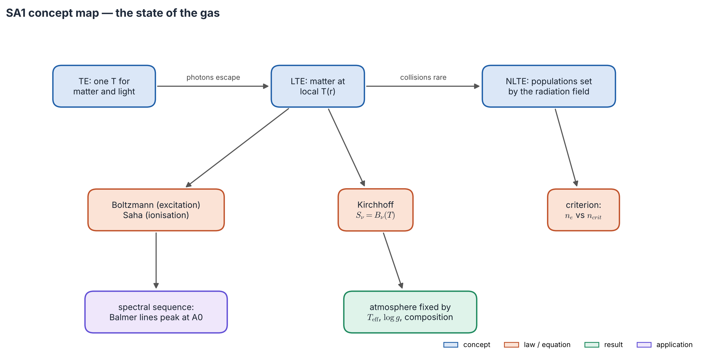
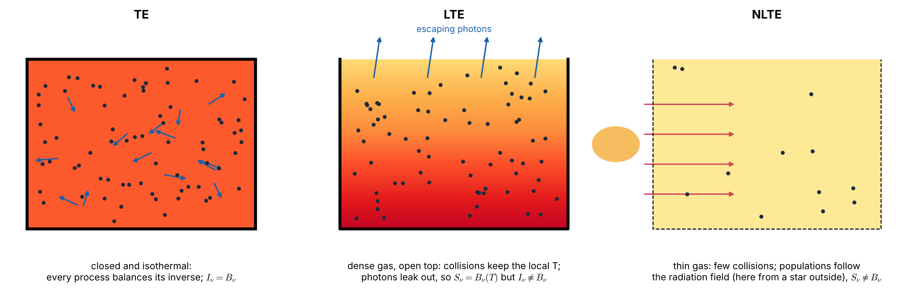
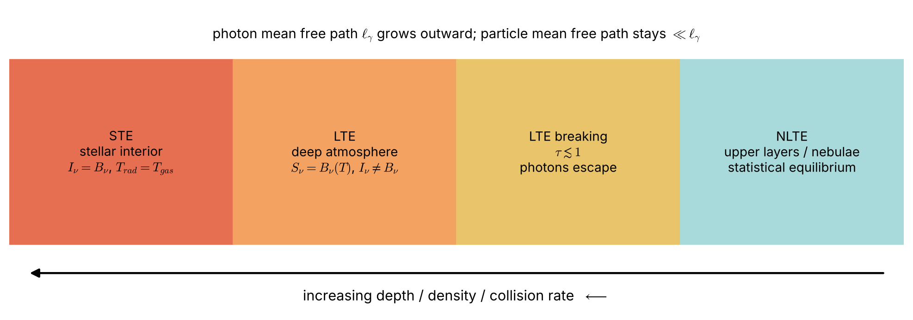
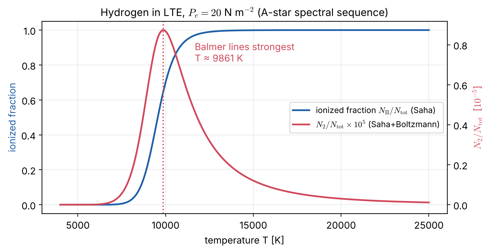

# Lecture SA1 — The State of the Gas: TE, LTE and Non-LTE; Saha and Boltzmann

> **Sources:** Collins §9.1 (breakdown of strict TE, assumption of LTE, the five assumptions of normal stellar atmospheres), §9.2c–d (Kirchhoff's law, $S_\nu = B_\nu$); E. Novotny, *Introduction to Stellar Atmospheres and Interiors* (1973), Ch. 3.1–3.3 (Bohr atom, excitation, ionisation); MIT 8.901 §7.3; Mihalas, *Stellar Atmospheres* (1978) §5-1 (LTE: Maxwell, Boltzmann, Saha) and §5-2 (the LTE equation of state), §11-1 (why LTE fails: diffusion, destruction, escape); R. N. Thomas (1965); Osterbrock & Ferland (2006).

*Concept map — three regimes, ordered by how much the radiation is allowed to escape. In **TE** one temperature rules everything. In **LTE** photons escape but collisions still set the atoms by the local temperature; Boltzmann, Saha and Kirchhoff then give the opacity and $S_\nu = B_\nu$. In **NLTE** collisions are too rare, and the radiation field takes over.*

## Learning goals

1. Say what a stellar atmosphere is, and which assumptions define a "normal" one.
2. Define TE, LTE and NLTE precisely, with two examples of each, and decide which applies.
3. Derive Kirchhoff's law and $S_\nu = B_\nu(T)$ in LTE.
4. Use the Boltzmann and Saha equations, and explain why Balmer lines peak in A stars.

## The big ideas in plain words

**The atmosphere is where photons escape.** It is the thin skin of the star, less than 0.1 % of the Sun's radius, from where the gas is still opaque ($\tau\sim10$–100) out to where it is transparent. Yet it produces the entire spectrum we observe.

**Three levels of equilibrium — a crowded hall** (Figure 1.1). In **TE** the hall is closed and has been quiet for a long time: people (matter) and the air (radiation) share one temperature everywhere. In **LTE** the doors are open and air streams out (photons escape), but people bump into each other so often that each corner keeps its own local temperature. In **NLTE** the hall is so empty that people rarely meet; what they do is decided by what blows in through the doors, i.e. the radiation field.

**Who talks to the atoms decides the regime.** Atoms are excited and de-excited by *collisions* (which "know" the local temperature) and by *photons* (which may come from far away, or escape). If collisions win, populations follow the local temperature: LTE. If photons win, populations follow the light: NLTE.

**Boltzmann is a tax on climbing the energy ladder.** Occupying a level of energy $\Delta E$ costs a factor $e^{-\Delta E/kT}$, a heavy tax when $kT$ is small.

**Saha balances cost against freedom.** Ionisation costs a large energy $\chi$, but a freed electron gains an enormous number of possible states. That freedom wins early: hydrogen ionises near 10 000 K although $\chi/k = 158\,000$ K. Low density helps too, since a free electron rarely meets an ion.

---

## 1.1 What a stellar atmosphere is

Collins (§9.1) defines the atmosphere by *the failure of the assumptions that work in the interior*: near the surface photons start to escape, the radiation stops being Planckian, and the transfer of radiation becomes global instead of local. The questions this course answers:

| Question | Lecture |
|---|---|
| What is the state of the gas? | SA1 (this lecture) |
| How does matter absorb and emit, in the continuum and in lines? | SA2 |
| What sets the level populations when LTE fails? | SA3 |
| What structure and spectrum result in the simplest (gray, LTE) case? | SA4 |
| How are real model atmospheres built, and how does the Sun compare? | SA5 |

**Collins' five assumptions of a "normal" atmosphere.** (1) LTE. (2) The structure is set by the continuum opacity. (3) Plane-parallel geometry. (4) Constant gravity with hydrostatic equilibrium, $dP/dz = -\rho g$. (5) Radiative equilibrium, $F = \sigma T_{\rm eff}^4$ = constant. Then **only $T_{\rm eff}$, $\log g$ and the composition** specify the atmosphere. Lecture SA4 works inside these assumptions; Lecture SA5 shows where each fails. Novotny (1973, Ch. 9) builds a complete solar model by hand under exactly these assumptions; we redo it in Lecture SA5.

## 1.2 TE, LTE and NLTE: definitions with examples

*Figure 1.1 — **TE:** a closed, isothermal box in which every process balances its inverse; $I_\nu = B_\nu$. **LTE:** a dense gas with an open top; collisions keep the local $T$, photons leak out, so $S_\nu = B_\nu(T)$ but $I_\nu\ne B_\nu$. **NLTE:** a thin gas with few collisions; populations follow the radiation field (here from a star outside), so $S_\nu\ne B_\nu$.*

> **TE.** Every process is balanced by its inverse, and all distributions take their equilibrium form at **one** $T$: Maxwell, Boltzmann, Saha and Planck, with $I_\nu = B_\nu(T)$ isotropic. Hence $J_\nu = B_\nu$, $F_\nu = 0$, $S_\nu = B_\nu$.
> *Examples:* a closed oven (the black body); the **solar core**, isotropic to 1 part in $10^{11}$ (Worked example 1.3); the **early Universe** before recombination, which is why the CMB is Planckian.

> **LTE.** The **matter** at each point is in equilibrium at the **local** $T(\mathbf r)$ (Maxwell, Boltzmann and Saha at $T(\mathbf r)$); the **radiation** may differ from $B_\nu$. Then $j_\nu = \alpha_\nu B_\nu$ and $S_\nu = B_\nu(T)$, but $I_\nu\ne B_\nu$ and $J_\nu\ne B_\nu$.
> *Examples:* the continuum of the solar photosphere and weak metal lines in F, G, K dwarfs (the basis of classical abundance work); Earth's lower atmosphere in the thermal infrared (CO$_2$ at 15 µm below ~70 km); dense laboratory arcs.

> **NLTE.** Some level populations differ from their Saha–Boltzmann values and must be found from the **rate equations**, which couple them to the radiation field. Then $S_\nu\ne B_\nu(T)$, and the problem is non-local and non-linear.
> *Examples:* cores of strong solar lines (Na D, Ca II H & K, H$\alpha$); chromospheres and coronae; hot O and B stars and their winds; H II regions and planetary nebulae (forbidden lines); molecular clouds; masers (inverted populations, $T_{\rm ex}<0$); aurorae and airglow.

| | **TE** | **LTE** | **NLTE** |
|---|---|---|---|
| temperature | one $T$ | local $T(\mathbf r)$ | kinetic $T(\mathbf r)$, but it does not set the populations |
| populations | Boltzmann, Saha ($T$) | Boltzmann, Saha ($T(\mathbf r)$) | rate equations: $n_i = b_i\,n_i^{\rm LTE}$ |
| source function | $S_\nu = B_\nu$ | $S_\nu = B_\nu(T(\mathbf r))$ | depends on $J_\nu$ |
| radiation field | $I_\nu = B_\nu$, $F = 0$ | $I_\nu\ne B_\nu$, carries flux | $I_\nu\ne B_\nu$ |
| local or global? | trivial | local: $T\to$ populations $\to\kappa_\nu, j_\nu$ | global: populations ↔ radiation everywhere |
| criterion | closed, isothermal over many $\ell_\gamma$ | collisions ≫ radiative rates | radiative rates ≳ collisions |

*Figure 1.2 — Moving outward through a star: TE in the interior, LTE in the deep atmosphere, NLTE in the upper layers. LTE fails first for strong lines and at low density.*

**Why the radiation leaves equilibrium first.** Photons have much longer mean free paths than particles (Collins §9.1a). Near the surface photons escape and no photons come back from space, so the radiation becomes anisotropic and non-local, while particles still collide often enough to stay Maxwell–Boltzmann–Saha at the local $T$.

**A practical criterion** (developed in Lecture SA3). Collisions win for a transition $u\to l$ if $n_e q_{ul}\gg A_{ul}\,\beta_{\rm esc}$, where $\beta_{\rm esc}\approx 1/\tau$ is the photon escape probability. Equivalently, compare $n_e$ with the **critical density** $n_{\rm crit} = A_{ul}\beta_{\rm esc}/q_{ul}$.

## 1.3 Kirchhoff's law: why $S_\nu = B_\nu$ in LTE

In a TE cavity $I_\nu = B_\nu$ is uniform and isotropic, so $dI_\nu/ds = 0 = j_\nu - \alpha_\nu B_\nu$:
$$\boxed{\;j_\nu = \alpha_\nu B_\nu(T)\;}\qquad\Rightarrow\qquad\boxed{\;S_\nu^{\rm LTE} = B_\nu(T)\;}$$
**Good absorbers are good emitters.** $j_\nu$ and $\alpha_\nu$ depend only on the *state of the matter*. In LTE that state is the TE state at the local $T$, so the law holds even though $I_\nu\ne B_\nu$. With Boltzmann populations the Einstein formulas of Lecture RT2 give the same result, together with the **LTE stimulated-emission factor** $(1-e^{-h\nu/kT})$ that multiplies every LTE opacity.

| True in LTE | *Not* implied by LTE |
|---|---|
| $S_\nu = B_\nu(T_{\rm local})$ | $I_\nu = B_\nu$ or $J_\nu = B_\nu$ |
| populations from Saha–Boltzmann at $T_{\rm local}$ | isotropic radiation, zero flux |
| $\kappa_\nu$, $j_\nu$ are functions of $(T,\rho)$ only | a black-body spectrum (thin gas emits $\tau_\nu B_\nu$; MIT §7.3) |

## 1.4 Boltzmann and Saha

**Boltzmann** (excitation within one ion):
$$\frac{N_j}{N_i} = \frac{g_j}{g_i}e^{-(E_j-E_i)/kT},\qquad \frac{N_j}{N} = \frac{g_je^{-E_j/kT}}{U(T)},\quad U = \sum_i g_ie^{-E_i/kT}.$$
For hydrogen (Bohr atom, Novotny §3.1), $g_n = 2n^2$ and $E_n = -13.6$ eV$/n^2$.

**Saha** (ionisation $r\to r+1$):
$$\boxed{\;\frac{N_{r+1}\,n_e}{N_r} = \frac{2U_{r+1}}{U_r}\left(\frac{2\pi m_ekT}{h^2}\right)^{3/2}e^{-\chi_r/kT}\;}$$
with $(2\pi m_ek/h^2)^{3/2} = 2.415\times10^{21}$ m$^{-3}$ K$^{-3/2}$ and $n_e = P_e/kT$. The factor 2 is the electron spin; the $T^{3/2}$ counts free-electron states and makes ionisation happen at $kT\ll\chi$.

*Figure 1.3 — Hydrogen in LTE at $P_e = 20$ N m$^{-2}$. The $n = 2$ population, which makes the Balmer lines, rises with $T$ (Boltzmann) and then collapses as H ionises (Saha). Its peak near 9900 K is why Balmer lines are strongest in A0 stars: the spectral sequence is a temperature sequence (Saha 1920; Payne 1925).*

---

## Worked example 1.1 — Balmer lines in the Sun and in an A0 star

*Compute $N_2/N_1$ for hydrogen at 5772 K and 9900 K, and the ionisation at 9900 K for $P_e = 20$ Pa ($U_{\rm I} = 2$, $U_{\rm II} = 1$).*

**Solution.**

- 5772 K: $kT = 0.4974$ eV, so $N_2/N_1 = 4e^{-10.20/0.4974} = 5.0\times10^{-9}$. Only five atoms in a billion can absorb a Balmer photon; the lines are visible only because H is so abundant.
- 9900 K: $N_2/N_1 = 4e^{-11.96} = 2.6\times10^{-5}$, about 5000 times more.
- Saha at 9900 K: $n_e = P_e/kT = 1.46\times10^{20}$ m$^{-3}$; $(2\pi m_ekT/h^2)^{3/2} = 2.38\times10^{27}$ m$^{-3}$; $e^{-13.6/0.8531} = 1.19\times10^{-7}$. So $N_{\rm II}/N_{\rm I} = 2.38\times10^{27}\times1.19\times10^{-7}/1.46\times10^{20} = 1.94$: 66 % ionised.
- Hence $N_2/N_{\rm tot}\approx 2.6\times10^{-5}/2.94 = 8.7\times10^{-6}$, the peak of Figure 1.3.

## Worked example 1.2 — Is Na D in LTE?

*Na I D$_2$: $A_{21} = 6.2\times10^7$ s$^{-1}$, $q_{21}\approx6\times10^{-13}$ m$^3$ s$^{-1}$. Compare $n_e\approx6\times10^{19}$ m$^{-3}$ at $\tau_{500} = 1$ with $n_e\approx10^{17}$ m$^{-3}$ where the line core forms.*

**Solution.** $n_{\rm crit} = A/q\approx10^{20}$ m$^{-3}$. At $\tau_{500} = 1$, $C/A\approx0.6$: close to LTE only with help from photon trapping. Where the core forms, $C/A\approx10^{-3}$, so $\varepsilon\approx10^{-3}$: strongly NLTE. The model of Lecture SA3 then gives $S(0)/B\approx0.14$, and indeed the observed Na D cores are much darker than LTE predicts.

## Worked example 1.3 — How close to TE is the Sun's centre?

*With photon mean free path $\ell\approx2$ cm and temperature scale height $H_T\approx R_\odot\approx7\times10^8$ m, estimate the anisotropy $F/(cu)$.*

**Solution.** Diffusion gives $F = \frac{c\ell}{3}|\nabla u|$ with $u\propto T^4$, so $|\nabla u|/u = 4/H_T$ and $F/(cu) = 4\ell/3H_T\approx 4\times10^{-11}$. The radiation is Planckian to about one part in $10^{11}$, essentially TE, yet this tiny anisotropy carries the whole solar luminosity.

---

## Common misconceptions

1. **"LTE means the radiation is Planckian."** LTE concerns matter; at the surface there is no incoming light, while $B_\nu\ne0$.
2. **"NLTE means the gas has no temperature."** Electrons and atoms usually still have a Maxwellian kinetic $T$; only the level populations depart from LTE.
3. **"A Planck spectrum proves TE."** Today's CMB is Planckian but decoupled from matter; free streaming redshifts a Planck spectrum into another Planck spectrum.
4. **"Hydrogen ionises when $kT\approx13.6$ eV."** It ionises at $kT\approx0.9$ eV, because of the huge number of free-electron states.

## Lecture summary

- The atmosphere is where photons escape; under Collins' five assumptions it is fixed by $T_{\rm eff}$, $\log g$ and composition.
- **TE:** one $T$, $I_\nu = B_\nu$ (oven, solar core, early Universe). **LTE:** matter at local $T$, $S_\nu = B_\nu$, $I_\nu\ne B_\nu$ (photospheric continuum, weak lines). **NLTE:** rate equations, $S_\nu\ne B_\nu$ (strong line cores, chromospheres, nebulae, masers).
- Kirchhoff: $j_\nu = \alpha_\nu B_\nu(T)$, valid whenever the matter is in LTE.
- Boltzmann and Saha give the populations; their competition makes the spectral sequence a temperature sequence.

---

## Exam questions and answers — Lecture SA1

**Q1.** Define TE, LTE and NLTE precisely and give two astrophysical examples of each.

> **A1.** **TE:** all distributions (Maxwell, Boltzmann, Saha, Planck) at one temperature, with detailed balance and $I_\nu = B_\nu$; examples: the solar core, the pre-recombination Universe. **LTE:** matter in equilibrium at the local temperature, so $S_\nu = B_\nu(T(\mathbf r))$, but the radiation may differ from $B_\nu$; examples: the solar photospheric continuum, weak Fe lines in the Sun, Earth's troposphere in the infrared. **NLTE:** some populations differ from Saha–Boltzmann and follow from rate equations coupled to the radiation; examples: Na D and Ca II H & K cores, planetary-nebula forbidden lines, masers.

**Q2.** Derive Kirchhoff's law and show that it implies $S_\nu = B_\nu$ in LTE. Why can LTE hold although the radiation near a stellar surface is far from a black body?

> **A2.** In a TE cavity, $dI_\nu/ds = 0 = j_\nu - \alpha_\nu B_\nu$, so $j_\nu = \alpha_\nu B_\nu(T)$. Since $j_\nu$ and $\alpha_\nu$ depend only on the state of the matter, the law holds whenever the matter is in its TE state at the local $T$; then $S_\nu = B_\nu$. LTE can hold near the surface because particle collisions, which set that state, are frequent (short particle mean free paths), while photons, with long mean free paths, escape. As long as collisional rates dominate radiative ones, the matter does not "notice" the anomalous radiation.

**Q3.** Explain with Saha and Boltzmann why Balmer lines are strongest in A0 stars ($T\approx10^4$ K) and weaker in both cooler and hotter stars.

> **A3.** The Balmer opacity is $\propto N_2$. In cool stars $N_2/N_1\propto e^{-10.2\,{\rm eV}/kT}$ is tiny ($5\times10^{-9}$ at 5800 K). Above about $10^4$ K, Saha ionisation removes neutral H. The product $N_2/N_{\rm tot}$ therefore peaks near 9900 K (for $P_e = 20$ Pa).

**Q4.** Today's CMB is an almost perfect Planck spectrum at 2.725 K, yet the photons have not interacted with matter since $z\approx1100$. Is the CMB in TE? Explain.

> **A4.** It was in TE before recombination, at about 3000 K. Afterwards photons stream freely: $I_\nu/\nu^3$ is conserved, and every frequency redshifts by the same factor $1+z$, so a Planck spectrum at $T$ becomes a Planck spectrum at $T/(1+z)\approx 2.7$ K. Today the radiation is **not** in equilibrium with any matter; the Planck shape is a relic. A Planck spectrum alone does not prove present equilibrium.
