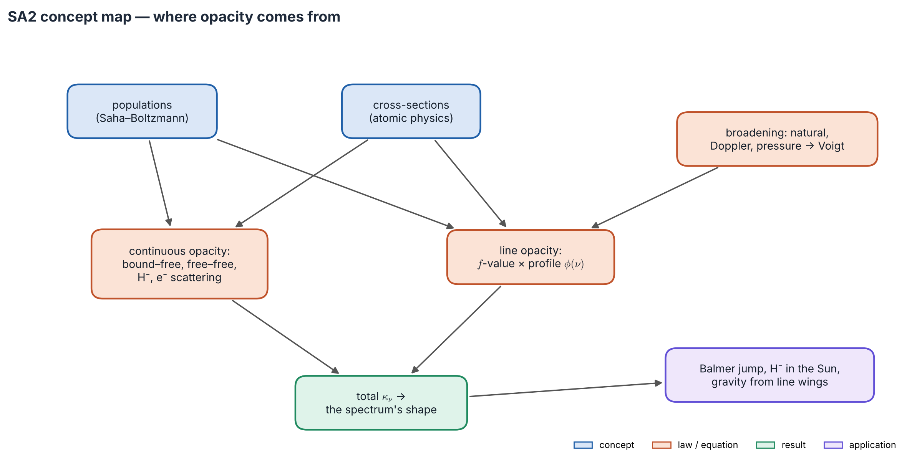
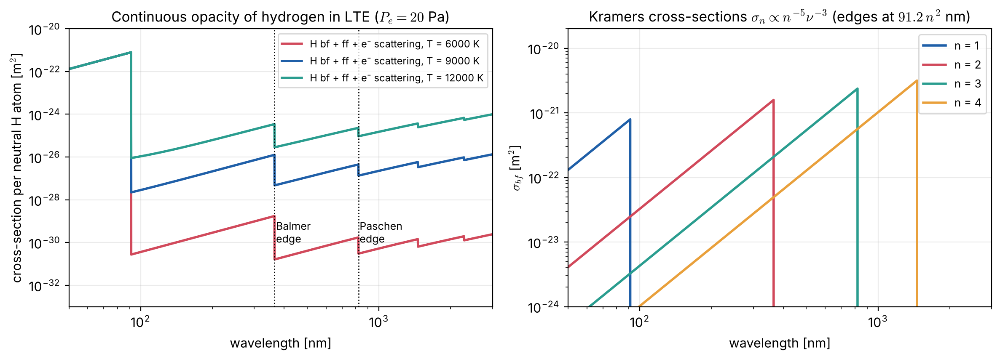

# Lecture SA2 — Where Opacity Comes From: Continuous Absorption and Line Broadening

> **Sources:** Mihalas, *Stellar Atmospheres* (1978) Chs. 4 and 9 (absorption cross-sections; line broadening); Novotny (1973) Ch. 3.4–3.6 (velocities of gas particles, absorption processes, absorption coefficients); Collins §9.2; Rybicki & Lightman Ch. 5 (free–free); Gray, *The Observation and Analysis of Stellar Photospheres*, Chs. 8, 11, 18; Wildt (1939); Barklem, Anstee & O'Mara (2000).

*Concept map — opacity is **how many absorbers** (populations from Saha–Boltzmann, Lecture SA1) times **how well each absorbs** (atomic cross-sections). Smooth processes give the **continuous opacity**; transitions between bound levels give **lines**, whose width comes from broadening. Their sum shapes the spectrum.*

## Learning goals

1. Name the continuous-opacity processes and say which dominates in O, A, G and M stars.
2. Use Kramers' bound–free formula and explain absorption edges and the Balmer jump.
3. Explain why the rare H$^-$ ion controls the Sun's visible opacity.
4. Write the line absorption coefficient, and describe natural, Doppler and pressure broadening and the Voigt profile.
5. Explain why line wings measure gravity and line cores measure temperature.

## The big ideas in plain words

**Opacity is a menu of processes** (Figure 2.1). A photon can lift a bound electron to a higher level (*bound–bound*: a line), free it (*bound–free*), be absorbed by a free electron passing an ion (*free–free*), or be redirected (*scattering*). The last three vary smoothly with frequency and form the **continuous opacity**.

**Edges are fingerprints.** A photon can ionise an atom from level $n$ only if it has enough energy, so each level absorbs from a sharp threshold (an *edge*) to higher frequencies, fading as $\nu^{-3}$. Hydrogen's edges are at 91.2 nm (Lyman), 364.7 nm (Balmer) and 820.6 nm (Paschen).

**Counting absorbers beats counting atoms.** A process absorbs only if atoms are in the right state. In the Sun only one H atom in $10^8$ is the fragile negative ion H$^-$, yet it out-absorbs ordinary hydrogen by a factor of 100 in the visible, because almost all neutral hydrogen sits in the ground state, which absorbs only below 91 nm.

**Why lines have widths.** Three things smear a sharp transition: *uncertainty* (short-lived states have fuzzy energies: natural broadening), *motion* (Doppler shifts: thermal and turbulent broadening) and *neighbours* (passing particles perturb the levels: pressure broadening). The first and third give broad Lorentzian wings; the second gives a Gaussian core. Together: the Voigt profile.

**The core is a thermometer; the wings are a barometer.** The Doppler core measures temperature and turbulence. The pressure-broadened wings measure the density of perturbers, and through hydrostatic equilibrium the surface gravity.

---

## 2.1 The menu of processes

*Figure 2.1 — The four ways matter stops a photon, drawn on an energy-level diagram (repeated from Lecture RT2).*

| Process | Frequency dependence | Dominant in |
|---|---|---|
| bound–free | edges, $\propto\nu^{-3}$ above each | H I in A–B stars; He in O–B; metals in the UV; H$^-$ in F–K |
| free–free | $\propto\nu^{-3}$ optical, $\nu^{-2}$ radio | hot stars (IR, radio); H$^-$ free–free beyond 1.6 µm |
| electron scattering | gray, $\sigma_T = 6.652\times10^{-29}$ m$^2$ | O stars, interiors |
| Rayleigh scattering | $\propto\lambda^{-4}$ | blue and UV of cool giants |
| molecules, dust | bands | M, L, T dwarfs |
| bound–bound | narrow profiles (§2.4) | lines in all stars |

## 2.2 Hydrogenic bound–free and free–free absorption

**Kramers' cross-section** for photo-ionisation from level $n$ of a hydrogen-like ion of charge $Z$:
$$\boxed{\;\sigma_{\rm bf}(n,\nu) = 2.815\times10^{29}\,\frac{Z^4\,g_{\rm bf}}{n^5\nu^3}\ \text{cm}^2\qquad(\nu\ge\nu_n = 3.288\times10^{15}Z^2/n^2\ \text{Hz})\;}$$
At its own edge the cross-section *grows* as $n$, so excited levels are excellent absorbers **if they are populated**. In LTE, with Boltzmann populations and stimulated emission:
$$\alpha^{\rm bf}_\nu = \sum_n N_n\,\sigma_{\rm bf}(n,\nu)\big(1-e^{-h\nu/kT}\big),\qquad N_n = N_{\rm H\,I}\frac{2n^2e^{-E_n/kT}}{U(T)}.$$

**Free–free** (inverse bremsstrahlung) for a hydrogen-like ion: $\alpha^{\rm ff}_\nu = 3.69\times10^8\,Z^2n_en_iT^{-1/2}\nu^{-3}g_{\rm ff}(1-e^{-h\nu/kT})$ cm$^{-1}$ (cgs). It rises toward low frequency and dominates the radio emission of H II regions (Lecture RT3).

*Figure 2.2 — Left: hydrogen continuous cross-section per neutral H atom in LTE at $P_e = 20$ Pa (`scripts/sa_physics.py`). The Lyman, Balmer and Paschen jumps grow dramatically with $T$, because excited-level populations follow Boltzmann. Right: Kramers cross-sections of the first four levels, each absorbing only blueward of its edge.*

**The Balmer jump across the spectral sequence.** At $P_e = 20$ Pa the hydrogen opacity jumps by factors of 106, 26 and 12 across the Balmer edge at 6000, 9000 and 12 000 K. Yet the *observed* jump is largest in late B and A stars. In the Sun, H$^-$ (with no edge at 364.7 nm) dominates and dilutes the jump. In A stars hydrogen dominates the continuum: blueward of the edge we see higher, cooler layers (Eddington–Barbier), and the flux drops. In hotter stars ionisation and electron scattering shrink it. The jump measures $T$ in B stars and gravity (through $P_e$) in A–F stars.

## 2.3 The negative hydrogen ion

- Binding energy 0.754 eV, so bound–free absorption extends to 1.64 µm, with a cross-section peaking near 850 nm at $\approx4\times10^{-21}$ m$^2$. Free–free H$^-$ dominates beyond 1.6 µm. The opacity minimum at 1.6 µm lets us see deepest there.
- Abundance from a Saha equation with the electron *added*:
$$\frac{n({\rm H^-})}{n({\rm H\,I})\,n_e} = \frac14\Big(\frac{h^2}{2\pi m_ekT}\Big)^{3/2}e^{+0.754\,{\rm eV}/kT}.$$
- **The electrons come from metals** (Na, Mg, Al, Si, Ca, Fe, with ionisation energies of 5–8 eV), because hydrogen is almost neutral. So H$^-$ opacity scales with metallicity: metal-poor stars are more transparent, and we see deeper, hotter layers.
- Identified by Wildt (1939); cross-sections computed by Chandrasekhar in the 1940s.

**Total and mean opacities.** $\kappa_\nu\rho = \sum(\alpha^{\rm bf} + \alpha^{\rm ff})(1-e^{-h\nu/kT}) + \alpha^{\rm es} + \alpha^{\rm Ray} + \alpha^{\rm lines}$; stimulated emission applies to true absorption only. Structure calculations use the Rosseland mean (for flux, Lecture RT4) and the Planck mean, taken from tables (OPAL, Opacity Project, Ferguson et al. 2005). Deep inside stars, bound–free and free–free combine into **Kramers' law**, $\bar\kappa\propto\rho T^{-3.5}$.

## 2.4 Line absorption

For $l\to u$ with oscillator strength $f_{lu}$ and normalised profile $\phi(\nu)$, in LTE (cgs):
$$\boxed{\;\alpha^{\rm line}_\nu = \frac{\pi e^2}{m_ec}\,f_{lu}\,n_l\,\phi(\nu)\big(1-e^{-h\nu/kT}\big)\;},\qquad \frac{\pi e^2}{m_ec} = 0.02654\ \text{cm}^2\,\text{Hz}.$$
Line strengths are quoted as $\log gf$, and $A_{ul} = 0.6670\,(g_l/g_u)\,f_{lu}/\lambda^2$ s$^{-1}$ ($\lambda$ in cm).

| Mechanism | Physical cause | Profile | Width |
|---|---|---|---|
| natural | finite lifetimes | Lorentzian | $\gamma_{\rm rad} = \Gamma_u + \Gamma_l$; $\Delta\lambda = \lambda^2\gamma/2\pi c$ |
| Doppler | thermal motion + microturbulence $\xi$ | Gaussian | $\Delta\nu_D = (\nu_0/c)\sqrt{2kT/m + \xi^2}$ |
| pressure, $\Delta\nu = C_n/r^n$ | perturbing particles | Lorentzian (impact) or Holtsmark (quasi-static) | $\gamma_n\propto N_{\rm pert}$ |

**Pressure-broadening families:** $n = 2$ linear Stark (H and He II lines in hot stars and white dwarfs); $n = 3$ resonance (self) broadening; $n = 4$ quadratic Stark (non-hydrogenic ions in hot stars); $n = 6$ van der Waals by neutral H (metal lines in cool stars, e.g. the Na D and Mg I b wings). Modern van der Waals widths use the **ABO theory**, which corrects Unsöld's classical values by factors of 1.5–2.5.

**The Voigt profile** combines them:
$$\phi(\nu) = \frac{H(a,v)}{\sqrt\pi\,\Delta\nu_D},\qquad H(a,v) = \frac a\pi\int\frac{e^{-y^2}dy}{(v-y)^2+a^2},\qquad a = \frac{\gamma}{4\pi\Delta\nu_D},\ v = \frac{\nu-\nu_0}{\Delta\nu_D}.$$
The core is $H\approx e^{-v^2}$ (Gaussian); the wings are $H\approx a/(\sqrt\pi v^2)$ (Lorentzian), taking over beyond $|v|\approx2$–3 for $a\sim0.01$.

*Figure 2.3 — Left: Voigt functions for increasing damping $a$; Lorentzian wings rise above the Gaussian core beyond $v\approx2$–3. Right: the rotational broadening kernel for $v\sin i = 20$ km s$^{-1}$, without and with limb darkening, compared with a 2 km s$^{-1}$ thermal Gaussian.*

**Broadening of the emergent spectrum.** Rotation ($\pm v\sin i$, with the kernel of Gray Ch. 18), macroturbulence, the instrument ($R = \lambda/\Delta\lambda$) and Zeeman splitting (Lecture RT5) act on the *emergent* spectrum. They change the shape but not the equivalent width. Atomic broadening acts on the *absorption coefficient*, and for saturated lines it does change the equivalent width (Lecture SA4).

---

## Worked example 2.1 — Why H$^-$ dominates the solar opacity at 500 nm

*At $T = 6000$ K and $n_e = 10^{19}$ m$^{-3}$, compare H$^-$ bound–free with hydrogen $n = 3$ (Paschen) bound–free, per H atom.*

**Solution.**

1. $(2\pi m_ekT/h^2)^{3/2} = 1.12\times10^{27}$ m$^{-3}$ and $e^{-0.754/0.517} = 0.233$, so $n({\rm H^-})/n({\rm H\,I}) = 10^{19}/(4\times1.12\times10^{27}\times0.233) = 9.6\times10^{-9}$. Times $4\times10^{-21}$ m$^2$ gives $3.8\times10^{-29}$ m$^2$ per H atom.
2. $N_3/N_{\rm H\,I} = 9e^{-12.09/0.517} = 6.3\times10^{-10}$, and $\sigma_3(500\,{\rm nm}) = 5.4\times10^{-22}$ m$^2$, giving $3.4\times10^{-31}$ m$^2$ per H atom.
3. The ratio is ≈110: a tiny fraction of fragile ions out-absorbs excited hydrogen by two orders of magnitude.

## Worked example 2.2 — How narrow is natural broadening?

*For H$\alpha$ the upper level decays at $1.0\times10^8$ s$^{-1}$ and the lower level (by Ly$\alpha$) at $6.27\times10^8$ s$^{-1}$. Compare the natural FWHM with the Doppler width at 5800 K (0.21 Å).*

**Solution.** $\gamma = 7.3\times10^8$ s$^{-1}$, so $\Delta\lambda = \lambda^2\gamma/2\pi c = 1.7\times10^{-13}$ m $= 0.0017$ Å, about 120 times narrower than the Doppler core. Natural broadening shows only in the far wings.

## Worked example 2.3 — The damping parameter of a solar Fe I line

*An Fe I line at 500 nm has $\gamma\approx10^9$ s$^{-1}$ (mostly van der Waals); $T = 5772$ K and $\xi = 1$ km s$^{-1}$. Find $a$.*

**Solution.** $v_D = \sqrt{2kT/m_{\rm Fe} + \xi^2} = 1.65$ km s$^{-1}$, so $\Delta\nu_D = v_D/\lambda = 3.3\times10^9$ Hz and $a = \gamma/(4\pi\Delta\nu_D) = 0.024$. That is why $a\approx0.01$–0.03 is used for solar metal lines in the curve of growth (Lecture SA4).

---

## Common misconceptions

1. **"The most abundant atom gives the most opacity."** What counts is the number of particles in an absorbing state at that frequency.
2. **"Bound–free absorption occurs only at the edge."** It occurs at all frequencies *above* the edge, falling roughly as $\nu^{-3}$.
3. **"The natural width is what we see."** It is usually 10–1000 times smaller than the Doppler and pressure widths.
4. **"The Voigt core is Lorentzian."** The core is essentially Gaussian; the Lorentzian shows only in the wings.

## Lecture summary

- Opacity = number of absorbers (Saha–Boltzmann) × cross-section, summed over bound–free, free–free, scattering and lines.
- Kramers: $\sigma_{\rm bf}\propto Z^4/(n^5\nu^3)$ above each edge; edges make the Balmer and Paschen jumps.
- H$^-$ (0.754 eV, to 1.64 µm) dominates F–K photospheres; its abundance tracks the metal-supplied electrons.
- Lines: $\alpha^{\rm line} = (\pi e^2/m_ec)f\,n_l\phi(\nu)(1-e^{-h\nu/kT})$, with a Voigt profile: Doppler core (temperature) and pressure wings (gravity).
- Rotation, macroturbulence and the instrument broaden the emergent spectrum without changing equivalent widths.

---

## Exam questions and answers — Lecture SA2

**Q1.** Explain why H$^-$ is the main continuous opacity in the solar photosphere, and why metal-poor stars are more transparent.

> **A1.** Solar hydrogen is mostly neutral and in the ground state, which absorbs only below 91 nm; excited levels are barely populated ($N_3/N_1\sim10^{-9}$). H$^-$, though only $\sim10^{-8}$ of H, is ionised by any photon below 1.64 µm with a large cross-section, so it dominates the visible and near-IR. Its abundance is $\propto n_e$, and the electrons come from metals: fewer metals means fewer electrons, less H$^-$ and lower opacity, so we see deeper layers.

**Q2.** Write Kramers' bound–free cross-section, show that at its own edge it is proportional to $n$, and rank the dominant continuous opacity in an O star, an A0 star, the Sun and an M dwarf.

> **A2.** $\sigma_{\rm bf} = 2.815\times10^{29}Z^4g/(n^5\nu^3)$ cm$^2$ for $\nu\ge\nu_1/n^2$. At the edge $\nu_n^3 = \nu_1^3/n^6$, so $\sigma\propto n^6/n^5 = n$. O star: electron scattering (plus He bound–free). A0: H I bound–free and free–free. Sun: H$^-$. M dwarf: H$^-$ plus molecules.

**Q3.** Name the three atomic broadening mechanisms and the profile each gives. Which part of a strong line does each control?

> **A3.** Natural (finite lifetimes) gives a Lorentzian. Pressure (perturbers) gives a Lorentzian in the impact limit, or Holtsmark in the quasi-static limit. Doppler (thermal and turbulent motions) gives a Gaussian. Their convolution is the Voigt profile. The Doppler part controls the core (temperature, microturbulence); the Lorentzian parts control the far wings (pressure, hence gravity).

**Q4.** Why do the wings of strong lines measure surface gravity? Give the chain of reasoning.

> **A4.** Wing strength $\propto\gamma_{\rm pressure}\propto$ the number density of perturbers where the wings form. By hydrostatic equilibrium the pressure at a given optical depth scales as $P\approx g\tau/\kappa$, so higher $g$ means higher density, more damping, and broader wings at fixed $T_{\rm eff}$ and abundance. Fitting the wings of Balmer lines (hot stars) or Mg I b and Ca II (cool stars) therefore gives $\log g$.
