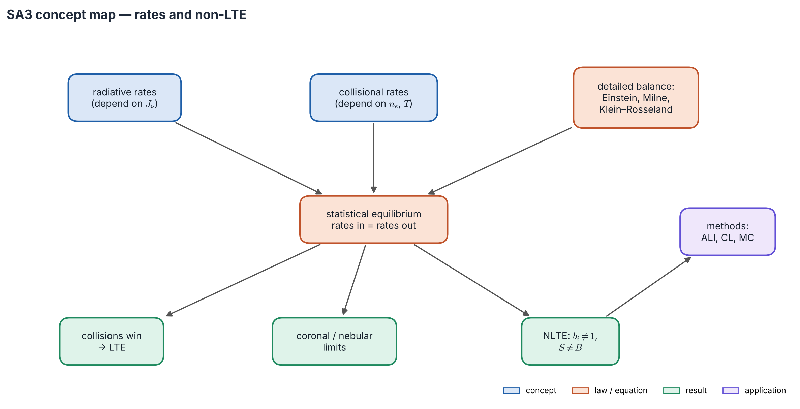
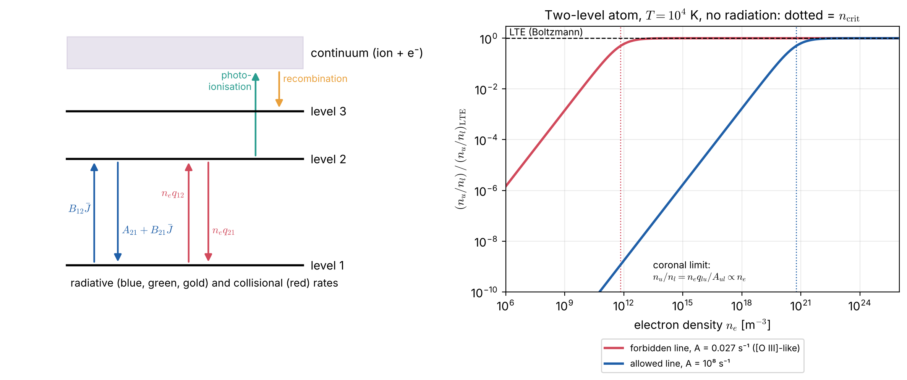

# Lecture SA3 — Transition Rates, Statistical Equilibrium and Non-LTE

> **Sources:** Mihalas, *Stellar Atmospheres* (1978) Chs. 5, 11–12 (rates, statistical equilibrium, NLTE line formation); Collins §9.1; R. N. Thomas (1965); Hubeny & Mihalas, *Theory of Stellar Atmospheres* (2014); Osterbrock & Ferland, *Astrophysics of Gaseous Nebulae* (2006); van Regemorter (1962); Drawin (1968).

*Concept map — populations are set by a **balance of traffic**: radiative rates (which depend on the light $J_\nu$) and collisional rates (which depend on $n_e$ and $T$), each tied to its inverse by detailed balance. When collisions win, the result is LTE. In thin gas we reach the coronal and nebular limits. In between lies the full NLTE problem, with its own solution methods.*

## Learning goals

1. List the radiative and collisional processes and the detailed-balance relation linking each to its inverse.
2. Write the statistical-equilibrium equations and say when they reduce to LTE.
3. Derive the two-level-atom source function $S = (1-\varepsilon)\bar J + \varepsilon B$ and the critical density.
4. Use the coronal and nebular limits.
5. Explain the main NLTE mechanisms with departure coefficients, and name the solution methods and codes.

## The big ideas in plain words

**A population is traffic in and traffic out.** Picture each atomic level as a room with doors to every other room and to the "continuum" (ion plus free electron). Atoms leave a room by absorbing, emitting or being hit by an electron, and enter by the inverse processes. In a steady state, traffic in equals traffic out for every room: **statistical equilibrium**.

**Two kinds of traffic.** *Radiative* transitions depend on the light, which may come from far away at a different temperature, or escape. *Collisional* transitions depend on the local electron density and temperature. Collisions push towards LTE; radiation pushes towards whatever the light dictates.

**Every process has a partner.** The probability of a process and of its inverse are linked by atomic physics alone. Imagine the gas in full TE, where each process balances its inverse, read off the link, and it then holds everywhere. Einstein (bound–bound), Milne (bound–free) and Klein–Rosseland (collisions) are three versions of one argument.

**NLTE is the rule in thin gas.** Most of the Universe by volume, including nebulae, the ISM, chromospheres, coronae and winds, is NLTE. Assuming LTE there misreads line strengths and gives wrong abundances, sometimes by a factor of two or more.

---

## 3.1 Inventory of rates and detailed balance

*Figure 3.1 — Left: radiative and collisional processes between bound levels and the continuum. Right: for an optically thin two-level atom with no radiation ($T = 10^4$ K), the upper population relative to LTE rises $\propto n_e$ (coronal regime) and saturates above the critical density. A forbidden line ($A = 0.027$ s$^{-1}$) reaches LTE above $\sim7\times10^{11}$ m$^{-3}$; an allowed line ($A = 10^8$ s$^{-1}$) needs $\sim6\times10^{20}$ m$^{-3}$.*

| Process (rate per atom) | Inverse | Link from detailed balance |
|---|---|---|
| radiative excitation $B_{lu}\bar J$ | emission $A_{ul} + B_{ul}\bar J$ | **Einstein:** $g_lB_{lu} = g_uB_{ul}$, $A_{ul} = \frac{2h\nu^3}{c^2}B_{ul}$ |
| photo-ionisation $4\pi\int\frac{\sigma_i}{h\nu}J_\nu d\nu$ | radiative recombination | **Milne** relation |
| collisional excitation $n_eq_{lu}(T)$ | de-excitation $n_eq_{ul}$ | **Klein–Rosseland:** $\frac{q_{lu}}{q_{ul}} = \frac{g_u}{g_l}e^{-\Delta E/kT}$ |
| collisional ionisation $n_eq_{i\kappa}$ | three-body recombination ($\propto n_e^2$) | **Saha** |
| dielectronic recombination; charge exchange | — | important in hot plasmas and nebulae |

**Collision strengths.** Rate coefficients are written with the dimensionless, symmetric collision strength $\Omega_{lu}$:
$$q_{ul} = \frac{8.629\times10^{-6}}{g_u\sqrt T}\,\Omega_{lu}\ \text{cm}^3\,\text{s}^{-1}\quad(\times10^{-6}\text{ in m}^3\,\text{s}^{-1}),\qquad q_{lu} = \frac{g_u}{g_l}q_{ul}e^{-\Delta E/kT}.$$
Without data, approximations are used: van Regemorter (allowed lines), Seaton (ionisation), and Drawin (neutral-H collisions in cool stars, now replaced by quantum calculations).

## 3.2 Statistical equilibrium

For every level $i$:
$$\boxed{\;n_i\sum_{j\ne i}(R_{ij}+C_{ij}) = \sum_{j\ne i}n_j(R_{ji}+C_{ji})\;}\qquad\text{(rates out = rates in)}$$
together with particle and charge conservation. If $J_\nu$ were known, this would be a linear system $\mathsf A\mathbf n = \mathbf b$. But $J_\nu$ depends on the populations *everywhere* through the transfer equation, so the full problem is **non-local and non-linear**.

**LTE is a limit, reached in two ways:** collisions dominate every transition ($C\gg R$), or the radiation is Planckian ($J_\nu = B_\nu$, so radiative rates balance pairwise). Either way, Saha–Boltzmann follows.

### The two-level atom

Statistical equilibrium for $1\leftrightarrow2$, $n_1(B_{12}\bar J + C_{12}) = n_2(A_{21} + B_{21}\bar J + C_{21})$, inserted into the line source function of Lecture RT2, gives
$$\boxed{\;S^{\rm line} = (1-\varepsilon)\bar J + \varepsilon B_\nu(T),\qquad \varepsilon = \frac{\varepsilon'}{1+\varepsilon'},\quad \varepsilon' = \frac{C_{21}}{A_{21}}\big(1-e^{-h\nu/kT}\big)\;}$$
This is exactly the scattering source function of Lecture RT4, now derived from atomic physics: $\varepsilon$ is the probability that a photon absorbed in the line is destroyed by a collision rather than re-emitted.

- **Collisions dominate** ($n_e\gg n_{\rm crit} = A_{21}/q_{21}$): $\varepsilon\to1$, $S\to B$, LTE.
- **Radiation dominates:** $\varepsilon\ll1$, $S\approx\bar J$, scattering-like, NLTE. Near the surface $S(0)\approx\sqrt\varepsilon B$.
- **Photon trapping** helps: an optically thick line re-absorbs its own photons, reducing the effective $A$ by the escape probability $\beta_{\rm esc}\approx1/\tau$. The practical criterion is therefore $n_e\gg A\,\beta_{\rm esc}/q$.

## 3.3 Two classical limits

**Coronal approximation** (hot, very thin, optically thin, no strong radiation; e.g. the solar corona, supernova remnants). Every collisional excitation produces one escaping photon: $n_ln_eq_{lu} = n_uA_{ul}$, so $n_u/n_l = n_eq_{lu}/A_{ul}$, far below Boltzmann. Ionisation and recombination are both $\propto n_e$, so $n_{i+1}/n_i = q_{\rm ion}(T)/\alpha_{\rm rec}(T)$ depends on **temperature only**, which makes Fe IX–XVI lines coronal thermometers.

**Nebular approximation** (photo-ionised gas around a hot star). Diluted starlight, $J_\nu\approx W B_\nu(T_*)$ with $W\approx\frac14(R_*/r)^2\ll1$, ionises from the ground state; recombination cascades populate the excited levels; forbidden lines are collisionally excited with $n_e\ll n_{\rm crit}$.

## 3.4 Non-LTE in stellar atmospheres

**Departure coefficients** $b_i = n_i/n_i^{\rm LTE}$ (= 1 in LTE) give the line source function
$$S^{\rm line} = \frac{2h\nu^3}{c^2}\frac{1}{\frac{b_l}{b_u}e^{h\nu/kT} - 1}\ \approx\ \frac{b_u}{b_l}B_\nu(T)\quad(\text{Wien limit}).$$

*Figure 3.2 — Left: the four rate processes of a two-level atom. Right: the exact line source function (Λ-matrix solution, `scripts/lte_solvers.py`) in an atmosphere with $B$ rising gently inward. As collisions become rarer ($\varepsilon\downarrow$), the surface $S$ falls far below $B$, and thermalisation happens deeper, at $\tau\sim1/\sqrt\varepsilon$.*

| Mechanism | What happens | Effect on the spectrum | Typical cases |
|---|---|---|---|
| **photon losses** | line photons escape near the surface: $\bar J<B$, $b_u<b_l$, $S<B$ | line cores darker than LTE | Na D, Ca II H & K, H$\alpha$ core, Mg II h & k |
| **overionisation** | UV $J_\nu > B_\nu$ ionises minority species | weaker lines; LTE underestimates abundances | Fe I, Mg I in metal-poor stars |
| **overrecombination** | recombination cascades overpopulate upper levels | emission features | He I, H I in nebulae and winds |
| **pumping, fluorescence** | strong radiation fills particular levels | emission, altered strengths | Bowen fluorescence (O III), masers |
| **photon suction** | cascades through strong lines drain a level | modified populations | high-excitation solar lines |

NLTE abundance corrections are about −0.2 dex for the O I 777 nm triplet in the Sun, and up to a few tenths of a dex for Fe I and Mg I in metal-poor giants.

**Solution methods (names only).**

- *Formal solvers:* Feautrier; long and short characteristics (linear, parabolic, Bézier); DELO and Hermitian methods; discontinuous finite elements; discrete ordinates; Monte Carlo.
- *Iteration schemes:* Λ-iteration; core saturation; accelerated Λ-iteration (ALI) and multilevel ALI (MALI); Gauss–Seidel and SOR; multigrid; Ng acceleration; Krylov methods (GMRES, BiCGStab); complete linearization; hybrid CL/ALI; variable Eddington factors; the equivalent two-level atom; escape-probability and Sobolev methods; comoving-frame and partial-redistribution (PRD) schemes.
- *Codes:* MULTI, MULTI3D, RH, Lightweaver, DETAIL/SURFACE, TLUSTY/SYNSPEC, PHOENIX, CMFGEN, FASTWIND, PoWR, Balder, Cloudy, MOCASSIN, LIME, RADEX.

---

## Worked example 3.1 — [O III] in a planetary nebula

*The $^1D_2$ level of O$^{2+}$ ($g_u = 5$) has $A\approx0.027$ s$^{-1}$ and $\Omega\approx2.29$. At $T = 10^4$ K find $q_{ul}$ and $n_{\rm crit}$, and the regime in a nebula with $n_e = 10^{10}$ m$^{-3}$.*

**Solution.** $q_{ul} = 8.629\times10^{-12}\times2.29/(5\times100) = 3.95\times10^{-14}$ m$^3$ s$^{-1}$, so $n_{\rm crit} = A/q_{ul} = 6.8\times10^{11}$ m$^{-3}$. In the nebula $n_e/n_{\rm crit}\approx0.015$, and the upper level holds only 1.4 % of its LTE population (Figure 3.1): extreme NLTE. Every excitation yields a photon, so the emissivity is $\propto n_en_{\rm ion}q_{lu}(T_e)$. The ratio [O III] 436.3/500.7 nm then depends only on $T_e$, which is how nebular temperatures (~10 000 K) are measured.

## Worked example 3.2 — An allowed line from corona to photosphere

*Allowed line: $A = 10^8$ s$^{-1}$, $\Omega = 10$, $g_l = g_u = 5$, $\Delta E = 2.48$ eV, $T = 10^4$ K. Find $n_{\rm crit}$ and the population relative to LTE at $n_e = 10^{15}$ and $10^{20}$ m$^{-3}$.*

**Solution.** $q_{ul} = 8.629\times10^{-12}\times10/500 = 1.73\times10^{-13}$ m$^3$ s$^{-1}$, so $n_{\rm crit} = 5.8\times10^{20}$ m$^{-3}$. Below it the ratio is $\approx n_e/n_{\rm crit}$: $1.7\times10^{-6}$ in the transition region (coronal) and 0.15 in the deep photosphere. Even photospheres cannot thermalise strong allowed lines by collisions alone; photon trapping must help.

## Worked example 3.3 — Klein–Rosseland from detailed balance

*Derive the relation between $q_{lu}$ and $q_{ul}$.*

**Solution.** In TE, collisional excitation balances de-excitation: $n_ln_eq_{lu} = n_un_eq_{ul}$, with Boltzmann populations. So $q_{lu}/q_{ul} = (g_u/g_l)e^{-\Delta E/kT}$. The coefficients depend only on cross-sections and on the Maxwellian at $T$, so the relation holds in any gas with Maxwellian electrons, however far from TE.

---

## Common misconceptions

1. **"Detailed-balance relations apply only in TE."** They are *derived* in TE but involve only atomic properties, so they hold everywhere.
2. **"High temperature means LTE."** The corona is very hot and far from LTE, because its density is tiny. What matters is collisional versus radiative rates.
3. **"NLTE always weakens lines."** Photon losses deepen cores, overionisation weakens minority-species lines, and pumping can create emission.
4. **"Dense atmospheres are LTE everywhere."** Near the surface photons escape ($\beta_{\rm esc}\to1$), so even dense atmospheres show NLTE in strong lines.

## Lecture summary

- Radiative rates depend on $J_\nu$; collisional rates on $n_e$ and $T$. Detailed balance links each to its inverse (Einstein, Milne, Klein–Rosseland, Saha).
- Statistical equilibrium, $n_i\sum P_{ij} = \sum n_jP_{ji}$, coupled to the transfer equation, is non-local and non-linear. LTE results when collisions dominate or $J = B$.
- Two-level atom: $S = (1-\varepsilon)\bar J + \varepsilon B$, with $n_{\rm crit} = A/q$; photon trapping lowers the effective $n_{\rm crit}$.
- Coronal limit: $n_u/n_l = n_eq_{lu}/A$, and ionisation depends on $T$ only. Nebular limit: diluted photo-ionisation versus recombination.
- NLTE mechanisms: photon losses, overionisation, overrecombination, pumping. Methods: ALI/MALI, complete linearization, CL/ALI and others.

---

## Exam questions and answers — Lecture SA3

**Q1.** List the radiative and collisional processes that populate and empty a bound level, and give the detailed-balance relation for each pair. Why do these relations hold outside TE?

> **A1.** Radiative excitation $B_{lu}\bar J$ ↔ emission $A_{ul} + B_{ul}\bar J$ (Einstein). Photo-ionisation ↔ radiative recombination (Milne). Collisional excitation $n_eq_{lu}$ ↔ de-excitation $n_eq_{ul}$ (Klein–Rosseland, $q_{lu}/q_{ul} = (g_u/g_l)e^{-\Delta E/kT}$). Collisional ionisation ↔ three-body recombination (Saha). They involve only atomic cross-sections and, for collisions, the Maxwellian electron distribution, so they hold whatever the radiation field or populations.

**Q2.** For a two-level atom, write $S^{\rm line}$ in terms of $\bar J$, $B$ and $\varepsilon$. When does the line form in LTE, and why can a dense photosphere still show NLTE line cores?

> **A2.** $S = (1-\varepsilon)\bar J + \varepsilon B$ with $\varepsilon'/(1+\varepsilon') = \varepsilon$ and $\varepsilon' = (C_{21}/A_{21})(1-e^{-h\nu/kT})$. LTE requires $C_{21}\gg A_{21}$, i.e. $n_e\gg n_{\rm crit}$ (helped by trapping, $n_e\gg A\beta_{\rm esc}/q$), **and** depths below $\tau\sim1/\sqrt\varepsilon$. Line cores form high, where $n_e$ is low and photons escape ($\beta_{\rm esc}\to1$), so $\varepsilon\ll1$ and $S<B$ there.

**Q3.** Describe the coronal approximation, show that its ionisation balance is independent of density, and give one application.

> **A3.** Thin gas, weak radiation: collisional excitation is balanced by spontaneous decay ($n_ln_eq_{lu} = n_uA_{ul}$), and collisional ionisation by radiative plus dielectronic recombination. Both rates per ion are $\propto n_e$, so $n_{i+1}/n_i = q_{\rm ion}(T)/\alpha_{\rm rec}(T)$. Application: Fe IX–XVI ion ratios measure coronal temperatures of 1–3 MK.

**Q4.** Why are strong resonance-line cores darker in NLTE than in LTE? Use departure coefficients, and name two methods and two codes used to compute them.

> **A4.** Near the surface line photons escape, so $\bar J<B$ and fewer atoms are radiatively excited: $b_u<b_l$, so $S\approx(b_u/b_l)B<B$. By Eddington–Barbier the core intensity is $\approx S$ at $\tau_\nu\approx1$, below the LTE value. Methods: e.g. ALI/MALI, complete linearization, short characteristics, Feautrier. Codes: e.g. MULTI, RH, TLUSTY, PHOENIX, CMFGEN, DETAIL.
