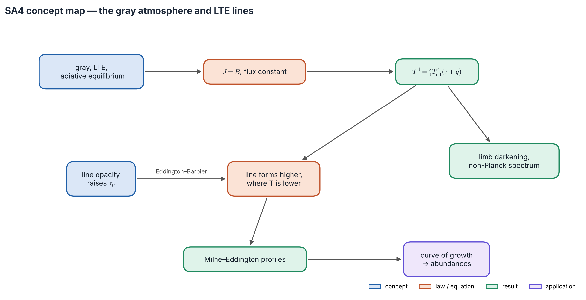
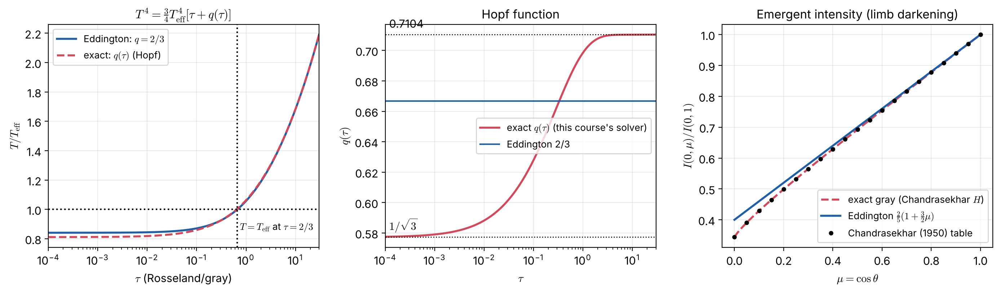
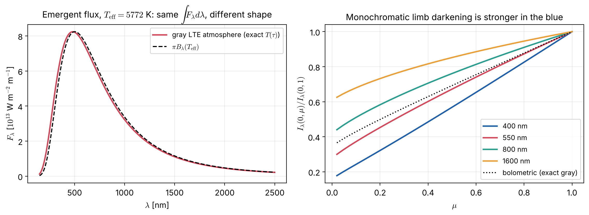
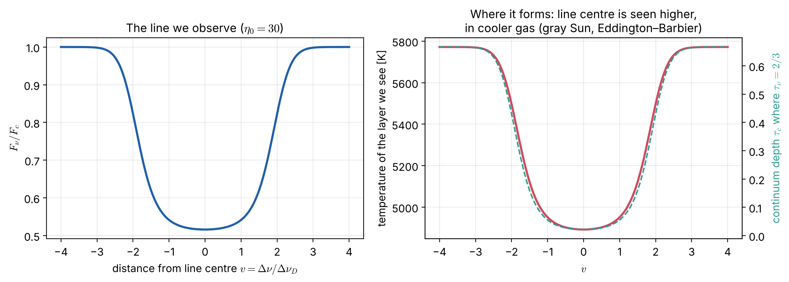
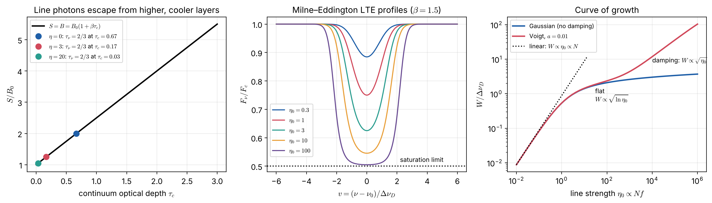

# Lecture SA4 — The Gray LTE Atmosphere and How Spectral Lines Form

> **Sources:** Collins §9.4 (gray atmosphere, Eddington approximation); Chandrasekhar (1950) Chs. III–V (Milne's equation, Hopf function, $H$-functions); Novotny (1973) Ch. 2.4–2.5 and Ch. 5 (formation of absorption lines, line profiles, line strengths); Mihalas (1978) Chs. 3 and 10; Gray, *The Observation and Analysis of Stellar Photospheres*, Chs. 13–16.

*Concept map — the top row solves the simplest complete atmosphere: **gray, LTE, radiative equilibrium**, giving $T^4 = \frac34T_{\rm eff}^4(\tau+q)$, limb darkening and a non-Planckian spectrum. The bottom row adds **line opacity**: it raises $\tau_\nu$, so lines are seen higher, where it is cooler (Eddington–Barbier). Milne–Eddington profiles and the curve of growth then turn line strengths into abundances.*

## Learning goals

1. Derive $T^4 = \frac34T_{\rm eff}^4(\tau+\frac23)$ step by step, and know where the approximation enters.
2. State the exact (Hopf) result and the gray limb-darkening laws.
3. Explain why a gray atmosphere still emits a non-Planckian spectrum.
4. Explain line formation in LTE with Eddington–Barbier, and why an isothermal atmosphere shows no lines.
5. Derive the Milne–Eddington profile and describe the three parts of the curve of growth.

## The big ideas in plain words

**The gray atmosphere is the hydrogen atom of stellar atmospheres.** Make the opacity the same at all frequencies, assume LTE and radiative equilibrium, and the whole problem can be solved exactly. It gives the temperature structure, limb darkening and the spectrum, and it is the starting point of every real model.

**In radiative equilibrium the gas absorbs exactly what it emits.** With gray opacity this means $J = B$: the mean intensity equals the Planck function at every depth, while the constant flux $\sigma T_{\rm eff}^4$ flows outward through the layers.

**The "surface temperature" is the temperature at $\tau = 2/3$.** Effective temperature is not the temperature at the top; it is the temperature of the layer from which the flux appears to come. The top layers are cooler, about $0.81\,T_{\rm eff}$.

**Lines are windows to higher layers** (Figure 4.3). Extra opacity at line frequencies means we see only the upper, cooler gas there. Lower $T$ means lower $B_\nu$, which means a darker line. No temperature gradient, no lines; a temperature *rise* outward gives emission lines.

**A line has three lives as it grows.** While weak, every added atom deepens it (linear). Once the core is black, adding atoms only widens it slowly (saturated, flat). Finally the far Lorentzian wings become opaque, and the line grows again (damping).

---

## 4.1 The gray atmosphere in six steps

**Assumptions:** plane-parallel and static; LTE ($S = B$); gray ($\kappa_\nu = \kappa$, in practice the Rosseland mean); radiative equilibrium with $F = \sigma T_{\rm eff}^4$.

1. **Radiative equilibrium:** $\int\kappa_\nu(J_\nu - B_\nu)d\nu = 0$ becomes $\kappa(J - B) = 0$, so $\boxed{J = B = S}$. Mathematically this is a pure-scattering atmosphere (the Milne problem).
2. **Constant flux:** $dH/d\tau = J - B = 0$, so $H = \sigma T_{\rm eff}^4/4\pi$.
3. **Exact:** $dK/d\tau = H$, so $K = H\tau + \text{const}$.
4. **Eddington closure** $K = J/3$ gives $J = 3H(\tau + C)$. *(First approximation.)*
5. **Boundary condition** $J(0) = 2H$ gives $C = 2/3$. *(Second approximation.)*
6. **Temperature:** with $J = \sigma T^4/\pi$,
$$\boxed{\;T^4(\tau) = \tfrac34T_{\rm eff}^4\big(\tau + \tfrac23\big)\;}$$

| Consequence | Value |
|---|---|
| $T(\tau = 2/3)$ | $= T_{\rm eff}$: the photosphere |
| $T(0)$ | $2^{-1/4}T_{\rm eff} = 0.841\,T_{\rm eff}$: the atmosphere never cools to zero |
| $\tau\gg1$ | $T^4\approx\frac34T_{\rm eff}^4\tau$: the diffusion regime |
| limb darkening | $S$ is linear, so Eddington–Barbier is exact: $I(\mu)/I(1) = (2+3\mu)/5$ |

**The exact solution** (Milne 1921; Hopf 1930–34; Chandrasekhar 1950). Without approximations, Step 1 gives Milne's integral equation $J = \Lambda[J]$, whose solution is
$$\boxed{\;T^4 = \tfrac34T_{\rm eff}^4\big[\tau + q(\tau)\big]\;}$$
where the Hopf function $q$ rises from $q(0) = 1/\sqrt3 = 0.5774$ to $q(\infty) = 0.7104$; Eddington's 2/3 lies between. The exact surface temperature is $0.8114\,T_{\rm eff}$ (Eddington is 3.6 % too hot). The exact limb darkening is $I(\mu)\propto H(\mu)$, Chandrasekhar's $H$-function with $H(1) = 2.9078$.

| $\mu$ | 0 | 0.1 | 0.2 | 0.5 | 1 |
|---|---|---|---|---|---|
| exact $I(\mu)/I(1)$ | 0.3439 | 0.4290 | 0.4988 | 0.6922 | 1 |
| Eddington $(2+3\mu)/5$ | 0.400 | 0.460 | 0.520 | 0.700 | 1 |

*Figure 4.1 — Left: $T(\tau)$, Eddington versus exact; they differ only for $\tau\lesssim1$. Centre: the Hopf function from our numerical solution of Milne's equation (`scripts/lte_solvers.py`). Right: limb darkening. The exact $H$-function law agrees with Chandrasekhar's table to 4 decimals; Eddington's is too bright at the limb.*

Our solver builds the $\Lambda$ matrix, attaches the known deep asymptote, and solves $(\mathbf1 - \mathbf\Lambda)\mathbf S = \mathbf b$. It reproduces $q(0) = 0.5773$, and the emergent flux integrated over all wavelengths equals $\sigma T_{\rm eff}^4$ to 0.007 %.

## 4.2 Gray opacity, non-gray spectrum

Each frequency samples $B_\nu(T(\tau))$ over a range of depths:
$$F_\nu(0) = 2\pi\int_0^\infty B_\nu\big(T(\tau)\big)E_2(\tau)\,d\tau .$$
Because $B_\nu$ depends very steeply on $T$ in the Wien regime, hot deep layers dominate the UV. The result is a **UV excess** relative to $\pi B_\nu(T_{\rm eff})$, and limb darkening that is **stronger in the blue**.

*Figure 4.2 — Left: emergent flux of the exact gray atmosphere ($T_{\rm eff} = 5772$ K) compared with $\pi B_\lambda(T_{\rm eff})$. Right: limb darkening at 400, 550 and 800 nm, with $I(0.1)/I(1)$ = 0.242, 0.372 and 0.510.*

**Adding pressure.** Hydrostatic equilibrium in optical depth, $dP/d\tau = g/\kappa$, gives $P = g\tau/\kappa$ for constant $\kappa$, and then $\rho = P\mu m_H/kT$. Together with $T(\tau)$ this is a complete model specified by $T_{\rm eff}$, $g$ and composition, as Collins' five assumptions promised. Lecture SA5 does it with a realistic, pressure-dependent opacity, following Novotny.

## 4.3 How lines form in LTE

In LTE both continuum and line emit thermally, so $S_\nu = B_\nu(T)$ at every frequency. **What differs is the depth scale.** With $\eta_\nu = \kappa_l\phi/\kappa_c$, $d\tau_\nu = (1+\eta_\nu)\,d\tau_c$, and Eddington–Barbier gives $F_\nu\approx\pi B_\nu(T(\tau_\nu = 2/3))$:

- continuum: $\tau_\nu = 2/3$ at $\tau_c = 2/3$, deep and hot;
- line centre: $\tau_\nu = 2/3$ at $\tau_c = (2/3)/(1+\eta)$, high and cool.

*Figure 4.3 — Left: a line with $\eta_0 = 30$ in a gray solar atmosphere. Right: the temperature of the layer we see at each frequency (red) and the continuum optical depth where $\tau_\nu = 2/3$ (teal). The line centre is seen at a continuum optical depth 31 times smaller, in gas some 900 K cooler. **An LTE absorption line is a map of the temperature gradient.***

This is the continuous version of MIT's two-layer star (Lecture RT3). An isothermal atmosphere gives **no lines**; a temperature rising outward gives **emission**, as in the Ca II H & K emission reversals of the chromosphere.

## 4.4 Milne–Eddington lines and the curve of growth

**Milne–Eddington assumptions:** LTE, $B = B_0(1 + \beta\tau_c)$, and $\eta_\nu$ constant with depth. Then $B$ is linear in $\tau_\nu$, Eddington–Barbier is exact, and
$$\boxed{\;r_\nu = \frac{F_\nu}{F_c} = \frac{1 + \dfrac{2\beta}{3(1+\eta_\nu)}}{1+\dfrac{2\beta}{3}}\;}\qquad r\xrightarrow{\eta\to\infty}\frac{1}{1+2\beta/3}.$$
The deepest possible line is set by the temperature gradient $\beta$: $\beta = 0$ gives no line. For the bolometric gray atmosphere $\beta = 3/2$, so the maximum depth is 0.5; at visible wavelengths $\beta$ is larger, so lines are deeper.

*Figure 4.4 — Left: line photons escape from higher layers, where $S = B$ is smaller. Centre: Milne–Eddington profiles for growing $\eta_0$; the core saturates at a finite depth. Right: the curve of growth: linear, then flat, then square-root.*

**Equivalent width** $W_\lambda = \int(1 - F_\lambda/F_c)\,d\lambda$. For a weak line,
$$\boxed{\;W_\lambda = \pi r_e\lambda^2N_lf\;}\qquad\text{(independent of broadening)}.$$

| Part of the curve | Condition | $W$ depends on | Use |
|---|---|---|---|
| linear | $\tau_0\lesssim1$ | $W\propto Nf$ | **abundances** |
| flat (saturated) | $1\lesssim\tau_0\lesssim10^{3\text{–}4}$ | $W\propto\Delta\nu_D\sqrt{\ln\tau_0}$ | microturbulence $\xi$ |
| damping | wings opaque | $W\propto\sqrt{Nf\gamma}$ | gravity |

**Beyond LTE:** for strong lines in thin upper layers, $S^{\rm line} = (1-\varepsilon)\bar J + \varepsilon B$ falls below $B$, and cores are darker than LTE predicts (Lecture SA3).

---

## Worked example 4.1 — The Sun as a gray atmosphere

*$T_{\rm eff} = 5772$ K. Find $T$ at several depths (Eddington) and the exact surface temperature.*

**Solution.**

| $\tau$ | 0 | 2/3 | 1 | 2 | 10 |
|---|---|---|---|---|---|
| $T$ (Eddington) [K] | 4854 | 5772 | 6103 | 6864 | 9707 |

The exact surface temperature is $0.8114\times5772 = 4682$ K. The observed solar temperature minimum (~4400 K) is close; above it the chromosphere heats up, which radiative equilibrium cannot produce. The limb-darkening inversion of Lecture RT4 (5155 K at $\tau_{500} = 0$, 6300 K at $\tau_{500} = 1$) agrees to within the effects of non-grayness.

## Worked example 4.2 — Milne–Eddington line depths

*With $\beta = 1.5$, find the central residual flux for $\eta_0$ = 1, 10 and ∞.*

**Solution.** $r = [1 + 1/(1+\eta)]/2$: $r$ = 0.75, 0.545 and 0.5. Going from $\eta = 10$ to ∞ barely changes the core: the line is **saturated**, and $W$ can now grow only in the wings.

## Worked example 4.3 — An abundance from a weak line

*A weak Fe I line at 500 nm has $W_\lambda = 22$ mÅ and $f = 0.1$. Find the absorbing column $N_l$.*

**Solution.**
$$N_l = \frac{W_\lambda}{\pi r_e\lambda^2 f} = \frac{2.2\times10^{-12}}{8.853\times10^{-15}\times(5\times10^{-7})^2\times0.1} = 1.0\times10^{16}\ \text{m}^{-2}.$$
The total iron abundance then follows from Saha–Boltzmann (the fraction of Fe in that level of Fe I) and the hydrogen column above $\tau\approx2/3$. **LTE enters at the Saha–Boltzmann step.**

---

## Common misconceptions

1. **"$T_{\rm eff}$ is the temperature of the stellar surface."** It is the temperature at $\tau\approx2/3$; the top is about 19 % cooler.
2. **"Gray opacity gives a black-body spectrum."** Each frequency averages $B_\nu$ over a range of temperatures; the UV shows an excess.
3. **"Absorption lines need cold gas in front of the star."** They need only a temperature that falls outward within the atmosphere.
4. **"Saturated lines are useless for abundances."** They are less sensitive to abundance, but they constrain microturbulence (flat part) and gravity (damping part).

## Lecture summary

- Gray + LTE + radiative equilibrium: $J = B$, $H$ constant, $K$ linear in $\tau$. Eddington gives $T^4 = \frac34T_{\rm eff}^4(\tau+\frac23)$; the exact result replaces 2/3 by the Hopf function $q(\tau)$, from 0.577 to 0.710.
- $T(2/3) = T_{\rm eff}$, $T(0) = 0.811\,T_{\rm eff}$; limb darkening $(2+3\mu)/5$ (Eddington) or $H(\mu)$ (exact).
- Gray opacity still gives a non-Planckian spectrum, with a UV excess.
- LTE lines form because line opacity lifts $\tau_\nu = 2/3$ into cooler layers; no gradient, no lines.
- Milne–Eddington: $r = [1 + 2\beta/3(1+\eta)]/(1+2\beta/3)$. Curve of growth: linear (abundance), flat ($\xi$), damping ($g$).

---

## Exam questions and answers — Lecture SA4

**Q1.** State the assumptions of the gray LTE atmosphere and derive $T^4 = \frac34T_{\rm eff}^4(\tau+\frac23)$, marking where approximations enter.

> **A1.** Plane-parallel, static, LTE, gray, radiative equilibrium with $F = \sigma T_{\rm eff}^4$. (i) RE with gray opacity: $J = B$. (ii) $dH/d\tau = J - B = 0$, so $H = F/4\pi$. (iii) $dK/d\tau = H$, so $K = H\tau + c$ (exact). **(iv) Eddington closure** $K = J/3$: $J = 3H(\tau + C)$. **(v) Boundary condition** $J(0) = 2H$: $C = 2/3$. (vi) $J = \sigma T^4/\pi$ and $H = \sigma T_{\rm eff}^4/4\pi$ give the result.

**Q2.** What is the Hopf function? Give $q(0)$ and $q(\infty)$, and the exact and Eddington surface temperatures.

> **A2.** The exact solution of Milne's equation is $J = 3H[\tau + q(\tau)]$, where $q$ rises from $1/\sqrt3 = 0.577$ (the Hopf–Bronstein relation $J(0) = \sqrt3H$) to $0.7104$. Then $T(0) = (\sqrt3/4)^{1/4}T_{\rm eff} = 0.811\,T_{\rm eff}$ exactly, against $2^{-1/4} = 0.841$ in the Eddington approximation, which replaces $q$ by the constant 2/3.

**Q3.** Explain, using Eddington–Barbier, why the solar spectrum shows absorption lines. What would an isothermal LTE atmosphere show, and what does a chromosphere do?

> **A3.** $F_\nu\approx\pi S_\nu(\tau_\nu = 2/3)$ with $S_\nu = B_\nu(T)$. Line opacity makes $\tau_\nu = 2/3$ occur higher up, where $T$ and $B_\nu$ are lower, so the flux is lower: an absorption line. An isothermal atmosphere has the same $B_\nu$ at all depths, so $F_\nu = F_c$ and there are no lines. In a chromosphere $T$ rises outward, so the cores of strong lines formed there appear in emission (e.g. the Ca II K$_2$ peaks).

**Q4.** Sketch the curve of growth and explain each of its three parts. Which is best for abundances, and why?

> **A4.** Linear: optically thin; each atom removes photons independently, so $W\propto Nf$. Flat: the core is saturated, and $W$ grows only as the region with $\tau_\nu>1$ widens through the Doppler core, $W\propto\Delta\nu_D\sqrt{\ln\tau_0}$. Damping: the Lorentzian wings become opaque, $W\propto\sqrt{Nf\gamma}$. The linear part is best for abundances because it does not depend on the poorly known $\xi$ and $\gamma$.
