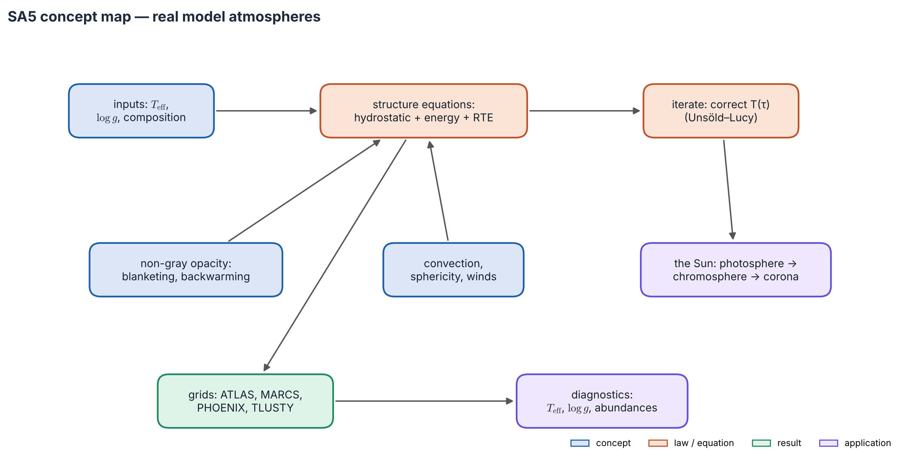
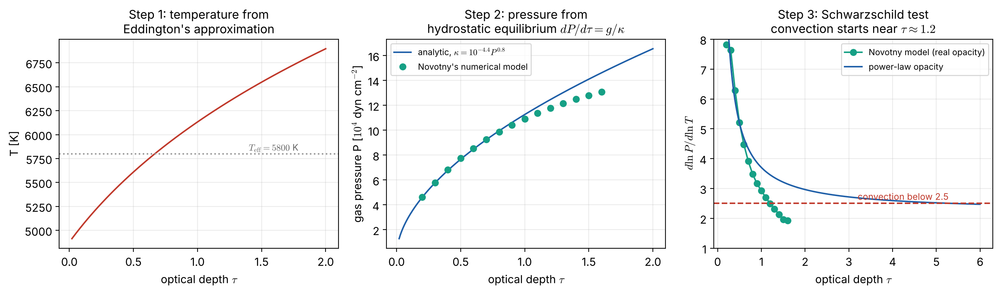

# Lecture SA5 — Real Model Atmospheres and the Sun

> **Sources:** E. Novotny, *Introduction to Stellar Atmospheres and Interiors* (1973), Ch. 4 (the equations for model atmospheres; convection; comparison of models) and Ch. 9 (a model solar atmosphere computed step by step); Collins §9.1d; Mihalas, *Stellar Atmospheres* (1978) §3-3 (Unsöld's temperature correction), Ch. 7 (§7-2 LTE models and temperature correction, §7-3 convection, §7-5 non-LTE models and the Cayrel mechanism, §7-7 semiempirical solar models); Gray, *The Observation and Analysis of Stellar Photospheres*; Vernazza, Avrett & Loeser (1981); Asplund et al. (2009); Hubeny & Mihalas (2014).

*Concept map — three inputs ($T_{\rm eff}$, $\log g$, composition) feed the **structure equations**: hydrostatic equilibrium, energy conservation and radiative transfer. Real opacity is non-gray (blanketing, backwarming), and convection, sphericity and winds enter as corrections. The equations are iterated until consistent. The output is a grid of models, used to diagnose real stars, starting with the Sun.*

## Learning goals

1. List the equations of a classical model atmosphere and explain why three parameters fix it.
2. Build a simple solar model by hand, following Novotny: $T(\tau)$, then $P(\tau)$, then a convection test.
3. Explain line blanketing, backwarming and surface cooling.
4. Describe the layers of the solar atmosphere and which need physics beyond radiative-equilibrium LTE.
5. Know when sphericity, winds and 3D effects matter, and name the main codes and diagnostics.

## The big ideas in plain words

**A model atmosphere is a self-consistent recipe.** Give it $T_{\rm eff}$, $\log g$ and composition. It returns, depth by depth, $T$, $P$, $\rho$, ionisation, opacity and the radiation field, all agreeing with each other: the energy flows out at a constant rate, pressure balances gravity, and populations follow from $T$ and $P$.

**You can build one with a pencil.** Novotny's recipe takes three steps: get $T(\tau)$ from the gray solution; integrate hydrostatic equilibrium for $P(\tau)$ using the opacity; and test whether the layers are stable against convection. Every modern code does the same thing, just with millions of frequencies and many iterations.

**Lines push energy around.** Thousands of lines block light in some windows. The energy squeezes through other windows and heats the deeper layers (*backwarming*), while lines cool the top layers.

**The Sun's atmosphere gets hotter outward above a minimum.** The temperature falls through the photosphere to about 4200 K, then rises in the chromosphere and jumps to millions of degrees in the corona. Radiative equilibrium cannot do that; waves and magnetic fields deposit energy there.

---

## 5.1 The structure equations

| Equation | Form | Role |
|---|---|---|
| hydrostatic equilibrium | $dP_{\rm gas}/d\tau = g/\kappa - dP_{\rm rad}/d\tau$ | pressure |
| energy conservation | $F_{\rm rad} + F_{\rm conv} = \sigma T_{\rm eff}^4$ | temperature |
| radiative transfer | $\mu\,dI_\nu/d\tau_\nu = I_\nu - S_\nu$ at $10^4$–$10^6$ frequencies | radiation field |
| convection | mixing length, where $\nabla_{\rm rad} > \nabla_{\rm ad}$ | convective flux |
| equation of state | ideal gas + Saha–Boltzmann (LTE) or rate equations (NLTE) | populations, $n_e$, $\rho$ |
| opacity | $\kappa_\nu(T, P, \text{composition})$ | couples everything |

In plane-parallel geometry $g$ is constant and the flux is fixed by $T_{\rm eff}$. The radius appears nowhere, so **$T_{\rm eff}$, $\log g$ and composition determine the model.**

*Figure 5.1 — Left: the layers of the solar atmosphere (schematic, after VAL-C): $T$ falls to a minimum near 4200 K, rises through the chromosphere, jumps through the transition region and reaches 1–2 MK in the corona. Right: the iteration. Start from the gray $T(\tau)$ of Lecture SA4, compute the opacities and radiation field, test flux constancy, correct $T$ (Unsöld–Lucy, Avrett–Krook, or complete linearization) and repeat.*

**How a temperature correction works (Unsöld; Mihalas §3-3).** Compute the flux $H(\tau)$ from the current model; its error is $\Delta H(\tau) = H_{\rm target} - H(\tau)$. The moment equations in the Eddington approximation then say how much the Planck function must change to remove that error:
$$\boxed{\;\Delta B(\tau) = 3\int_0^\tau\Delta H\,d\tau' + 2\,\Delta H(0) - \frac{d\,\Delta H}{d\tau}\;}$$
Apply $\Delta B$, recompute the flux, and repeat until $\Delta H\to0$. Unlike $\Lambda$-iteration, this corrects the deep layers as well as the surface. Lucy (1964) generalised it to non-gray atmospheres, and it is still the workhorse of LTE codes (Worked example 5.4).

## 5.2 A solar model atmosphere by hand (after Novotny, Ch. 9)

Novotny's problem: find $T$, $P$ and $\rho$ for $0.05<\tau<2$ in the Sun, given $T_{\rm eff} = 5800$ K and $g = 2.74\times10^4$ cm s$^{-2}$ (cgs units, as in the book).

**Step 1 — Temperature.** Take the gray Eddington law (Lecture SA4):
$$T^4 = \tfrac34T_{\rm eff}^4\big(\tau + \tfrac23\big),\qquad T = 4877\,(1 + 1.5\tau)^{1/4}\ \text{K}.$$

**Step 2 — Pressure.** Hydrostatic equilibrium in optical depth is $dP/d\tau = g/\kappa(P,T)$. Novotny reads the Rosseland mean $\kappa$ from Vitense's (1951) tables. For $\theta = 5040/T$ between 0.9 and 1.0 and $\log P$ between 4 and 5, the tables are well fitted by
$$\kappa\approx10^{-4.40}P^{0.8}\ \text{cm}^2\,\text{g}^{-1}.$$
With this power law the equation separates: $P^{0.8}\,dP = 10^{4.40}g\,d\tau$, so
$$\boxed{\;P^{1.8} = 1.8\times10^{4.40}\,g\,\tau\;}\qquad(P = 0\text{ at }\tau = 0).$$
This analytic law provides the *starting values*. Novotny then integrates numerically with the full tabulated $\kappa(P,T)$, using finite differences (Table 9-2), to $\tau = 2$.

**Step 3 — Convection test.** The layer is stable if the actual gradient is shallower than the adiabatic one, $\nabla = d\ln T/d\ln P < \nabla_{\rm ad} = 0.4$, i.e.
$$\frac{d\ln P}{d\ln T} > 2.5 \quad(\text{stable}).$$

*Figure 5.2 — Building the Sun's atmosphere in three steps (`scripts/sa_physics.py`). Left: $T(\tau)$ from Eddington's approximation. Centre: $P(\tau)$; the analytic power-law solution (line) agrees with Novotny's numerical integration with real opacities (dots) to 3 % at $\tau = 1$. Right: the Schwarzschild test. With real opacity, $d\ln P/d\ln T$ drops below 2.5 near $\tau\approx1.2$, where convection begins. With a power-law opacity that ignores the temperature dependence, convection would start only near $\tau\approx5$.*

**The lesson of Step 3.** In the gray, constant-$\kappa$ model, $\nabla = \tau/[4(\tau + 2/3)] < 0.25$, so convection never starts. In the real Sun the H$^-$ opacity rises steeply with $T$; $\kappa$ grows inward, the pressure gradient $g/\kappa$ shrinks, $d\ln P/d\ln T$ falls, and convection sets in just below the photosphere. Hydrogen ionisation lowers $\nabla_{\rm ad}$ further. The top of the convection zone is what we see as **granulation**: cells about 1000 km across that last 5–10 minutes. 1D models use mixing-length theory plus a microturbulence parameter; **3D radiation-hydrodynamics** (Stagger, CO5BOLD, MURaM, Bifrost) simulates convection directly.

## 5.3 Real opacity: blanketing across the spectral sequence

| Type | $T_{\rm eff}$ [K] | Dominant continuum opacity | Spectral features |
|---|---|---|---|
| O, early B | 30 000–50 000 | electron scattering; He bound–free | He II lines; winds; NLTE essential |
| late B, A | 10 000–20 000 | H I bound–free | strongest Balmer lines and jump near A0 |
| F, G, K | 4000–7500 | **H$^-$** | metal lines, G band, Ca II H & K |
| M | 2500–4000 | H$^-$ + molecules | TiO, VO, H$_2$O bands |
| L, T | < 2500 | molecules, dust clouds | CH$_4$ and H$_2$O bands |

**Line blanketing** has three effects: **blocking** (less UV flux, redder colours); **backwarming** (the same total flux must get through, so the deeper layers heat up); and **surface cooling** (lines radiate efficiently from the top, lowering the boundary temperature below the gray value).

## 5.4 The solar atmosphere, layer by layer

| Layer | Height [km] | $T$ | Physics | Diagnostics |
|---|---|---|---|---|
| photosphere | 0–500 | 6400 → 4200 K | radiative equilibrium, mostly LTE, convective overshoot | visible continuum, weak lines, limb darkening |
| temperature minimum | ~500 | ~4200 K | | UV near 160 nm, far IR |
| chromosphere | 500–2100 | 6000–20 000 K | wave and magnetic heating; NLTE | H$\alpha$, Ca II H & K, Mg II h & k, mm continuum |
| transition region | ~2100–2300 | $10^4\to10^6$ K | conduction-dominated | C IV, Si IV, O V |
| corona | > 2300 | 1–2 MK | magnetic heating; coronal approximation | EUV and X-ray lines (Fe IX–XVI); white-light K-corona |

Only the photosphere is close to radiative-equilibrium LTE. The rise above the temperature minimum needs non-radiative heating, and its lines need NLTE (Lecture SA3). In LTE such a rise would give emission cores in strong lines: the thermal-inversion effect of MIT's toy model (Lecture RT3).

**NLTE alone can warm the surface: the Cayrel mechanism (Mihalas §7-5).** In LTE radiative equilibrium the temperature always *falls* outward, and LTE lines cool the top layers further. Cayrel noticed that the outer layers resemble a nebula around a star. They are lit by diluted radiation, $J_\nu = W B_\nu(T_R)$ with $W<1$. In LTE the gas balances the *quantity* of light, so the dilution lowers its temperature. In NLTE, where photo-ionisation is balanced by recombination, the gas responds to the *quality* of the light: each absorbed photon still carries energy typical of $T_R$, and the gas settles at $T_0\approx T_R$, whatever $W$ is. For the Sun, Cayrel estimated $T_0\approx5600$ K, against the gray 4800 K; Feautrier's NLTE H$^-$ model gave a minimum near 4700 K and a surface value of 5200 K. Two lessons follow: a temperature minimum followed by a modest rise can appear *without* any mechanical heating, but the chromosphere's climb to 10 000 K and beyond cannot. And strong lines with $\varepsilon\ll1$ leave the boundary temperature almost unchanged, unlike LTE lines, which cool it.

## 5.5 Beyond plane-parallel and static; codes; diagnostics

- **Sphericity** matters when the atmosphere's thickness, about $10H$ with $H = kT/(\mu m_Hg)$, exceeds a few per cent of $R$, as in giants and supergiants.
- **Winds**: hot stars drive winds by radiation pressure on lines (Castor, Abbott & Klein 1975), producing P Cygni profiles. These are modelled with the Sobolev approximation or in the comoving frame.
- **3D and NLTE** analyses lowered the solar oxygen abundance by about 0.2 dex (Asplund et al. 2009).

| Code or grid | Type | Use |
|---|---|---|
| ATLAS9/12 (Kurucz) | 1D LTE, line-blanketed | A–K stars |
| MARCS | 1D LTE, plane-parallel or spherical, molecules | F–M stars, giants |
| PHOENIX | 1D/3D spherical, NLTE capable | cool stars, brown dwarfs, novae, supernovae |
| TLUSTY | 1D NLTE | O and B stars, white dwarfs, disks |
| CMFGEN, PoWR, FASTWIND | spherical NLTE with winds | massive stars, Wolf–Rayet stars |
| Stagger, CO5BOLD, MURaM, Bifrost | 3D radiation-(M)HD | granulation, the solar atmosphere |
| SYNTHE, MOOG, Turbospectrum, SME | spectrum synthesis | abundances |

| Parameter | Main diagnostics |
|---|---|
| $T_{\rm eff}$ | spectral energy distribution, infrared flux method, Balmer wings (F–G), Fe I excitation balance, interferometry |
| $\log g$ | pressure-broadened wings (Lecture SA2), Fe I/Fe II ionisation balance, asteroseismology, binaries |
| abundances | curve of growth and spectrum synthesis (Lecture SA4), with NLTE and 3D corrections |
| microturbulence | flat part of the curve of growth |
| magnetic field | Zeeman splitting and Stokes $V$ (Lecture RT5) |

---

## Worked example 5.1 — Numbers from the hand-built Sun

*Using Novotny's recipe, find $T$ and $P$ at $\tau = 0.2$ and $\tau = 1$, the density at $\tau = 1$ (mean molecular weight 1.3), and the depth where convection begins.*

**Solution.**

- $\tau = 0.2$: $T = 4877(1.3)^{1/4} = 5208$ K; $P = (1.8\times10^{4.40}\times2.74\times10^4\times0.2)^{1/1.8} = 4.61\times10^4$ dyn cm$^{-2}$, exactly Novotny's starting value (4.607).
- $\tau = 1$: $T = 6133$ K. The analytic law gives $1.13\times10^5$ dyn cm$^{-2}$; Novotny's integration gives $1.091\times10^5$ (= $1.09\times10^4$ Pa).
- Density: $\rho = P\mu m_H/kT = 1.09\times10^4\times1.3\times1.674\times10^{-27}/(1.381\times10^{-23}\times6133) = 2.8\times10^{-4}$ kg m$^{-3}$, close to detailed solar models.
- Convection: from Novotny's table, $d\ln P/d\ln T$ = 2.70 at $\tau = 1.1$ and 2.49 at $\tau = 1.2$ (his 2.68 and 2.48), so convection begins just above $\tau = 1.2$. Novotny adds that radiation still carries most of the flux there.

## Worked example 5.2 — When is an atmosphere plane-parallel?

*Find $H = kT/(\mu m_Hg)$ ($\mu = 1.3$) for the Sun, a red supergiant ($T = 4000$ K, $g = 0.01$ m s$^{-2}$, $R = 500R_\odot$) and a white dwarf ($T = 10^4$ K, $g = 10^6$ m s$^{-2}$).*

**Solution.**

- Sun: $H = 134$ km, so $10H/R_\odot = 0.2\,\%$: plane-parallel is excellent.
- Supergiant: $H = 2.5\times10^9$ m $= 3.6\,R_\odot$, so $10H/R = 7\,\%$: spherical models are needed.
- White dwarf: $H\approx64$ m. The whole atmosphere is a few hundred metres thick, with enormous pressure broadening.

## Worked example 5.3 — Energy budget of the chromosphere

*The chromosphere radiates ~$4\times10^3$ W m$^{-2}$ and the quiet corona ~$3\times10^2$ W m$^{-2}$. Compare with the photospheric flux.*

**Solution.** $\sigma T_{\rm eff}^4 = 6.3\times10^7$ W m$^{-2}$, so the ratios are $6\times10^{-5}$ and $5\times10^{-6}$. Only about $10^{-4}$ of the energy needs to be deposited non-radiatively. The *temperature* is high because the density is so low that very few particles must radiate this power.

## Worked example 5.4 — One Unsöld correction (Mihalas Exercise 3-7)

*Start the gray atmosphere from a wrong guess, $B = 3H(\tau + c)$, with any constant $c$. Apply one Unsöld correction and find the new $q(0)$ and $q(\infty)$.*

**Solution.**

1. The Schwarzschild–Milne flux integral for this $B$ gives the flux error $\Delta H(\tau) = \frac32H\,[E_4(\tau) - c\,E_3(\tau)]$. For the Eddington value $c = 2/3$, $\Delta H(0) = 0$: the surface flux is already right, but not the flux at depth.
2. Use $\int_0^\infty E_n = 1/n$, $E_n(0) = 1/(n-1)$ and $dE_n/d\tau = -E_{n-1}$ in the correction formula. At depth, $q(\infty) = c + \int_0^\infty\Delta H/H + \frac23\Delta H(0)/H = c + (\frac38 - \frac c2) + (\frac13 - \frac c2) = \frac{17}{24} = 0.708$.
3. At the surface, $q(0) = c + \frac23\Delta H(0)/H - \frac13\Delta H'(0)/H = c + (\frac13 - \frac c2) + (\frac14 - \frac c2) = \frac7{12} = 0.583$.

**Every starting guess gives the same answer after one step**: 0.583 and 0.708, against the exact 0.577 and 0.710. (`scripts/worked_examples.py` reproduces these numbers by direct integration for $c$ = 0.5, 2/3 and 0.8.) By contrast, one $\Lambda$-iteration leaves $q(\infty) = c$, with no improvement at all at depth.

---

## Common misconceptions

1. **"The photosphere is the hottest visible layer."** The chromosphere and corona are hotter but faint in visible light, because their density is low.
2. **"Line blanketing only removes light."** The blocked energy is redistributed: it emerges elsewhere and heats deeper layers.
3. **"Model atmospheres need the stellar radius."** Plane-parallel models need only $T_{\rm eff}$, $\log g$ and composition.
4. **"1D LTE models are always good enough for abundances."** 3D and NLTE effects change many abundances by 0.1–0.3 dex, especially in metal-poor stars and giants.

## Lecture summary

- A model atmosphere solves hydrostatic equilibrium, energy conservation, radiative transfer, the equation of state and the opacities together; $T_{\rm eff}$, $\log g$ and composition fix it.
- Novotny's hand-built Sun: gray $T(\tau)$, then $P^{1.8} = 1.8\times10^{4.4}g\tau$ as starting values, then numerical integration and the Schwarzschild test. Convection begins near $\tau\approx1.2$ because H$^-$ opacity rises steeply with $T$.
- Non-gray opacity causes blocking, backwarming and surface cooling; the dominant opacity runs from electron scattering (O) to H I (A) to H$^-$ (F–K) to molecules (M).
- The Sun: photosphere → temperature minimum (~4200 K) → chromosphere → transition region → corona (1–2 MK), with non-radiative heating and NLTE above the minimum.

---

## Exam questions and answers — Lecture SA5

**Q1.** List the equations of a classical 1D LTE model atmosphere, and explain why $T_{\rm eff}$, $\log g$ and composition determine it.

> **A1.** Hydrostatic equilibrium $dP/d\tau = g/\kappa$ (plus radiation and turbulent pressure); energy conservation $F_{\rm rad} + F_{\rm conv} = \sigma T_{\rm eff}^4$; radiative transfer at many frequencies; mixing-length convection; the equation of state with Saha–Boltzmann populations; and opacities $\kappa_\nu(T,P,\text{composition})$. In plane-parallel geometry $g$ is constant, the flux is fixed by $T_{\rm eff}$, and the radius appears nowhere.

**Q2.** Following Novotny, show that if $\kappa = \kappa_0P^a$, hydrostatic equilibrium gives $P^{1+a} = (1+a)g\tau/\kappa_0$. Evaluate $P$ at $\tau = 0.2$ for the Sun with $\kappa_0 = 10^{-4.4}$ and $a = 0.8$ (cgs).

> **A2.** $dP/d\tau = g/(\kappa_0P^a)$, so $P^a\,dP = (g/\kappa_0)\,d\tau$. Integrating with $P(0) = 0$ gives $P^{1+a}/(1+a) = g\tau/\kappa_0$. Numerically, $P^{1.8} = 1.8\times10^{4.4}\times2.74\times10^4\times0.2 = 2.48\times10^8$, so $P = 4.6\times10^4$ dyn cm$^{-2}$ (4.6 kPa).

**Q3.** Why is the gray, constant-opacity atmosphere stable against convection, while the real Sun becomes convective just below its photosphere?

> **A3.** With constant $\kappa$, $P\propto\tau$ and $T^4\propto\tau + 2/3$, so $\nabla = d\ln T/d\ln P = \tau/[4(\tau + 2/3)] < 0.25 < \nabla_{\rm ad} = 0.4$: stable. In the Sun the H$^-$ opacity rises steeply with $T$, so $\kappa$ grows inward and $dP/d\tau = g/\kappa$ shrinks. $d\ln P/d\ln T$ then drops below 2.5 (i.e. $\nabla > 0.4$) near $\tau\approx1.2$ (Novotny's model). Hydrogen ionisation also lowers $\nabla_{\rm ad}$.

**Q4.** Describe the temperature structure of the solar atmosphere from photosphere to corona, and say which parts radiative-equilibrium LTE can describe.

> **A4.** $T$ falls from about 6400 K at $\tau_{500} = 1$ to a minimum of about 4200 K some 500 km up (photosphere: radiative equilibrium, mostly LTE). It then rises through the chromosphere (6000–20 000 K), jumps in the transition region near 2100–2300 km, and reaches 1–2 MK in the corona. Only the photosphere is close to radiative-equilibrium LTE; the chromosphere and corona need non-radiative heating, and their lines need NLTE.
